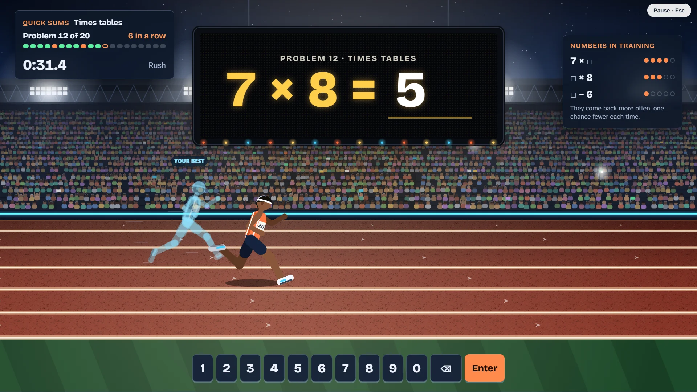

# Number Sprint

> Fast sums. Prime splits. Beat your own time.

## The hook

Twenty sums, one hundred metres. Every right answer is a stride, a streak makes your runner
faster, and the ghost of your best block runs in the next lane. Miss a sum and it waits for you:
no answer is ever shown, and the numbers you missed come back for practice until the tutor
forgives them. Between blocks, break numbers into primes over a row of hurdles, sweep a board
clean of everything that is not prime, and turn big numbers into words and back. Prefer
molecules to running tracks? Switch to Atom, and every number becomes a molecule of prime
atoms that fuse, loosen and finally burst apart into a neat row.

## Where it comes from

Four small programs from the BSD games. **arithmetic** (1989) is Eamonn McManus's rebuild of an
older Unix quiz, written without looking at its source: it asks sums until you get each one
right, prints your rights, wrongs and seconds per problem every twenty, and quietly keeps a list
of the numbers you missed so they come up more often, a little less each time. **factor** and
**primes** (1989) are by Landon Curt Noll, a hunter of record-sized primes, who signed his code
with one; `primes` stamps out its sieve from a pre-made pattern for the multiples of 3 to 13.
**number** (1988) spells any numeral out in English, one magnitude per line.

## What is new

- One game from four tools: Quick Sums, Split, Sieve and Spell It, with Rush and Calm tempos.
- The forgiving tutor kept exactly, and made visible: a "Numbers in training" panel shows each
  number it is bringing back and the chances it has left.
- A picture hint after three misses (rows of dots, a friendlier split), never the answer.
- A twelve-chapter campaign with three stars each, free play on every rung, and a Daily for
  everyone with a link-free share line.
- A prime album: every prime you uncover, with twins, big primes and palindromes marked.
- Two worlds to choose from, Sprint and Atom, each drawn entirely in code by day and by night.

## At a glance

|                 |                                                          |
| --------------- | -------------------------------------------------------- |
| Directory       | `/usr/games/numbers`                                     |
| Players         | 1                                                        |
| Session         | 2–10 minutes                                             |
| Daily challenge | yes                                                      |
| Inspired by     | `arithmetic`, `factor`, `primes` (1989), `number` (1988) |

## More

- [How to play](HOW-TO-PLAY.md)
- [Changes from the original](CHANGES-FROM-ORIGINAL.md)
- [Architecture](ARCHITECTURE.md)
