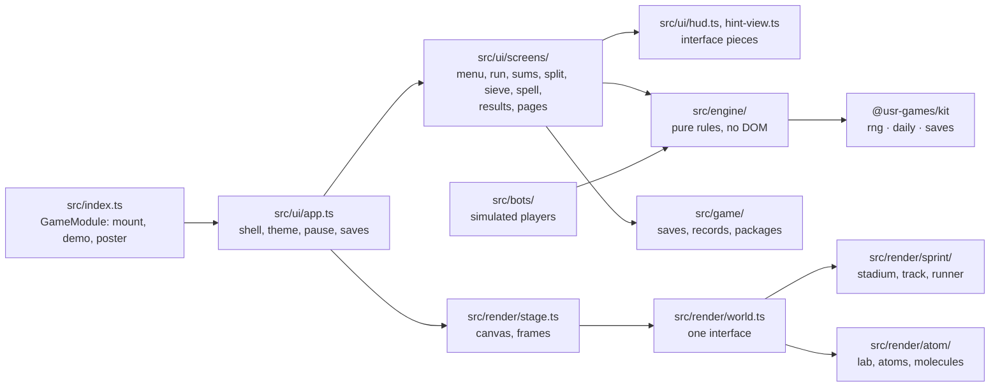
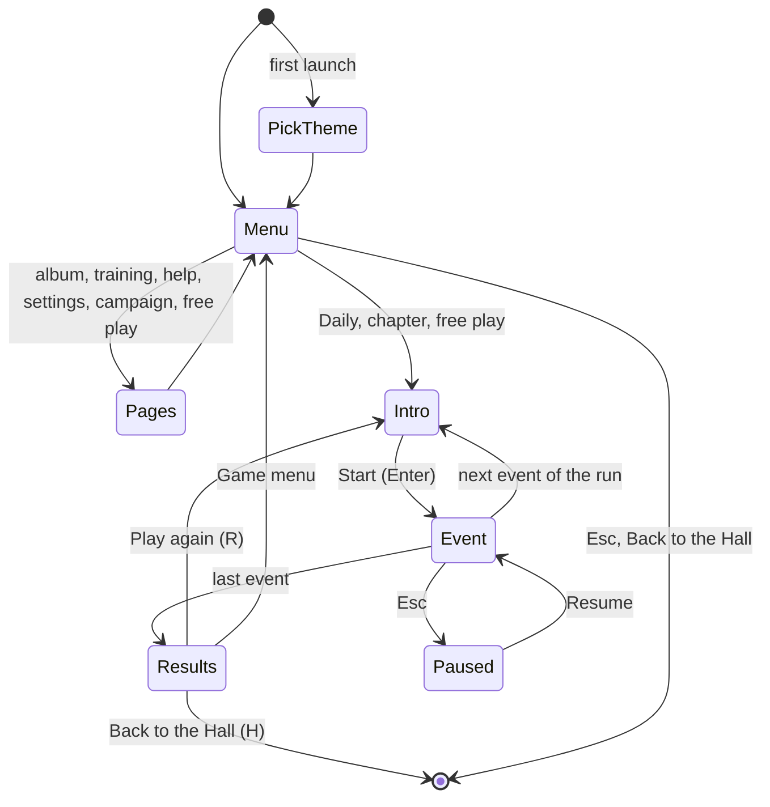

# Number Sprint — architecture

## Overview

A native game: pure TypeScript engines for the four modes, two Canvas 2D worlds behind one
`World` interface (Sprint and Atom, see [ADR 0001](adr/0001-canvas-worlds.md)), and a DOM
interface placed from the same layout as the worlds. No libraries beyond the kit; nothing raster.

## Module map

| Path                  | Responsibility                                                                                                     |
| --------------------- | ------------------------------------------------------------------------------------------------------------------ |
| `src/index.ts`        | `mount` (navigation registry), `demo`, `poster`, `achievements`                                                    |
| `src/engine/`         | Penalty book, sums, hints, factorisation, sieve, sieve board, split, words, levels, events, chapters, Daily, album |
| `src/bots/`           | Novice, steady and ace players on simulated time; the balance tests                                                |
| `src/game/`           | Save slots, records (bests, ghosts, stars, Daily), packages                                                        |
| `src/render/`         | Layout, stage, the two worlds, the poster                                                                          |
| `src/ui/`             | The shell, interface pieces, screens, the demo, styles                                                             |
| `src/audio/sounds.ts` | Every sound, in two voices                                                                                         |
| `dev/`                | The workbench: mock Hall, hero scenes, art viewer, sample saves                                                    |
| `scripts/balance.ts`  | The balance report (`tsx scripts/balance.ts 200`, `… rungs`, `… 200 calm`)                                         |

## State machine

A **run** (`ui/screens/run.ts`) is a list of events: one for free play, two to four for a
chapter, four for the Daily. Each event screen ends with an `EventOutcome`; the run notes bests,
stars and the Daily, installs packages, reports once to the Hall and shows the results.

## Engine

- **Penalty book** (`engine/penalties.ts`): the lists of `arithmetic.c`, one per operation and
  operand slot, newest charge first. `drawOperand` rolls `random(fresh + owed)`; past the fresh
  values it walks the list and spends a chance. Immutable; `trainingRows` feeds the panel.
- **Sums** (`engine/sums.ts`): `nextProblem` draws in the original's order; `submitAnswer` keeps
  a problem until it is right, charges the book on each miss, and scores; `blockCard` is the
  original's card. Division hides a remainder, or asks for it (`remainders`).
- **Hints** (`engine/hints.ts`): pictures and steps that never contain the answer (tested over
  every rung).
- **Factor** (`engine/factor.ts`): trial division by small primes, deterministic Miller–Rabin
  (bases 2, 7, 61), Brent's rho with split multiplication so doubles never lose digits.
- **Sieve** (`engine/sieve.ts`): odd-only windows stamped from the computed 3-to-13 wheel
  pattern, then sieved by primes from 17. `sieve-board.ts` is the game board and its par.
- **Words** (`engine/words.ts`): `number`'s algorithm, line for line (`numberLines`), the phrase
  (`spell`), and lenient checking both ways.
- **Levels, events, chapters, Daily** (`engine/levels.ts`, `events.ts`, `chapters.ts`,
  `daily.ts`): the rungs, pars, points, stars, the Daily plan and its share line.
- Randomness is the kit's seeded `Rng`: a run's seed plus `:event-N` for each event; the Daily's
  seed comes from `context.daily.seed()`, so everyone gets the same numbers.

## AI

There is no opponent. The **bots** (`bots/bots.ts`) are simulated players for balance: time per
sum grows with a difficulty score; each has slip rates for sums, probes, sieve picks and words.
They play the real engines on simulated time. The **demo** uses the ace on the Sprint track.

## Where visuals are defined

| Visual                                 | Defined in                                         | Change it by                                                       |
| -------------------------------------- | -------------------------------------------------- | ------------------------------------------------------------------ |
| Layout of everything                   | `src/render/layout.ts`                             | Rects per layout kind (`menu`, `play`, `results`)                  |
| Sky, roof, stands, crowd, scoreboard   | `src/render/sprint/stadium.ts`                     | `paintStadium`, `paintScoreboard`; colours in `palette.ts`         |
| Track, lanes, chevrons                 | `src/render/sprint/track.ts`                       | `trackGeometry`, `drawLanes`                                       |
| The runner and its poses               | `src/render/sprint/runner.ts`                      | Pose functions (`runPose`, `setPose`, `hurdlePose`…), body lengths |
| Hurdles, finish tape, ghost, confetti  | `src/render/sprint/sprint-world.ts`                | `drawHurdle`, `drawFinish`, `drawGhost`, `confetti`                |
| Lab wall, chamber, readout, wall chart | `src/render/atom/lab.ts`                           | `paintLab` and its helpers; `drawScope` is live                    |
| Atoms and molecules                    | `src/render/atom/atoms.ts`, `molecule.ts`          | Orbit shapes, `atomRadius`, `moleculeOf` packing                   |
| Fusion, loosening, burst, shelf        | `src/render/atom/atom-world.ts`                    | `drawSums`, `drawSplit`, `drawShelf`                               |
| Prime colours                          | `src/render/atom/palette.ts`                       | `HUES`                                                             |
| Interface colours and type             | `src/ui/styles.css` (tokens), `src/ui/screens.css` | `--ns-*` per theme and look (contrast-tested)                      |
| Icons                                  | `src/ui/icons.ts`                                  | Paths on a 24 grid                                                 |
| Key art                                | `src/render/poster.ts`                             | The staged moment and board text                                   |

Light and dark are separate palettes (`DAY`/`NIGHT`, `CLEAN_ROOM`/`PARTICLE_NIGHT`). Static parts
are painted once per size and look into offscreen layers. Reduced motion stops scrolling, cycles,
bursts and the sieve's sweeps; end states are shown at once.

## Where sounds are defined

All in `src/audio/sounds.ts`, one method per moment, each with a Sprint and an Atom voice.

| Sound    | Plays when                                     |
| -------- | ---------------------------------------------- |
| `tap`    | A key or tile                                  |
| `right`  | A right answer; the pitch climbs with a streak |
| `wrong`  | A wrong answer, bounce or wrong pick           |
| `split`  | A prime split off; brighter for the last       |
| `sweep`  | A sieve sweep                                  |
| `start`  | An event starts                                |
| `finish` | An event or run ends; fuller for a best        |
| `hint`   | A hint appears                                 |

## Hall integration

- `reportResult` once per run: `outcome: 'win'`, the run's score, `stats` (`sumsSolved`,
  `numbersSplit`, `boardsCleared`, `wordsDone`), XP events (`personal-best`, `three-stars`,
  `perfect-block`), `daily` for the first Daily of a day, `presentation: 'game'`.
- Packages: `src/game/packages.ts`, installed by `records.ts` decisions (and the album and tutor).
- Pause items: "Start this … again" on every event screen, behind a confirm.
- Daily numbering and seed from `context.daily`; share via `context.share` (no link).
- Saves (`src/game/saves.ts`), each version 1: `prefs`, `tutor` (the penalty book), `album`,
  `records`. Damaged data is repaired field by field.
- `setOnTitleScreen(true)` on the game menu and the first-launch theme pick.
- Safe zones: the Sieve board and Spell It's tiles start right of the 400 px toast column; results
  sit on the right.

## Tests

| Test                 | Command                                                                 | What it proves                                                        |
| -------------------- | ----------------------------------------------------------------------- | --------------------------------------------------------------------- |
| Engine unit tests    | `pnpm vitest run --project arithmetic`                                  | The original's rules, factorisation, sieve, words, records, layout    |
| Balance              | (in the above) `src/bots/balance.test.ts`                               | Stars and lengths per skill, locked with tolerances                   |
| Contrast             | (in the above) `src/ui/contrast.test.ts`                                | AA for every token pair, both themes, both looks                      |
| Workbench end-to-end | `pnpm exec playwright test -c games/arithmetic --grep-invert @hero`     | Every mode by keyboard and mouse, hint, tutor, Daily, campaign, exits |
| Hero frames          | `pnpm exec playwright test -c games/arithmetic --grep @hero`            | Renders the twelve checkpoint frames                                  |
| Hall end-to-end      | `pnpm exec playwright test -c games/arithmetic --project hall`          | Runs inside the Hall: menu, a block, results, ways out, safe zones    |
| Screenshots          | `SHOTS=1 pnpm exec playwright test -c games/arithmetic --project shots` | `docs/media/` at 1280 and 1920, both themes, both looks               |

## Kit candidates

- `ui/dom.ts` (`h`, `svg`): the same small element builder now lives in several games.
- `ui/clock.ts` (`EventClock`): a pausable stopwatch with penalties.
- `render/paint.ts` (`transparentOf`, `glow`): gradients that fade without grey fringes.
- A `context.requestPause()` would let games pause from their own buttons without a synthetic key.
