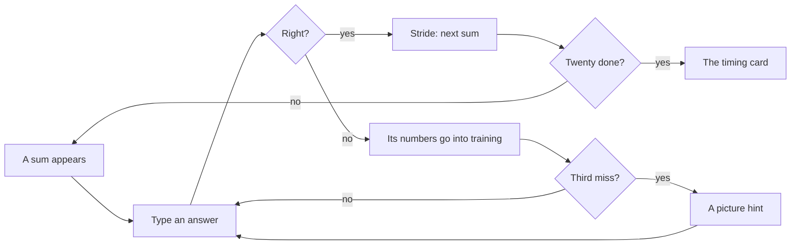

# How to play Number Sprint

## Goal

Answer, split, sieve and spell quickly and surely. In Rush you race the clock and your own best;
in Calm there is no clock and only accuracy counts. A good session is a clean block of sums, a
chapter's three stars, or a Daily you can share.

## Controls

Keyboard first; everything also works with the mouse. Nothing is remappable: the keys are the
digits and words themselves.

| Action                                   | Keyboard          | Mouse            |
| ---------------------------------------- | ----------------- | ---------------- |
| Type an answer or a number               | 0–9               | The number keys  |
| Check the answer / pick the typed number | Enter             | Enter key        |
| Rub out                                  | Backspace         | ⌫                |
| Remainder (Quick Sums, Remainders rung)  | r or Space        | r key            |
| Split off a prime                        | its digits, Enter | The prime's key  |
| Say what is left is prime (Split)        | P                 | It's prime       |
| Hint (Split, Sieve, Spell It)            | ?                 | Hint             |
| Move along the sieve                     | Arrow keys        | —                |
| Pick a number on the sieve               | Enter or Space    | Click the number |
| Type words (Spell It)                    | letters, Space, - | Word tiles       |
| Take the last word off (Spell It)        | Delete            | ⌫ word           |
| Start the next event                     | Enter             | Start            |
| Pause                                    | Esc               | Pause button     |
| Play again (results)                     | R                 | Play again       |
| Share the Daily (results)                | S                 | Share            |
| Next chapter (results)                   | N                 | Next             |
| Back to the Hall (results)               | H                 | Back to the Hall |
| Theme (first launch)                     | 1 Sprint, 2 Atom  | The theme cards  |

## Rules

### Quick Sums

1. A sum appears; type the answer and press Enter. A block is twenty sums.
2. A wrong answer keeps the sum on the board until you get it. After three wrong tries a picture
   shows a way to see it: rows of dots, two ten-frames or friendlier steps. The answer itself is
   never shown.
3. Sharing (÷) answers are whole numbers: whatever is left over is dropped, and the board says
   so. On the Remainders rung you give the remainder too: `47 ÷ 6 = 7 r 5`.
4. When the block ends you get the original's card: rights, wrong answers, the score as a
   percentage, the time, seconds a problem and your fastest.

**The forgiving tutor.** Every miss gives the numbers in that sum five extra chances of coming up
again in that kind of sum. Each time one comes up it uses a chance; when its chances run out it
is forgiven. "Numbers in training" shows them, with their chances as dots.

### Split

1. A number appears. Pick a prime that goes into it, by its key or by typing it; the number
   shrinks. Keep going.
2. When what is left is itself prime, pick it or press P (It's prime).
3. A prime that does not go in, or a number that is not prime, bounces; in Rush it adds three
   seconds. The finished split reads both ways: `360 = 2³ × 3² × 5`.

### Sieve

1. Pick a prime: all its multiples leave the board. 1 starts off the board (it is not prime).
2. When only primes are left, the board is clear and they light up.
3. Par is the fewest picks that clear it. Picking a number that is not prime adds three seconds
   in Rush. On boards that start high (1,000 to 1,199), the sieving primes wait in a strip below.

### Spell It

1. A number appears: put it into words with the tiles or by typing, then press Enter. Spaces,
   hyphens and capitals never matter, and a British "and" after the hundreds is fine.
2. Every other number goes the other way: read the words and type the digits.
3. Decimals read as tenths, hundredths and thousandths: 3.25 is "three and twenty-five
   hundredths".

## Modes

| Mode      | What changes                                                                                |
| --------- | ------------------------------------------------------------------------------------------- |
| Campaign  | Twelve chapters of two to four events; each opens once the one before has a star            |
| Free play | Any mode, any rung, Rush or Calm; Quick Sums also has "Your own" signs and range            |
| Daily #N  | Everyone gets the same four events today, in Rush; only the first play of the day is scored |

## Settings

| Setting                | Options                         | Default                |
| ---------------------- | ------------------------------- | ---------------------- |
| Theme                  | Sprint · Atom                   | chosen on first launch |
| Tempo                  | Rush · Calm                     | Rush                   |
| On-screen number keys  | Show · Hide                     | Show                   |
| Start the tutor afresh | clears every number in training | —                      |

The Hall's own settings (appearance, sound, motion) are one button away.

## Scoring

- Quick Sums: 100 for a sum right the first time, 40 after a miss; in Rush up to 100 more for
  speed (full marks under a second, none after five).
- Split: 200 a number, less 40 a bounce (never under 60); in Rush up to 150 more against par.
- Sieve: 300 to 500 by how close to par you picked, less 60 a wrong pick; in Rush up to 300 more.
- Spell It: 150 for right first time, 60 after a miss; in Rush up to 100 more against par.
- Chapter stars: accurate (90 % or better); under par (Rush) or a clean run, at most one
  mistake (Calm); and no hints.
- The Daily's share line: `Number Sprint #42 · 2,840 · Sums 19/20 · Split 5/5 · Sieve 0:41 ·
Spell ✓` (sums right first time, numbers split without a bounce, the sieve's time, words right
  first time). It carries no link.

## Achievements (packages)

| Package              | How to earn it                                                   |
| -------------------- | ---------------------------------------------------------------- |
| `perfect-block`      | Answer all twenty sums of a block right the first time.          |
| `forgiven`           | Practise a number the tutor kept bringing back until it lets go. |
| `lightning`          | Finish a block in Rush at 1.5 seconds a problem or faster.       |
| `first-split`        | Break a number all the way down into its primes.                 |
| `big-split`          | Split a six-digit number.                                        |
| `most-wanted`        | Split a number from the Most wanted rung.                        |
| `clean-sweep`        | Clear a sieve without picking a number that is not prime.        |
| `twin-primes`        | Collect ten pairs of twin primes in the album.                   |
| `wordsmith`          | Spell or read a nine-digit number right.                         |
| `fraction-fluent`    | Get five fractions right the first time in Spell It.             |
| `calm-and-collected` | Earn three stars on a chapter played in Calm.                    |
| `daily-regular`      | Play seven Dailies.                                              |

## XP

This game reports results to the Hall: a completed run, the first win of the day, the Daily and
packages all earn XP (see the Hall's rules). Within a run, a personal best, three stars and a
perfect block are XP events. Weekly goals count `sumsSolved` and `numbersSplit`.

## Tips

- The tutor's numbers are the ones worth slowing down for: they will be back.
- In Split, 2, 3 and 5 are easy to spot (even; digits adding to a multiple of 3; ending in 0 or
  5). Once no prime up to the square root goes in, what is left is prime.
- On the sieve, the primes you need are only those up to the square root of the last number.
- Read big numbers in groups of three digits from the right.
