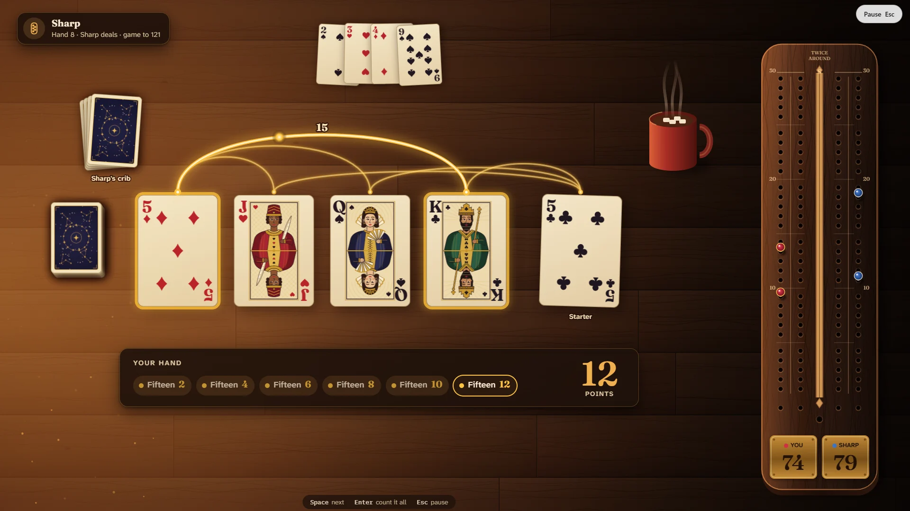

# Fifteen-Two

> Fifteen-two, fifteen-four… see every point.

## The hook

Cribbage is the old pub card game with a wooden board: throw two cards to the crib, play towards
31 pegging for fifteens, pairs and runs, then count your hand with the cut card. Fifteen-Two
makes the counting something you can see. Every fifteen is a bridge of light over the cards that
make it, pairs pulse, runs get their bar, a flush shimmers and his nobs sparks, while a ledger
adds it all up beside you and your back peg jumps past the front one with a wooden tok. The
perfect hand, 29, turns the cards to gold.

## Where it comes from

Earl T. Cohen wrote the game logic and Ken Arnold the screen interface for the Berkeley
`cribbage` in 1980. It drew the board in text, with two pegs a side that leapfrogged like real
ones, and it never counted your hand for you: you typed your total, and if you claimed too much
you got only the true count while the computer pegged two; claim too little and the rest was
lost. A claim of 19 counted as nothing, after the old joke that nineteen is the one hand nobody
can hold. The computer was a fair player, weighing every throw against every card it could not
see.

## What is new

- **Counting you can see**: every combination lights up in turn as the points add up.
- **Three ways to count**: Automatic, Count yourself (with no penalty), or Classic 1980, the
  original's rule, nineteen included.
- **A real board** in walnut and maple with brass plates and two leapfrogging pegs a side, twice
  round for 121 or once for 61.
- **Three opponents**: Beginner, Classic (Cohen's own player, card for card) and Sharp, which
  weighs every starter and looks ahead to the end of the play.
- **A coach** for the throw and the play, a **counting trainer** against the clock, the **Daily
  Discard** (the same six cards for everyone) and an album of your best hands with a slot waiting
  for the 29.
- **Two tables**: a porch in the late-afternoon sun, and a table by the fire.

## At a glance

|                 |                         |
| --------------- | ----------------------- |
| Directory       | `/usr/games/cards`      |
| Players         | 1, against the computer |
| Session         | 10–30 minutes           |
| Daily challenge | yes, the Daily Discard  |
| Inspired by     | `cribbage` (1980)       |

## More

- [How to play](HOW-TO-PLAY.md)
- [Changes from the original](CHANGES-FROM-ORIGINAL.md)
- [Architecture](ARCHITECTURE.md)
- [Notes](NOTES.md)
