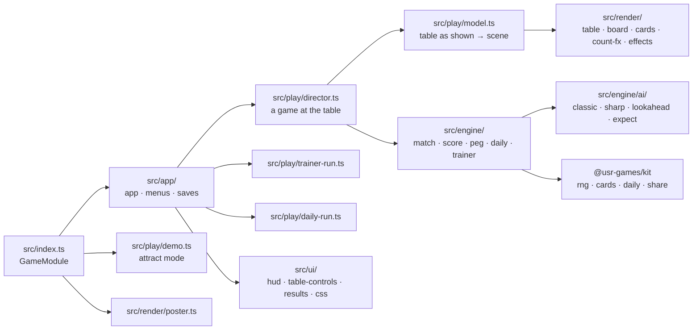
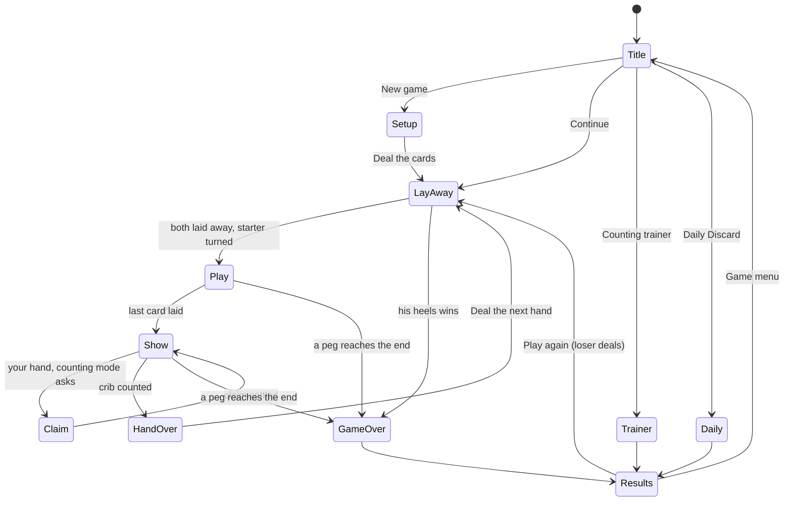

# Fifteen-Two — architecture

## Overview

A native game for the Hall: a pure TypeScript engine (rules, scoring, three computer players,
the Daily Discard and the trainer), a Canvas 2D table drawn from a plain scene description, and
HTML panels over it on a design sheet that scales with the canvas
([ADR 0001](adr/0001-table-in-canvas-2d.md)). The cards are the kit's Art Deco deck
(`@usr-games/kit/cards`), used unchanged. No dependencies beyond the kit.

## Module map

| Path                     | Responsibility                                                                                                                                                   |
| ------------------------ | ---------------------------------------------------------------------------------------------------------------------------------------------------------------- |
| `src/index.ts`           | `mount`, `demo`, `poster`, `achievements` (the kit contract)                                                                                                     |
| `src/engine/match.ts`    | One game as pure functions over a JSON-safe state: deal, lay away, starter, play, show, claims, skunks                                                           |
| `src/engine/score.ts`    | Counting a hand: itemised (`countHand`, for the lights) and fast (`scoreHand`, for the computers)                                                                |
| `src/engine/peg.ts`      | Points made in the play                                                                                                                                          |
| `src/engine/ai/`         | The three minds (`minds.ts`), Classic (`classic.ts`), Sharp (`sharp.ts`, `lookahead.ts`, `expect.ts`), the crib table (`crib-odds.ts`, generated `crib-sums.ts`) |
| `src/engine/daily.ts`    | The Daily Discard: the puzzle, the verdict, the share line                                                                                                       |
| `src/engine/trainer.ts`  | Trainer hands and answers                                                                                                                                        |
| `src/engine/autoplay.ts` | Two computers playing a whole game (simulations, tests)                                                                                                          |
| `src/modes/`             | Packages and XP events (`packages.ts`), hand records (`album.ts`)                                                                                                |
| `src/app/`               | The app (`app.ts`), the screens (`menus.ts`), the saves (`saves.ts`)                                                                                             |
| `src/play/`              | The director, the card motion (`visuals.ts`), the model, the trainer and Daily runs, sound, the demo                                                             |
| `src/render/`            | Everything drawn: table, board and pegs, cards, counting effects, callouts, stamp, props, backdrop, poster                                                       |
| `src/ui/`                | HTML over the table: status card, prompt, ledger, key strip, hand buttons, coach, claim pad, results                                                             |
| `scripts/`               | `simulate.ts` (balance), `crib-table.ts` (regenerates the crib sums)                                                                                             |
| `dev/`                   | The workbench (port 5297): hero scenes and the whole game with a stand-in Hall context                                                                           |

## State machine

Pausing (the Hall's Esc or Pause button) stops the director's clock and the fire's crackle; the
Hall's own "Leave this round?" guards leaving a game, and the game is saved after every move, so
Continue on the game menu resumes it.

## Engine

`MatchState` holds everything: options, scores and back pegs, dealer, phase, the six dealt and
four kept per player, the crib, the stock, the starter, the play (cards in hand, the pile since
the last reset, the count, whose turn, who said go and at which count) and the show's step. Each
action (`layAway`, `playCard`, `showNext`, `nextHand`) returns the next state and a list of
events (`dealt`, `laid-away`, `starter`, `played`, `go`, `count-reset`, `scored`, `shown`,
`game-over`…). `settlePlay` runs the moves nobody chooses: saying go, the point for the go, the
count starting again, the last card. `score` moves the pegs (the back peg jumps to the new
score) and ends the game the moment a peg reaches the end, so the counting order is the rules'
order.

Randomness is the kit's sfc32 generator held in the state (`rng`): the shuffle each hand and the
cuts. The computers draw from their own streams, seeded from the game's seed, the hand and the
moment, so a seed replays the same game and a continued game plays on deterministically.

The counter is the heart and is tested exhaustively (see Tests).

## AI

Three minds, each seeing only a player's view (`DiscardView`, `PlayView`)
([ADR 0002](adr/0002-three-opponents.md)):

- **Beginner** keeps the best-looking hand half the time and throws at random otherwise, never
  thinking about the crib; in the play it takes points 60 % of the time when it sees them.
- **Classic** is the Berkeley player ported decision for decision and proven against 2,300
  positions answered by the C program: the discard sums each kept hand's score against the 46
  unseen starters plus or minus a rounded crib table; the play takes the most points now, else
  the quiet play (`cchose`). Its two slips are kept (NOTES.md).
- **Sharp** lays away by exact averages (hand over 46 starters, crib over all 45,540 deals,
  `expect.ts`) plus how well each of the five best keeps pegs, measured by playing the play out
  against 24 imagined opponents. It plays each card by imagining the opponent's hand 64 times
  (six unseen cards and the four a sensible player keeps, consistent with every go they said),
  playing the rest of the play out perfectly for both and taking the best average. Within 32
  holes of the end it plays to win: a line that pegs out beats any number of points, and each
  imagined deal is counted through the show in order.

The coach uses Sharp's reckoning: the three best throws with their averages, and the best card
with how much it gains over the next.

All searches are bounded by sample counts, never by wall-clock time.

## Where visuals are defined

| Visual                                                              | Defined in                                                    | Change it by                                                                 |
| ------------------------------------------------------------------- | ------------------------------------------------------------- | ---------------------------------------------------------------------------- |
| Colours of both tables, board, pegs, glows                          | `src/render/look.ts` (`PORCH`, `FIRESIDE`)                    | Editing the look; every colour has a name                                    |
| Layout (where everything sits)                                      | `src/render/layout.ts` (`LAYOUT`, `CARD`)                     | Design-sheet coordinates on 1920 × 1080                                      |
| Planks, sun, railing shadows, leaves, fire, dust and embers         | `src/render/table.ts`                                         | `paintPlanks`, `paintSunPool`, `paintRailingShadow`, `drawFirelight`, `wash` |
| The board, holes, inlay, plates, pegs and their jumps               | `src/render/board.ts`, `src/render/arrange.ts` (`leapingPeg`) | `BoardPainter`, `drawPeg`, `drawPegTrail`, `holeFor`                         |
| Cards, shadows, rings, gold faces                                   | `src/render/cards.ts` (on the kit's `CardSprites`)            | `CardPainter.draw`, `goldFace`                                               |
| Counting lights: fifteen bridges, run bars, flush sweep, nobs spark | `src/render/count-fx.ts`                                      | `drawFifteen`, `drawRunBar`, `drawFlushSweep`, `drawNobsSpark`               |
| Count dial, callouts, 29 rays, gold leaf, glints, skunk stamp       | `src/render/effects.ts`                                       | One function each                                                            |
| Lemonade and cocoa                                                  | `src/render/props.ts`                                         | `lemonade`, `cocoa`                                                          |
| Menu backdrop and key art                                           | `src/render/backdrop.ts`, `src/render/poster.ts`              | The fanned hand, the counted hand                                            |
| Card motion and flips                                               | `src/play/visuals.ts`                                         | `GLIDE_RATE`, `TURN_SECONDS`                                                 |
| HTML panels                                                         | `src/ui/cribbage.css`, `src/ui/screens.css`                   | `--ft-*` properties per look                                                 |

Light and dark are two designed tables, not one inverted: Porch has sun and railing shadows that
fall across the cards too, Fireside a breathing firelight from the left, embers and a darker
far side. Reduced motion puts cards in place, holds the leaves, fire and embers still, and
shortens the pauses. Below the design size, small print on the sheet and the table labels grow
back (`--ft-text-boost`). Per-frame shadows are radial gradients; blur filters are only used in
layers painted once.

## Where sounds are defined

All in `src/play/sound.ts`, synthesised with the kit's synth (no files), quiet by default and
following the Hall's volume and mute.

| Sound        | Function    | Plays when                                            |
| ------------ | ----------- | ----------------------------------------------------- |
| Peg tok      | `peg`       | A peg lifts and lands                                 |
| Card snap    | `card`      | A card is laid or thrown                              |
| Deal         | `deal`      | Cards are dealt                                       |
| Flip         | `flip`      | The starter turns; a card is picked                   |
| Chime        | `chime`     | Each combination counted, climbing a pentatonic scale |
| Thirty-one   | `thirtyOne` | The count reaches 31                                  |
| Go knock     | `go`        | Someone says go                                       |
| Total        | `total`     | A hand's count is complete                            |
| Perfect      | `perfect`   | A 29                                                  |
| Stamp        | `stamp`     | The skunk stamp                                       |
| Win          | `win`       | The game ends                                         |
| Fire crackle | `fireside`  | While a game is open in the Fireside look             |

## Hall integration

- **Results**: `reportResult` once per finished game (`win`/`loss`, score = your peg, stats
  `games`, `wins`, `thirtyOnes`, `bigHands`, XP events from `xpEventsFor`), trainer round
  (`complete`, stats `trainerRight`) and first Daily of the day (`complete`, `daily: true`),
  all with `presentation: 'game'` and our own results card.
- **Packages**: the twelve in `src/modes/packages.ts` (same list as the manifest); moments
  (thirty-one, his heels, big hands, 29) install at once, the rest at the end.
- **Pause items**: Coach on / Coach off (C).
- **Daily**: the kit's number and seed; share `Fifteen-Two #N · discard P% of best · 🃏🃏`.
- **Saves** (all version 1, repaired on load): `prefs`, `records`, `album`, `daily`, `game` (the
  game in progress).
- **Title screen**: `setOnTitleScreen(true)` on the game menu only.
- **Safe zones**: nothing of ours under the top-right Pause pill; nothing that informs in the
  bottom-left toast corner.

## Tests

| Test                                  | Command                                                  | What it proves                                                                                      |
| ------------------------------------- | -------------------------------------------------------- | --------------------------------------------------------------------------------------------------- |
| Unit tests (all)                      | `pnpm vitest run --project cribbage`                     | Everything below                                                                                    |
| The counter, exhaustive               | `src/engine/score.test.ts`                               | All 12,994,800 hands with a starter agree with a brute-force counter; the published distribution    |
| Classic against the C program         | `src/engine/ai/classic.test.ts`                          | 700 discards and 1,600 plays recorded from the original, all matched                                |
| Sharp's averages and the crib table   | `src/engine/ai/expect.test.ts`                           | Exact crib averages equal full enumeration; the table recomputes; quick pegging scorer              |
| The rules of a game                   | `src/engine/match.test.ts`                               | Go, 31, last card, runs out of order, his heels, show order, claims, skunks, replay                 |
| Balance (locked samples) and manifest | `src/engine/balance.test.ts`                             | Beginner < Classic < Sharp; the manifest validates                                                  |
| Modes                                 | `src/modes/modes.test.ts`                                | Daily, trainer, packages, album, saves                                                              |
| Browser: the game                     | `npx playwright test -c games/cribbage e2e/game.spec.ts` | Whole games by mouse and keyboard, counting modes, coach, trainer, Daily and share, Continue, exits |
| Browser: in the Hall                  | `npx playwright test -c games/cribbage e2e/hall.spec.ts` | The game runs inside a Hall of its own                                                              |
| Hero frames / screens                 | `--grep @hero`, `--grep @shots`                          | The pictures in `docs/media/`                                                                       |
| Balance, full                         | `pnpm --filter @usr-games/game-cribbage simulate 2000`   | The 2,000-game numbers in NOTES.md                                                                  |

## Kit candidates

- **Card motion by targets** (`src/play/visuals.ts`): cards glide to where the table says they
  belong, with deal holds and flips; any card table could use it.
- **Soft shadow** (`src/render/shadow.ts`): a cheap gradient shadow for anything drawn every
  frame.
- **Card chips** (`cardChip` in `src/ui/dom.ts`): a card in text with a four-colour suit and its
  spoken name.
- **A tinted face** for `CardSprites` (our gold faces are painted locally in `cards.ts`).
