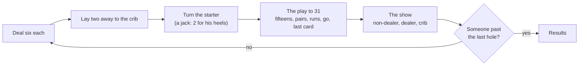

# How to play Fifteen-Two

## Goal

Be first round the board: 121 holes in a long game (twice round), 61 in a short one (once
round). Points come from the play, from your hand, and from the crib when you deal.

## Controls

| Action                                         | Keyboard                        | Mouse                                         | Remappable |
| ---------------------------------------------- | ------------------------------- | --------------------------------------------- | ---------- |
| Move between your cards                        | ← →                             | Point at a card                               | no         |
| Choose a card for the crib, or put it back     | Space (or Enter)                | Click the card                                | no         |
| Throw the two chosen cards to the crib         | T, or Enter once two are chosen | Throw to the crib, or drag a card to the crib | no         |
| Lay a card in the play                         | Enter or Space on the card      | Click the card, or drag it to the play        | no         |
| Type your count (Count yourself, Classic 1980) | 0–9, then Enter                 | The digit pad, then Count it                  | no         |
| Speed up a count                            | Space or Enter                  | —                                             | no         |
| Deal the next hand                             | Enter                           | Deal the next hand                            | no         |
| Coach on or off                                | C                               | Pause menu: Coach on / Coach off              | no         |
| Pause                                          | Esc                             | Pause button                                  | no         |
| Play again (results)                           | R                               | Play again                                    | no         |
| Game menu (results)                            | Esc                             | Game menu                                     | no         |
| Back to the Hall (results)                     | H                               | Back to the Hall                              | no         |

On the game menu each item has its letter: C Continue, N New game, T Counting trainer, D Daily
Discard, A Hand records, ? How to play, S Settings. Escape on a page goes back to the game menu,
and on the game menu it goes back to the Hall. A screen reader hears every card laid, every
count and every peg.

## Rules

1. **The deal.** Each player gets six cards. The dealer changes every hand; for the first game
   you both cut and the lower card deals, and after that the loser of a game deals first.
2. **The crib.** Each player lays away two cards, face down. The four make the crib, an extra
   hand for the dealer.
3. **The starter.** The deck is cut and the top card turned up: the starter, which belongs to
   every hand. A jack pays the dealer 2 for his heels.
4. **The play.** The non-dealer leads. Lay cards in turn and keep a running count (courts count
   10, aces 1), never past 31. Score 2 for making 15 or 31; 2 for a pair with the card before
   (6 for three in a row, 12 for four); and 1 a card for a run of three or more among the last
   cards laid, in any order. If you cannot lay a card you have a go; your opponent keeps laying
   while they can, then pegs 1 for the go (or 2 for making 31), and the count starts again. The
   last card of all scores 1.
5. **The show.** Hands are counted with the starter, the non-dealer first, then the dealer, then
   the crib: 2 for every combination that makes 15, 2 for every pair, 1 a card for each run of
   three or more, 4 for four cards of one suit in a hand (5 with the starter; a crib needs all
   five) and 1 for his nobs, the jack of the starter's suit.
6. **The end.** The first peg into the last hole wins, at once, even in the middle of a count.
   A loser still more than 30 holes short is skunked; in a long game, more than 60 short is a
   double skunk.

The best hand is 29: three fives and the jack, with the fourth five cut as the starter in the
jack's suit. No hand makes 19, 25, 26 or 27, which is why a hand of nothing is called nineteen.

## Modes

| Mode             | What changes                                                                                                                        |
| ---------------- | ----------------------------------------------------------------------------------------------------------------------------------- |
| New game         | A game to 61 or 121 against Beginner, Classic or Sharp, with the counting mode and the coach you choose.                            |
| Continue         | A game left part-way picks up exactly where it was.                                                                                 |
| Counting trainer | Hands to count, one after another: a two-minute sprint, or ten hands with no clock. Hands counted right peg your side of the board. |
| Daily Discard #N | The same six cards and the same crib for everyone today: choose two to lay away and see how your choice compares with all fifteen.  |

## Settings

| Setting             | Options                                   | Default   |
| ------------------- | ----------------------------------------- | --------- |
| Opponent            | Beginner · Classic · Sharp                | Classic   |
| Length              | 61 · 121                                  | 121       |
| Counting your hands | Automatic · Count yourself · Classic 1980 | Automatic |
| Coach               | on · off (never in the Daily)             | on        |
| Pace                | Relaxed · Brisk                           | Relaxed   |

The Hall's own settings (appearance, sound, motion) apply everywhere: the porch by day, the
fireside by night.

**The counting modes.** Automatic counts every hand for you. Count yourself asks for your total
first, then shows the true count and pegs it in full. Classic 1980 is the original's rule: claim
too much and you peg only the true count while your opponent pegs 2 (unless your true count
already wins); claim too little and the rest is lost; a claim of 19 is read as nothing.

## Scoring

A game's score is your final peg. The Daily Discard measures your throw against the best one
over every possible starter: the best throw is 100 %, and every point of average given away
costs ten. The share line reads `Fifteen-Two #42 · discard 98% of best · 🃏🃏`: three cards for
the best throw, two from 90 %, one otherwise.

## Achievements (packages)

| Package            | How to earn it                                                              |
| ------------------ | --------------------------------------------------------------------------- |
| `thirty-one`       | Lay the card that brings the count to exactly 31.                           |
| `his-heels`        | Deal, and turn up a jack as the starter.                                    |
| `twenty-plus`      | Count a hand or a crib worth 20 points or more.                             |
| `long-game`        | Win a game to 121.                                                          |
| `daily-regular`    | Lay away in the Daily Discard on seven different days.                      |
| `twenty-four-plus` | Count a hand or a crib worth 24 points or more.                             |
| `skunk`            | Win while your opponent is still behind the skunk line.                     |
| `perfect-counter`  | Count every one of your hands exactly right through a game of Classic 1980. |
| `trainer-50`       | Count fifty hands right in the counting trainer.                            |
| `double-skunk`     | Win a game to 121 before your opponent has gone once round the board.       |
| `beat-sharp`       | Win a game against Sharp.                                                   |
| `perfect-29`       | Hold the perfect hand.                                                      |

## XP

This game reports results to the Hall: a completed session, the first win of the day, the daily
challenge and packages all earn XP (see the Hall's rules). Within a game: a win (more against
Sharp), a skunk, thirty-ones, a hand of 20 or more (the most for a 29) and counting every hand
right. The trainer rewards hands counted right; the Daily Discard rewards a good throw. Weekly
goals count games won, thirty-ones made and hands counted right in the trainer.

## Tips

- In your own crib, throw cards that go together: fives, pairs, neighbours. In theirs, throw cards
  far apart: a king with an ace or a two is hard to build on.
- A four is the safest lead: nothing your opponent lays can make 15.
- Avoid leaving the count on 5 or 21; a ten-card makes 15 or 31 for them.
- Count fifteens first, then runs, then pairs: "fifteen two, fifteen four, and a run of three is
  seven."
