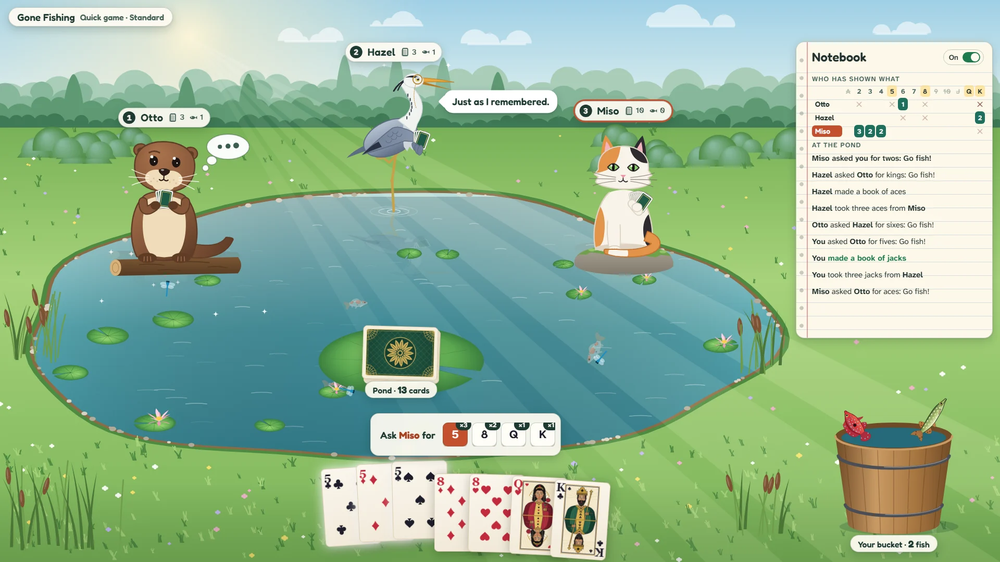

# Gone Fishing

> Ask. Remember. Reel them in.

## The hook

The children's card game everyone knows, played by a quiet pond with three animal friends. Ask a
rival for a rank you hold; if they have any, they hand them over and you ask again. If they say
"Go fish!", your line flies out over the water, the float bobs, dips, and a card comes up
wriggling on the hook. Four of a kind fuse into that rank's own fish, which leaps into your
bucket; now and then it comes up golden.

The real game is memory. Whoever asks for a rank holds it; whoever says "Go fish!" has none, until
they draw again. Otto the otter forgets everything, Hazel the heron remembers what you asked for
and asks it back, and Miso the cat remembers it all. A notebook keeps track for you until you can
do it yourself.

## Where it comes from

`fish` (installed as `go-fish`) came to Berkeley's machines from Muffy Barkocy in 1990 and shipped
with 4.4BSD in 1993. You typed ranks at a prompt against a computer with two minds: its normal one
asked for its ranks in turn, round and round; typing `p` switched on a pro mode that remembered
what you had asked for. Its instructions promised it never looked at your hand. Its manual's only
bug said it cheated only rarely, and it did: one ask in about fifteen hundred, in pro mode, it
peeked. One game in 1024, it signed off with a parting shot.

## What is new

- **A pond to play in:** casts and reels for every "Go fish!", a fish for every book (thirteen
  species, one per rank, and a golden variant of each), and a lap of honour for every fish at the
  end. Morning Pond by day, Firefly Pond by night.
- **Three rivals with different memories:** Otto plays the original's normal mode, Hazel its pro
  mode, and Miso is new: she reasons from everything said at the pond, and never peeks.
- **The notebook:** who asked whom for what, who has shown what, who said "Go fish!". Open for
  newcomers; win with it closed for a bonus.
- **Three rule sets:** Standard, All 13 books, and Classic 1993, the Berkeley game exactly.
- **A Tournament** of five rounds against rivals who grow smarter, **the Daily Pond** (the same
  cards and seats for everyone), a **fish album** and thirteen packages.

## At a glance

|                 |                                       |
| --------------- | ------------------------------------- |
| Directory       | `/usr/games/cards`                    |
| Players         | 1, against one to three rivals        |
| Session         | 3–8 minutes                           |
| Daily challenge | yes, the Daily Pond                   |
| Inspired by     | `fish`, installed as `go-fish` (1990) |

## More

- [How to play](HOW-TO-PLAY.md)
- [Changes from the original](CHANGES-FROM-ORIGINAL.md)
- [Architecture](ARCHITECTURE.md)
- [Notes: verified facts and simulations](NOTES.md)
