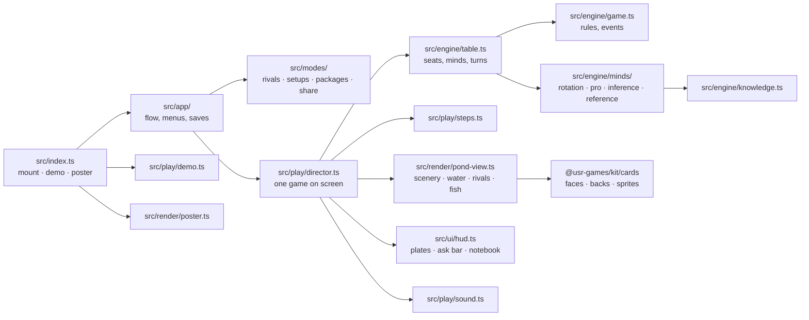
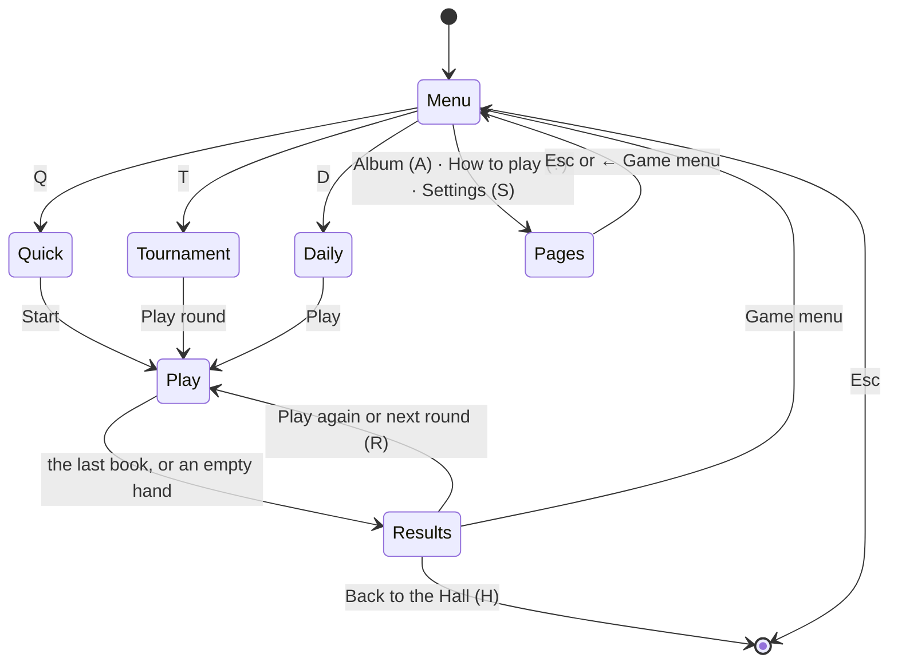
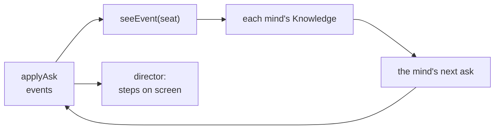

# Gone Fishing — architecture

## Overview

A native game: the Hall mounts `src/index.ts` into its own page. A pure TypeScript engine holds
the rules and the minds and knows nothing of time or screens; a **director** turns its events
into timed steps on a Canvas 2D pond; the game menu, its pages, the HUD and the results are plain
DOM over the canvas. The cards come from the kit (`@usr-games/kit/cards`), unchanged.

## Module map

| Path                      | Responsibility                                                                                   |
| ------------------------- | ------------------------------------------------------------------------------------------------ |
| `src/index.ts`            | The kit contract: `mount`, `demo`, `poster`, `achievements`.                                     |
| `src/engine/rules.ts`     | The three rule sets, hand sizes, the golden and rare odds.                                       |
| `src/engine/game.ts`      | The game, pure: deal, legal asks, applying an ask with its handover or draw, books, the ending.  |
| `src/engine/events.ts`    | Everything that happens as an event, and `seeEvent`: what one seat is allowed to see of it.      |
| `src/engine/chance.ts`    | The random streams: the deal, the golden roll, the rare roll, each mind's own.                   |
| `src/engine/knowledge.ts` | What can be known from one seat: shown cards, denials, draws since, unseen copies, odds.         |
| `src/engine/minds/`       | Otto's rotation and Hazel's pro mode (the original's, exactly), Miso's inference, the reference. |
| `src/engine/table.ts`     | Seats with minds, whose turn, running the computers, pro mode, the peek in Classic.              |
| `src/engine/testing/`     | The C library's `random()` and the original's shuffle, and the 1 200 recorded games.             |
| `src/modes/match.ts`      | The rivals, Quick game setups, the Tournament's rounds, the Daily's setup and share line.        |
| `src/modes/packages.ts`   | The thirteen packages and the XP events of a finished game.                                      |
| `src/play/director.ts`    | One game on screen: input, the display state, steps for every event, the HUD model, the end.     |
| `src/play/steps.ts`       | A queue of timed steps that can be hurried, flushed or cleared.                                  |
| `src/play/lines.ts`       | What each rival says.                                                                            |
| `src/play/demo.ts`        | The attract mode: three rivals play each other.                                                  |
| `src/play/sound.ts`       | Synthesised sounds.                                                                              |
| `src/render/`             | Layout, the two looks, scenery, water, flora, flyers, the rivals, the fish, casts and leaps.     |
| `src/ui/`                 | DOM pieces: the HUD and notebook, results, icons, words, styles.                                 |
| `src/app/`                | The game menu and its pages, the flow between them, saves.                                       |
| `scripts/simulate.ts`     | The balance runs in `NOTES.md`.                                                                  |
| `dev/`                    | The workbench on port 5295: hero scenes and the whole game with a stand-in Hall.                 |

## The app

The pond is always on screen: behind the menu its rivals idle by the water (the layout moves the
pond right of the menu panel); in play it fills the window. A game left midway through the pause
menu counts nothing. A Tournament's progress is saved after each round.

## Engine

`startGame(rules, players, dice)` deals from a seeded deck; `applyAsk(state, ask, dice)` returns
the new state and its events (`ask`, `give`, `go-fish`, `draw`, `book`, `turn`, `end`), in order.
Nothing else changes a game. The ending follows the rule set: Standard and Classic end the moment
a hand runs out; All 13 books draws an emptied hand one card and ends with the thirteenth book.

**The information boundary.** A mind never reads the game state. It is handed a `SeatView` (its own
hand, the public counts) and events filtered by `seeEvent` for its seat: other hands and other
players' draws are hidden; asks, answers, handed-over cards, lucky catches and books are shown.
The original's peek is the one exception, a `Peek` capability the table grants Hazel only under
Classic 1993. `miso.test.ts` proves Miso's honesty by re-dealing everything she cannot see.

**Randomness.** Every stream comes from the kit's seeded RNG and `split`: the deal, the golden
roll (one book in 16), the rare roll (1 in 1 024) and each mind's own, resolved once per seat. A
golden fish never changes a deal or a move. For the proof, `testing/c-random.ts` reproduces the C
library's `random()` and the original's shuffle, and `berkeley.test.ts` replays 1 200 recorded
games event for event (see `NOTES.md`).

## The director

The engine runs ahead; the screen follows. The director keeps a **display state** (hands, piles,
books, plates) that lags the engine until each step lands: a flight of cards, a cast and reel, a
book's leap into the bucket, a rival's leap, the end lap. Steps sit in a `StepQueue`; the Brisk
pace and reduced motion hurry them (reduced motion three times over, with water and scenery
still). The person's turn waits in two stages: choose a rival (1–3, Enter, a click), then a rank.
With one rival the first stage is skipped. The HUD is rebuilt from a `hudModel` only when it
changes, and focus is restored by `data-focus-key`.

## Where visuals are defined

| Visual                                         | Defined in                              | Change it by                                   |
| ---------------------------------------------- | --------------------------------------- | ---------------------------------------------- |
| Pond colours per look                          | `src/render/look.ts`                    | `MORNING`, `FIREFLY` (with their UI colours)   |
| Where everything sits                          | `src/render/layout.ts`                  | `layoutFor` (seats, ask bar, notebook, bucket) |
| Sky, trees, banks, sun shafts or mist, moon    | `src/render/scenery.ts`                 | `paintScenery`                                 |
| Water, ripples, koi, the mirror band           | `src/render/water.ts`, `pond-view.ts`   | `drawWater`, `PondView`                        |
| Lily pads, lilies, reeds                       | `src/render/flora.ts`                   | `drawPads`, `drawLily`, `drawReeds`            |
| Dragonflies and fireflies                      | `src/render/flyers.ts`                  | `drawFlyers`                                   |
| Otto, Hazel, Miso, their moods and held cards  | `src/render/rivals/`                    | `OTTER`, `HERON`, `CAT`, `common.ts`           |
| The thirteen species and their golden variants | `src/render/fish/species.ts`            | `SPECIES` (outline, fins, marks, colours)      |
| Drawing a fish on a bending spine              | `src/render/fish/draw.ts`, `painter.ts` | `drawFish`, `WarpPath`                         |
| Rod, line, float, cast and reel                | `src/render/cast.ts`                    | `CAST` timings, `drawRod`, `drawFloat`         |
| A book's leap into the bucket                  | `src/render/leap.ts`                    | `LEAP` timings, `drawLeap`                     |
| Rival leaps and the end lap                    | `src/render/effects.ts`                 | `RIVAL_LEAP_TIME`, `LAP_TIME`                  |
| The bucket                                     | `src/render/bucket.ts`                  | `drawBucket`                                   |
| Hands, piles, drips                            | `src/render/cards.ts`                   | `CardPainter`, `handSlots`                     |
| Cached glows, koi frames, pads                 | `src/render/sprite-cache.ts`            | `sprite`, `glowSprite`                         |
| The key art                                    | `src/render/poster.ts`                  | `PosterPainter`                                |
| HUD, notebook, pages, results                  | `src/ui/fish.css`, `src/ui/screens.css` | the `--gf-*` colours; `--gf-u` scales it all   |

The pond is two canvases. The **back** (sky, trees, banks, the basin) is painted once per size and
look. The **live** layer is drawn every frame from a `PondScene`, a plain description of the
moment: water and koi, a mirror band reflecting the rivals (refreshed every other frame), pads,
flyers, the rivals, cards in flight, casts, leaps. Glows, koi swim frames and pads come from a
sprite cache, which keeps both looks at 60 frames a second at 1920 × 1080.

## Where sounds are defined

| Sound      | In `src/play/sound.ts` | Plays when                                                |
| ---------- | ---------------------- | --------------------------------------------------------- |
| Water      | `WATER` (a drone)      | Under everything while a game is open                     |
| Deal       | `deal` (snaps)         | The hands are dealt                                       |
| Ask        | `ASK`                  | Anyone asks                                               |
| Give       | `give` (snaps)         | Cards are handed over, one snap a card                    |
| Go fish    | `GO_FISH`              | Someone says "Go fish!"                                   |
| Cast, reel | `CAST`, `REEL`         | The line flies out; the card is reeled in                 |
| Splash     | `splashPatch`          | The float lands; a fish dives into the bucket             |
| Lucky      | `LUCKY`                | The cast brings up the rank that was asked for            |
| Book       | `chime`                | A book is made; it climbs with each book, brighter golden |
| Win, end   | `WIN`, `END`           | The game ends, won or not                                 |

## Hall integration

- **Results**: `reportResult` once per finished game, `presentation: 'game'`: `outcome` win, loss
  or draw; `score` the books; `stats { games, wins, books, goldens }`; `xpEvents` books (2 each,
  up to 12), win 10, from memory 8, golden 5; `daily` on the first finish of the day;
  `durationSeconds`. A game left midway reports nothing.
- **Packages**: installed as earned (`modes/packages.ts`); first book, golden, three in a turn and
  the third lucky cast mid-game, the rest at the end.
- **Pause items**: Notebook open or closed (N); Pro mode for your rival (P, Classic 1993 only).
- **Title screen**: `setOnTitleScreen(true)` on the game menu only.
- **Daily**: the kit's number and seed; share line `Gone Fishing #N · 4 books · 🐟🐠🐟🐟 · no notebook`.
- **Saves** (`app/saves.ts`, all version 1): `prefs`, `records`, `album`, `tournament`, `daily`.
  Every reader repairs missing or broken fields.
- **Safe zones** (`layout.safe`): the Pause pill's corner and the toasts' corner hold only sky and
  scenery; the HUD keeps clear of both.

## Tests

| Test             | Command                                                        | What it proves                                                                                          |
| ---------------- | -------------------------------------------------------------- | ------------------------------------------------------------------------------------------------------- |
| Faithfulness     | `pnpm vitest run --project fish`                               | 1 200 recorded games of the original replay event for event                                             |
| Rules            | (same)                                                         | Deals, legal asks, handovers, draws, books, all three endings, the guard                                |
| Honesty          | (same)                                                         | Miso's asks never depend on a card she cannot see                                                       |
| Balance          | (same)                                                         | Hazel beats Otto, Miso beats both, within bands                                                         |
| Modes · saves    | (same)                                                         | Setups, the Tournament, the Daily share line, packages, XP, the manifest, repairing saves               |
| Director · look  | (same)                                                         | Steps, keys, the HUD model; AA contrast of every UI colour in both looks                                |
| Browser          | `pnpm --filter @usr-games/game-fish exec playwright test -c .` | Whole games by keyboard and mouse, the notebook, pause items, results, the ways out, the game in a Hall |
| Frames · screens | `… playwright test -c . --grep @hero` · `--grep @shots`        | `docs/media/`                                                                                           |
| Frame rate       | `… playwright test -c . e2e/perf.spec.ts`                      | 60 frames a second in both looks                                                                        |
| Balance runs     | `pnpm --filter @usr-games/game-fish simulate 3000`             | `NOTES.md`                                                                                              |

## Kit candidates

Not moved into the kit by this prompt (the kit is not ours to change in this wave):

- **`StepQueue`** (`src/play/steps.ts`): timed steps over a pure engine, with hurry and flush.
  Any turn-based game that animates engine events could use it.
- **The sprite cache** (`src/render/sprite-cache.ts`): offscreen canvases keyed by look and scale,
  for glows and repeated shapes.
- **`seeEvent` and `Knowledge`**: a pattern for hidden-information card games (cribbage, mille).
