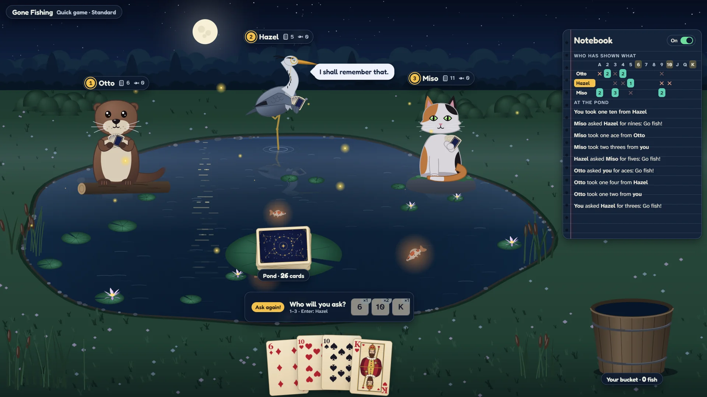
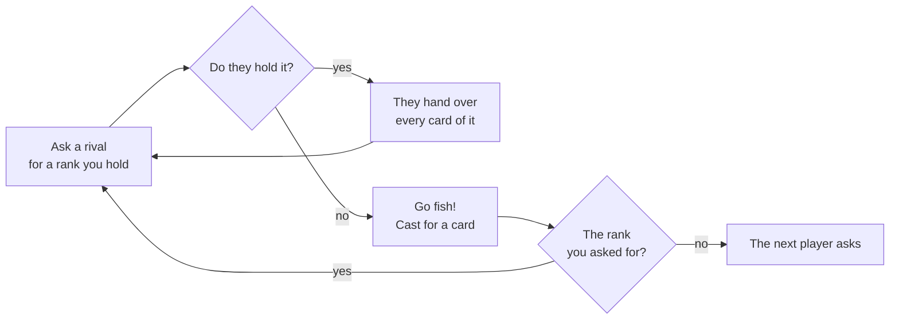

# How to play Gone Fishing

## Goal

Make the most books. A book is all four cards of one rank; every book leaps into your bucket as
that rank's fish.

## Controls

When it is your turn, choose a rival, then a rank you hold.

| Action                                  | Keyboard                          | Mouse                         | Remappable |
| --------------------------------------- | --------------------------------- | ----------------------------- | ---------- |
| Choose the rival to ask                 | 1 · 2 · 3                         | Click their name              | no         |
| Ask the rival you asked last            | Enter                             | Click their name              | no         |
| Choose a different rival                | Backspace                         | Click another name            | no         |
| Ask for a rank                          | A · 2–9 · 0 (the ten) · J · Q · K | Click a card or a rank button | no         |
| Open or close the notebook              | N                                 | The notebook's switch         | no         |
| Pro mode for your rival (Classic 1993)  | P                                 | Pause menu                    | no         |
| Pause                                   | Esc                               | Pause button                  | no         |
| Menu items                              | Q · T · D · A · ? · S             | Click                         | no         |
| Play again, or the next round (results) | R                                 | Play again                    | no         |
| Back to the Hall (results)              | H                                 | Back to the Hall              | no         |
| Share (Daily Pond results)              | S                                 | Share                         | no         |

With one rival there is no one to choose: rank keys ask straight away. Every ask, answer, catch
and book is also read out for screen readers.

## Rules

1. Everyone is dealt seven cards (five each when four play); the rest are the pond.
2. On your turn, ask one rival for a rank you already hold.
3. If they hold any of it, they hand over all of it, and you ask again.
4. If not, they say "Go fish!" and you cast: the top card of the pond comes up on your hook. If it
   is the rank you asked for, you show it and ask again; otherwise the turn passes to your left.
5. Four of a rank make a book, set aside at once as a fish in your bucket.
6. The game ends as your rule set says; most books wins, and a tie at the top is a tie.

## Rule sets

| Rule set     | What changes                                                                          |
| ------------ | ------------------------------------------------------------------------------------- |
| Standard     | The game ends the moment anyone's hand runs out. Two to four players.                 |
| All 13 books | An empty hand draws one card from the pond at once; play on until every book is made. |
| Classic 1993 | The Berkeley game exactly: one rival (Otto or Hazel), seven cards, P for pro mode.    |

## Modes

| Mode          | What it is                                                                                                                                               |
| ------------- | -------------------------------------------------------------------------------------------------------------------------------------------------------- |
| Quick game    | Choose your rivals (one, two or all three), the rules and the notebook.                                                                                  |
| Tournament    | Five rounds of All 13 books: Otto, Hazel, Miso, Otto and Miso at once, then all three. Win three rounds to take the cup; all five are always played.     |
| Daily Pond #N | The same cards, seats and rivals' luck for everyone today; All 13 books against all three. Your score is your books; the first finish of the day counts. |

## The rivals

| Rival | How they think                                                                                                   |
| ----- | ---------------------------------------------------------------------------------------------------------------- |
| Otto  | Forgets everything. Asks for his ranks in turn, round and round: the original's normal mode.                     |
| Hazel | Remembers what you ask for, and asks it back once she holds it: the original's pro mode.                         |
| Miso  | Remembers every ask, every "Go fish!" and every card handed over, and asks where the odds are best. Never peeks. |

## The notebook

On the right while you play. The grid shows, for each rival and rank, how many cards they are
known to hold (a filled number), or a cross when they have just said "Go fish!" for it (fading
as they draw again). Your own ranks are marked along the top. Below, the latest asks and answers.
It knows only what was said and shown at the pond.

## Settings

| Setting                | Options                                | Default  |
| ---------------------- | -------------------------------------- | -------- |
| Rules for a Quick game | Standard · All 13 books · Classic 1993 | Standard |
| Open the notebook      | on · off                               | on       |
| Pace                   | Relaxed · Brisk                        | Relaxed  |
| Sound                  | on · off (at the Hall's volume)        | on       |

## Scoring

Your score is your books. The Daily Pond shares a line like
`Gone Fishing #45 · 6 books · 🐟🐟🐠🐟🐟🐟 · no notebook` (a 🐠 is a golden fish), with no link in it.

## Achievements (packages)

| Package                | How to earn it                                          |
| ---------------------- | ------------------------------------------------------- |
| `first-book`           | Make a book of four.                                    |
| `beat-otto`            | Win a game with Otto at the pond.                       |
| `lucky-cast`           | Fish up the rank you asked for three times in one game. |
| `daily-regular`        | Fish the Daily Pond on seven different days.            |
| `three-books-one-turn` | Make three books in a single turn.                      |
| `beat-hazel`           | Win a game with Hazel at the pond.                      |
| `no-notebook-win`      | Win with the notebook closed the whole way through.     |
| `full-house`           | Win a game of All 13 books.                             |
| `classic-1993`         | Win a game of Classic 1993.                             |
| `golden-catch`         | Make a book that turns into a golden fish.              |
| `beat-miso`            | Win a game with Miso at the pond.                       |
| `tournament-cup`       | Win three rounds of a Tournament.                       |
| `rare-taunt`           | Hidden.                                                 |

## XP

This game reports every finished game to the Hall: a completed session, the first win of the
day, the Daily Pond and packages all earn XP. Within a game: books (2 each, up to 12), a win (10),
a win from memory with the notebook closed (8) and a golden fish (5). Weekly cron goals: _Catch
{n} fish_ and _Win {n} games at the pond_.

## Tips

- Whoever asks for a rank holds it. If you hold it too, ask them for it on your next turn.
- A rival who just said "Go fish!" for a rank has none of it, until they draw.
- Asking tells everyone you hold that rank. Hazel will remember; ask for ranks you are close to
  completing.
- Against two or three rivals, ask the one most likely to hold the rank: the notebook knows.
