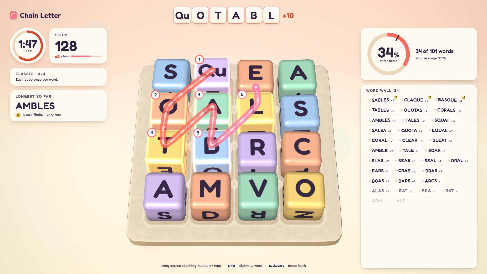
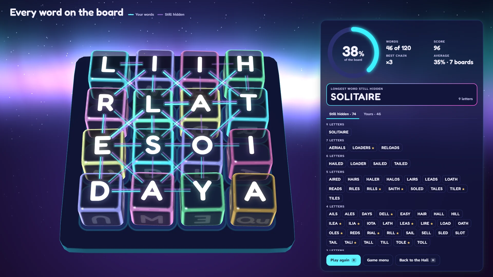

# Chain Letter

**Trace the letters. Find the words. Beat the dictionary.**

## The hook

Sixteen chunky letter cubes tumble onto a tray, and you have three minutes to drag your way
through touching letters and pull words out of them. Every word flies to your word wall; quick
finds build a chain up to ×3. Then the bell rings and the board lights up with every word it was
hiding, a web of strands across the cubes, and the ring fills to your share of them. That share is
the number to beat, round after round.

## Where it comes from

`bog`, Barry Brachman's word hunt from the computer science department of the University of
British Columbia, written in 1988 for a Sun 3 and an Atari 1040ST and later shipped with BSD.
Its quiet genius was the scoring: it did not count points, it computed every word on the board
when the time ran out and told you what share of them you had found, with a running average
over every game. Its author planned windowing versions he never meant to write, and signed off
his README with a warning that the game could become a habit.

Chain Letter keeps that contest with the dictionary at its heart and rebuilds everything around
it.

## What is new

- **Real cubes.** Lit, rounded, tactile cubes that tumble onto the tray at the start of every
  round: pastel and glossy in the Studio look, glass lit from inside over an aurora in Arcade
  Glow. Our own cube sets, designed from the dictionary itself.
- **Drag to trace.** Draw through the cubes with the mouse, click them one by one, type the
  letters, or move with the arrow keys. A glowing ribbon follows the chain; numbered badges keep
  it readable without colour.
- **The reveal.** Every word on the board, drawn as a web; point at any word to see it traced on
  the grid, as the 1988 program's Escape key did.
- **Board-reading level.** The original's running average, kept the same way, opens the Big grid
  (5×5) at 25 % and the Mega grid (6×6) at 35 %.
- **Rule cards.** The 1988 command-line switches return as Echo (a cube may come back) and
  Mirror (a cube may repeat at once), with their own records.
- **More ways to play.** A Daily Grid with a link-free share line, a Duel against an AI
  word-hunter at five strengths, Pass and play for two, Zen with no clock, a one-minute tutorial,
  and a word book that files every word you find with a foil stamp for the rare ones.

## The dictionary

A word counts only when two independent word lists agree on it: SCOWL 2020.12.07 (the
spell-checker lists behind the Hunspell English dictionaries, sizes up to 60, American and
British spellings) and ENABLE2K (the public-domain list for word games). 75,786 words, checked
but never defined.

## At a glance

|                 |                        |
| --------------- | ---------------------- |
| Directory       | `/usr/games/words`     |
| Players         | 1–2                    |
| Session         | 3–6 minutes            |
| Daily challenge | yes                    |
| Inspired by     | `boggle` (`bog`, 1988) |

## More

- [How to play](HOW-TO-PLAY.md)
- [Changes from the original](CHANGES-FROM-ORIGINAL.md)
- [Architecture](ARCHITECTURE.md)
- [Notes](NOTES.md)
