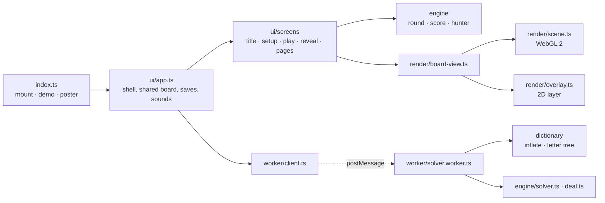
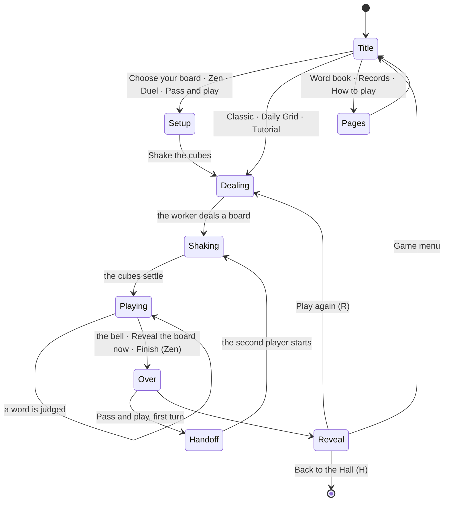

# Chain Letter — architecture

## Overview

A native game against the kit contract. The tabletop is WebGL 2 (one instanced rounded-cube
mesh, four small shader programs) under a Canvas 2D layer for the ribbon, badges and the reveal's
web; the interface is plain HTML. The engine is pure TypeScript; the 75,786-word dictionary and
the solver run in a Web Worker. Decisions: [ADR 0001](adr/0001-webgl2-cubes-and-a-2d-layer.md)
(rendering), [ADR 0002](adr/0002-two-dictionaries.md) (dictionary),
[ADR 0003](adr/0003-the-hunter.md) (the Duel's AI).

## Module map

| Path                  | Responsibility                                                                                                |
| --------------------- | ------------------------------------------------------------------------------------------------------------- |
| `src/index.ts`        | `mount`, `demo`, `poster`, `achievements` (the kit contract) and the screen navigator                         |
| `src/engine/`         | Pure and seeded: grid and rules, letter tree, solver, rolls, deals, rounds, scoring, the hunter               |
| `src/dictionary/`     | The bundled word list (generated), its codec, tiers, counts and the loader                                    |
| `src/worker/`         | The solver worker and the page-side client (runs in the page where workers are missing)                       |
| `src/game/`           | Modes and plans, packages, records, word book, saves, the Daily share line                                    |
| `src/render/`         | Camera, mesh, atlas, shaders, the WebGL scene, the 2D layer, tumble, board view, attract, poster, 2D fallback |
| `src/ui/`             | The app shell, input, HUD, play and reveal layouts, screens, styles                                           |
| `src/audio/sounds.ts` | Every sound, as kit synth patches                                                                             |
| `scripts/`            | Dictionary build, deny-list hashes, cube design, showcase boards, manifest, solver and hunter benches         |
| `dev/`                | The workbench (port 5291): mock Hall, hero scenes                                                             |
| `e2e/`                | Playwright: game, hero frames, screenshots, the Hall; helpers and quick scripts                               |

## State machine

## Engine

- **Grid and rules** (`grid.ts`): cubes numbered row by row; eight-way neighbours;
  `canExtend` encodes Classic (no reuse), Echo (reuse, never the same cube twice in a row) and
  Mirror (reuse and self-adjacency).
- **Letter tree** (`trie.ts`): first-child/next-sibling arrays built from the sorted,
  front-coded list in about 20 ms; each word node stores its rarity tier.
- **Solver** (`solver.ts`): Classic is a depth-first walk with a used-cube mask; Echo and Mirror
  explore each (prefix, cube) state once, because what can follow depends only on the cube in
  hand. `pathsSpelling` finds the paths for typed letters, ignoring the dictionary. Under 3 ms for
  any 6×6 board.
- **Cubes and rolls** (`cube-sets.ts`, generated; `roll.ts`): our own sets per size; a roll
  shuffles cubes into cells and picks a face for each, with the kit RNG.
- **Deals** (`deal.ts`): reroll until the board holds `MIN_WORDS` (30, 80, 150); the Daily Grid is
  the richest of 24 rolls holding a word of seven letters or more.
- **Round** (`round.ts`): pure verdicts (`found`, `again`, `too-short`, `not-on-board`,
  `not-a-word`), chain combos and points (`score.ts`), coverage.
- **Randomness:** `createRng(seed)` from the kit everywhere: `classic#<n>` seeds for rounds,
  `dailySeed('letters', date)` for the Daily Grid, `hunter:<strength>:<seed>` for the hunter.

## AI

The Duel's hunter (`engine/hunter.ts`, [ADR 0003](adr/0003-the-hunter.md)) plans its whole round
when the board is dealt: it knows each word with a chance set by its strength, the word's rarity
tier and its length; it finds known words easiest first, each taking a moment that grows with the
word's length. The screen reveals each find when its moment comes. Mean share of a 4×4 board in
three minutes: Nibbler 16 %, Browser 32 %, Reader 46 %, Scholar 60 %, Lexicon 73 %
(`scripts/hunter-sim.ts`, locked in `src/game/game.test.ts`).

## Where visuals are defined

| Visual                            | Defined in                                           | Change it by                                              |
| --------------------------------- | ---------------------------------------------------- | --------------------------------------------------------- |
| Colours of both looks             | `src/render/palette.ts` (`STUDIO`, `ARCADE`)         | Editing a palette; the DOM gets them through `ui/look.ts` |
| Backdrop (studio sweep, aurora)   | `BACKDROP_FRAGMENT` in `src/render/shaders.ts`       | The `uLook` branches                                      |
| Cubes (pastel and glass)          | `CUBE_FRAGMENT` in `shaders.ts`                      | The two branches; letters come from the atlas             |
| Cube shape                        | `roundedCube` in `src/render/mesh.ts`                | Corner radius and steps (`scene.ts`)                      |
| Letters                           | `src/render/atlas.ts`                                | `LETTER_FONT`, glyph size, halo blur                      |
| Tray and its wells                | `TRAY_FRAGMENT` in `shaders.ts`                      | Well shape, grain, neon lines                             |
| Shadows and light pools           | `glows`/`floorGlow` in `board-view.ts`               | Offsets, softness, alpha                                  |
| Camera                            | `src/render/camera.ts`                               | `ELEVATION`, `FIELD_OF_VIEW`, `GAP`                       |
| Tumble                            | `src/render/tumble.ts`                               | `planTumble` heights, spins, delays                       |
| Ribbon, order badges, reveal web  | `src/render/overlay.ts`                              | Blend modes per look, widths                              |
| Flash, shake, long-word pop, glow | `board-view.ts` (`FLASH_SECONDS` …, `cubeInstances`) | Durations and amplitudes                                  |
| Without WebGL 2                   | `src/render/painter2d.ts`                            | The flat drawing                                          |
| Interface                         | `src/ui/styles.css` (all under `.chl-`)              | Per-look rules under `[data-look]`                        |

Light and dark are separate designs (Studio, Arcade Glow), switched live from the Hall's
appearance. Reduced motion: no tumble (cubes are simply there), no hop or spin on long words,
no tag flights, the ring fills at once.

## Where sounds are defined

| Sound          | Patch (`src/audio/sounds.ts`) | Plays when                                  |
| -------------- | ----------------------------- | ------------------------------------------- |
| Wooden clatter | `clatter`                     | Cubes strike the tray during a tumble       |
| Rising note    | `letter`                      | A cube joins the chain (pentatonic, upward) |
| Chord          | `word`                        | A word counts (fuller for long words)       |
| Soft knock     | `miss`                        | A word does not count                       |
| Two taps       | `again`                       | A word found before                         |
| Sparkle        | `sparkle`                     | A very rare word new to the book            |
| Woodblock      | `tick`                        | Each of the last five seconds               |
| Bell           | `bell`                        | Time, or the board revealed early           |
| Shimmer        | `reveal`                      | The reveal's web draws in                   |
| Tap            | `tap`                         | Menu choices                                |

## Hall integration

- **Results:** `reportResult` once per round with `presentation: 'game'`: outcome `complete`
  (Duel: `win`, `loss` or `draw`), score, stats `wordsFound`, `longWords` (six letters or more,
  for the weekly goal) and `coverage`, XP events for long words, coverage and new very rare
  words, `daily`, `durationSeconds`.
- **Packages:** `src/game/packages.ts`; four are installed mid-round from `packagesForFind`,
  the rest from `recordRound` at the end.
- **Pause items:** New board (asks first once words are on the wall), Reveal the board now.
- **Daily:** the kit's seed, date and number; the share line from `game/share.ts`.
- **Saves:** three slots, version 1 each: `prefs`, `records` (`sanitizeRecords` fills gaps),
  `book`.
- **Safe zones:** the HUD keeps to the top of the left column, the coverage and wall start below
  the Pause pill; the board sits in the middle column. On the reveal the board may pass under the
  toasts; no text or control does.

## Kit candidates

- `ui/dom.ts` `h()`/`svg()` (every game writes one).
- `ui/confirm.ts`, an in-game confirmation dialog.
- `render/math3d.ts`, small matrices and quaternions for WebGL games.

## Tests

| Where                                   | What                                                                                                 |
| --------------------------------------- | ---------------------------------------------------------------------------------------------------- |
| `src/engine/engine.test.ts`             | Adjacency, the rule switches, Qu, minimum length, solver against brute force, scoring, rounds, deals |
| `src/dictionary/dictionary.test.ts`     | Counts and tiers, order and shape, the deny-list, the codec                                          |
| `src/game/game.test.ts`                 | Hunter balance (locked), records, packages, the Daily line, labels, showcase boards                  |
| `src/game/manifest.test.ts`             | The manifest validates and matches the packages                                                      |
| `e2e/game.spec.ts`                      | Tracing, typing, clicking, arrow keys, feedback, the reveal, every mode, sharing, exits              |
| `e2e/hall.spec.ts`                      | The game inside a Hall dev server                                                                    |
| `e2e/hero.spec.ts`, `e2e/shots.spec.ts` | Hero frames and documentation screenshots (`MEDIA=1`)                                                |
