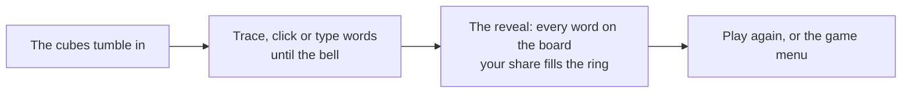

# How to play Chain Letter

## Goal

Find as many words as you can in the letter cubes before the bell. When it rings you see every
word the board held: your share of them is your coverage, and across every timed board it
becomes your board-reading level.

## Controls

| Action                      | Keyboard                              | Mouse                                               | Remappable |
| --------------------------- | ------------------------------------- | --------------------------------------------------- | ---------- |
| Make a word by tracing      | Arrow keys to a cube, Space to add it | Drag across touching cubes, release to claim        | no         |
| Make a word cube by cube    | Arrow keys and Space                  | Click each cube; click the last one again to claim  | no         |
| Type a word                 | Letters (`q` reaches the Qu cube)     | —                                                   | no         |
| Claim the word              | Enter                                 | Release the drag, click the last cube, or **Claim** | no         |
| Take a step back            | Backspace                             | Drag back onto the previous cube                    | no         |
| Clear the word              | Delete                                | —                                                   | no         |
| Repeat a cube (Mirror only) | Space on the same cube                | Click the same cube again                           | no         |
| Pause                       | Esc                                   | Pause button                                        | no         |
| Trace a word on the reveal  | Tab to it                             | Point at it                                         | no         |
| Play again (reveal)         | R                                     | Play again                                          | no         |
| Back to the Hall (reveal)   | H                                     | Back to the Hall                                    | no         |

While you type, every path that spells your letters lights up; the first one gets the ribbon.
Letters that spell nothing on the board are struck through.

## Rules

1. The cubes are shaken and land in the tray, each showing one face. One face of one cube reads
   `Qu` and counts as two letters.
2. A word is a chain of cubes, each touching the last one: horizontally, vertically or
   diagonally.
3. Under the Classic rule each cube is used once per word. Words have three letters or more
   (four or five if you choose).
4. A word counts only if both of our dictionaries know it. A word found before does not count
   again; its tag on the wall pulses instead.
5. When the time is up, the reveal shows every word on the board.

## Rule cards

| Card    | What changes                                                                 |
| ------- | ---------------------------------------------------------------------------- |
| Classic | Each cube once per word (the 1988 default).                                  |
| Echo    | A cube may come back later in the same word, but never twice in a row (`+`). |
| Mirror  | A cube counts as its own neighbour, so it may repeat straight away (`++`).   |

## Modes

| Mode              | What changes                                                                                                                                          |
| ----------------- | ----------------------------------------------------------------------------------------------------------------------------------------------------- |
| Tutorial          | One minute on a friendly board; the clock waits while you trace a shown word and type another.                                                        |
| Classic           | Three minutes on a 4×4 board, the 1988 rules.                                                                                                         |
| Choose your board | Any open grid (4×4, Big grid 5×5 for four minutes, Mega grid 6×6 for five), any rule card, any shortest word.                                         |
| Daily Grid #N     | Everyone gets the same rich board today (it always holds a word of seven letters or more). Your first try is the one you share; replays are practice. |
| Zen               | No clock; finish when you like. Does not count towards your level.                                                                                    |
| Duel              | An AI word-hunter plays the same board in real time. Most points wins; its words show as dashed ghost strands in the reveal.                          |
| Pass and play     | Two players take one turn each on the same board, then compare.                                                                                       |

The Duel's hunters, from gentlest to strongest: Nibbler, Browser, Reader, Scholar and Lexicon.

## Settings

| Setting       | Options                    | Default |
| ------------- | -------------------------- | ------- |
| Grid          | 4×4 · Big grid · Mega grid | 4×4     |
| Rule card     | Classic · Echo · Mirror    | Classic |
| Shortest word | 3 · 4 · 5 letters          | 3       |
| Hunter        | Nibbler … Lexicon          | Browser |

The Big grid opens at a board-reading level of 25 %, the Mega grid at 35 % (after three timed
boards). Choices are remembered.

## Scoring

| Letters | Points |
| ------- | -----: |
| 3–4     |      1 |
| 5       |      2 |
| 6       |      3 |
| 7       |      5 |
| 8+      |     11 |

Find a word within four seconds of the last one and the chain grows: ×1.5, then ×2, then ×3
(points round to the nearest whole number). A longer pause starts again at ×1.

**Coverage** is the share of the board's words you found. Your **board-reading level** pools
every timed Classic, Daily and Duel board you have played with three-letter words: all the
words you found over all the words there were.

The Daily Grid's share line: `Chain Letter #42 · 38 words · 41% of the board · longest: TRAPEZE · 🟩🟨🟨`,
one square each for words of 3–4, 5–6 and 7+ letters: full where you found at least half of that
kind, half where you found some, dark where you found none.

## The word book

Every word you find is filed in the book with its rarity, read from the spell-checker lists'
sizes: common, uncommon, rare (★) and very rare (★). A very rare word new to your book gets a
small celebration.

## Achievements (packages)

| Package              | How to earn it                                 |
| -------------------- | ---------------------------------------------- |
| First link           | Trace your first word.                         |
| Quick on the Qu      | Find a word that runs through the Qu cube.     |
| Chain reaction       | Keep finding words until the chain reaches ×3. |
| Morning reader       | Play seven Daily Grids.                        |
| Long stretch         | Find a word of eight letters or more.          |
| Half the board       | Find half of the words on a timed board.       |
| Echo chamber         | Reach a third of an Echo board.                |
| Mirror image         | Reach a third of a Mirror board.               |
| Sharper eye          | Raise your board-reading level by ten points.  |
| Three quarters       | Find three words in four on a timed board.     |
| Mega reader          | Finish a timed round on the 6×6 Mega grid.     |
| Out-read the Lexicon | Win a Duel against the strongest hunter.       |

## Tips

- Look for endings that join many words: `-S`, `-ED`, `-ER`, `-ING`. One stem often gives three
  or four words.
- The Qu cube is a gift: _quit_, _quote_, _equal_ and their families.
- Keep moving: a word every four seconds holds the chain, and long words are worth chaining
  into.
