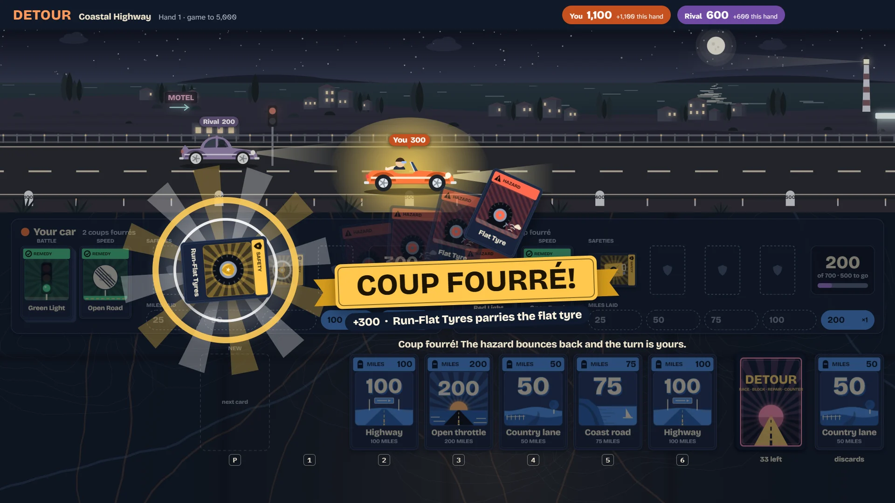

# Detour

> Race to 700 miles. Block. Repair. Counter.

## The hook

Two cars, one road and a deck of 101 cards. Lay miles to roll toward exactly 700, throw a flat
tyre or a red light at your rival, patch up whatever they throw back, and keep a safety in your
hand for the moment it matters. When their hazard lands and you are holding the answer, slam it
down: time slows, the hazard bounces back, and **COUP FOURRÉ! +300** blazes across the table.

## Where it comes from

`mille` is Ken Arnold's road-race card game from Berkeley, dated 1982 in its sources, with a
manual from 1983. On a terminal it showed your seven cards along the bottom of the screen and both
players' piles above them in curses windows. You typed a card's number, then P to play it or D to
discard it, against a computer opponent that never threw a safety away and always parried a
hazard when it could. Its manual explains the coup fourré as a fencing term, a counter-thrust
that is part of a parry, and calls one display command "recommended for hackers and other
miscreants". Everything you see in Detour is ours: the names, the deck, the road and the rivals'
manners are drawn and written from scratch.

## What is new

- **A living road.** Both cars drive along the top of the screen. A flat sags and wobbles, an
  empty tank coughs, a red light turns green and the car pulls away, and the 700 flag waits at
  the end of the road.
- **The coup fourré as a moment.** Slow motion, the safety slamming down in gold, the hazard
  bouncing back and a banner over the table.
- **Three rivals.** Rookie plays whatever will go down. Classic is the Berkeley program's strategy
  move for move, checked against the original on 35,928 positions. Sly plays the hand out in its
  head before it commits.
- **Teams.** You and a computer partner share a car against two rivals, to 1000 a hand.
- **Five routes and a travel journal.** Win hands to open new roads, each by day and by night;
  your first win on a road earns its sticker.
- **A helper for newcomers.** It greys out what cannot be played and says why, marks safeties to
  save for a counter, and explains every bonus on the score sheet.

## At a glance

|                 |                                           |
| --------------- | ----------------------------------------- |
| Directory       | `/usr/games/cards`                        |
| Players         | 1 against the computer (2–4 at the table) |
| Session         | 5 minutes a hand; 20–45 for a game        |
| Daily challenge | yes: Daily Road #N                        |
| Inspired by     | `mille` (1982)                            |

## More

- [How to play](HOW-TO-PLAY.md)
- [Changes from the original](CHANGES-FROM-ORIGINAL.md)
- [Architecture](ARCHITECTURE.md)
