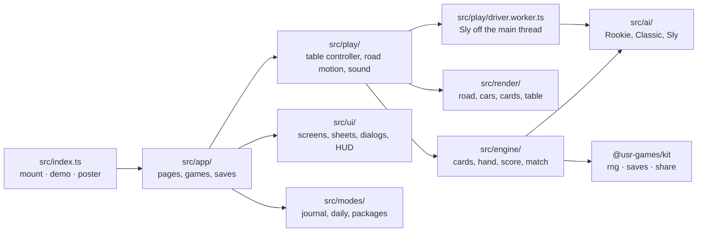
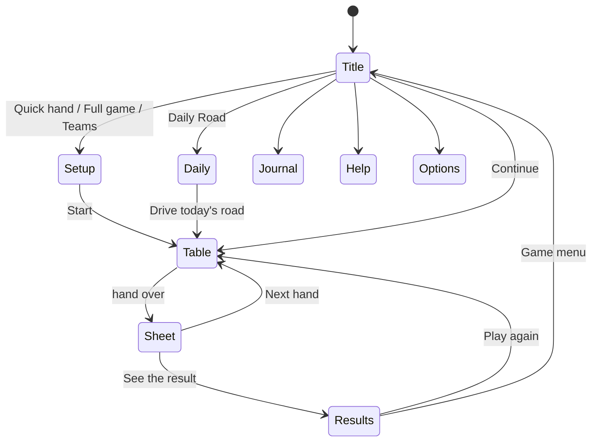
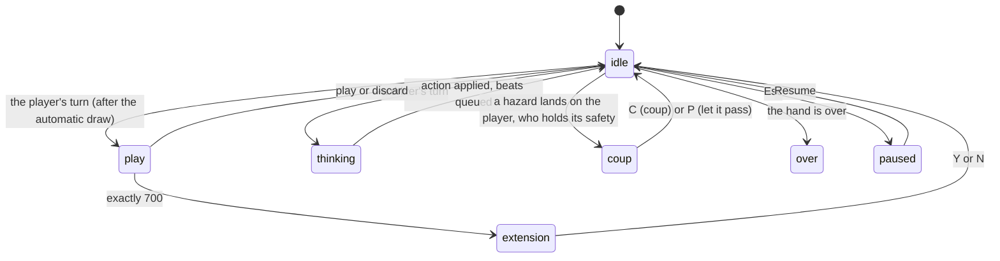

# Detour — architecture

## Overview

Detour is a native game: a TypeScript module the Hall mounts in its own page. The road and the
table share one Canvas 2D (ADR 0001); the words people read and every control are DOM above it.
The rules engine is pure and seeded, about 1,000 lines with the scoring and the match; the
computer drivers sit beside it, and Sly's search runs in a Web Worker (ADR 0002).

## Module map

| Path                      | Responsibility                                                                                             |
| ------------------------- | ---------------------------------------------------------------------------------------------------------- |
| `src/index.ts`            | The kit contract: `mount`, `demo` (Classic against Classic on the road), `poster`, `achievements`.         |
| `src/engine/cards.ts`     | The 19 kinds in the original's order, the 101- and 106-card decks, families, safeties and their hazards.   |
| `src/engine/hand.ts`      | One hand: the deal, every rule of play (`playVerdict`), legal actions, `apply`, the coup fourré window.    |
| `src/engine/score.ts`     | Every scoring item, per side, live and at the end of a hand.                                               |
| `src/engine/match.ts`     | Hands to a target, the first turn passing round, drivers watching every event, `bankedTotals`.             |
| `src/engine/stacked.ts`   | Decks stacked on purpose for tests and the workbench.                                                      |
| `src/ai/classic.ts`       | The port of `comp.c` (`calcmove`, `onecard`, `canplay`) and the computer's half of `check_ext`.            |
| `src/ai/sly.ts`           | Classic plus a second look: shaped worlds, playouts, a 2.5-standard-error veto; extension playouts.        |
| `src/ai/players.ts`       | `Driver`: level, random stream and memory, saved with the game; Rookie.                                    |
| `src/play/table.ts`       | The table controller: modes, the queue of beats, input (keys, clicks, drags), prompts, narration.          |
| `src/play/road-motion.ts` | Where each car is between frames: acceleration, per-card performances, slow motion.                        |
| `src/play/view.ts`        | Pure mapping from a hand to what the road and table show.                                                  |
| `src/play/driver-*.ts`    | `DriverClient` posts Sly's choices to the worker; Rookie and Classic answer on the main thread.            |
| `src/play/sound.ts`       | Synth patches for every cue, each route's ambience.                                                        |
| `src/play/demo.ts`        | The Hall's attract mode: a silent hand between two Classic drivers, route after route.                     |
| `src/render/`             | Everything painted: road and scenery, cars, card faces and back, the table, effects, poster, journal map.  |
| `src/modes/`              | The travel journal (routes, stickers, stamps), the Daily Road (route and share line), the twelve packages. |
| `src/app/`                | `DetourApp`: pages, starting and resuming games, scoring a hand, results, saves.                           |
| `src/content/`            | Card names and lines, the helper's reasons and the line of play.                                           |
| `src/ui/`                 | DOM builders for pages, the HUD, the score sheet, results and the confirm dialog; the two style sheets.    |

## State machines

The app moves between pages; the table has its own modes inside a hand.

`idle` means "nothing is moving yet": `advance` waits for the beats queue to empty, then hands the
turn to the player or a driver. Every action is applied to the engine at once and queued as beats
(a card flight, a road performance, the coup slam and banner, a trip flag), and the table paints a
`shown` copy of the hand that lags the real one until each beat lands. The score bar, the
placards and the narration follow `shown`, so nothing is announced before it is seen.

## Engine

- **Hand.** Seven slots per seat, slot 0 the new card, compacted after every play as the original
  does. A coup fourré window `{side, hazard}` opens when a hazard lands and closes at the next
  draw, discard or non-safety play. `apply` returns events (`draw`, `play`, `discard`, `trip`,
  `extension`, `over`) that drive narration, sound and the road.
- **Randomness.** Every shuffle comes from the kit's sfc32 stream labelled `<seed>:deck`, its state
  saved with the match; each driver has its own stream `<seed>:driver:<seat>`. A saved game
  restored through JSON plays on exactly (tested).
- **Teams.** Seats 0 and 2 against 1 and 3, sharing a side's piles; the 106-card deck; the turn
  jumps to a seat that lays a coup fourré out of turn.

## AI

- **Rookie** plays a random legal card, or discards at random when nothing goes down.
- **Classic** is `comp.c` line for line, with its arithmetic, tie-breaks and slips, checked against
  the original on 35,928 positions; 300 are kept as fixtures. Its card-counting memory (`Numseen`,
  `Numneed`) lives in `Driver.memory` and is fed every event by `classicObserve`.
- **Sly** asks Classic first, then plays 48 worlds of unseen cards (rival hands shaped by
  `RIVAL_HAND_BIAS`) to the end of the hand for every distinct move, and takes another move only
  when it leads by 2.5 standard errors. An extension is 120 playouts each way. Budgets are counts,
  never wall-clock. About 130 ms a choice, in the worker.

Balance over 2,000 full games: Classic beats Rookie 83.5%; Sly beats Classic 53.6% (NOTES.md).

## Where visuals are defined

| Visual                                                                            | Defined in                              | Change it by                                                      |
| --------------------------------------------------------------------------------- | --------------------------------------- | ----------------------------------------------------------------- |
| Colours of the two looks (Day, Night)                                             | `src/render/look.ts`                    | Editing `DAY` / `NIGHT`; each is designed, not derived.           |
| Card faces, 19 vignettes, and the back                                            | `src/render/card-art.ts`                | One painter per kind in `drawCardFace`.                           |
| Card image cache                                                                  | `src/render/sprites.ts`                 | `CardSprites` repaints per size and look.                         |
| Road: sky, coast layers, rail, posts, lanes, flags, signals, trouble, slow motion | `src/render/road.ts`                    | `drawRoad` and its helpers; `RoadFrame` is the whole input.       |
| The other four routes' scenery                                                    | `src/render/scenery.ts`                 | `paintScenery`, `paintRail`, `paintVergeProps` per route.         |
| Route palettes                                                                    | `src/render/routes.ts`                  | `day` and `night` palettes per route.                             |
| Cars (roadster, coupé), dents, flats                                              | `src/render/car.ts`                     | `drawCar` with a `CarPose`.                                       |
| Table: placards, mile chips, odometer, piles, ghosts                              | `src/render/table.ts`                   | `drawTable`; the atlas background is `paintAtlas`.                |
| Layout on a 1920 × 1080 grid                                                      | `src/render/layout.ts`                  | `computeLayout`; keeps the hand clear of the Hall's toast corner. |
| Coup burst, banner, puffs                                                         | `src/render/effects.ts`                 | `drawCoupBurst`, `drawBanner`, `drawPuff`.                        |
| Menu backdrop (endless drive, card fan)                                           | `src/render/backdrop.ts`                | —                                                                 |
| Journal map                                                                       | `src/render/journal-map.ts`             | `paintJournalMap`; stops sit at `STOPS[].map`.                    |
| Poster (Hall key art)                                                             | `src/render/poster.ts`                  | `paintPoster`: Night City, two cars, a Green Wave mid-slam.       |
| HUD, hand buttons, tips, dialogs, pages                                           | `src/ui/detour.css`, `src/ui/pages.css` | Colours from `.dt-app`'s look variables.                          |

Reduced motion: card flights, the car's acceleration and the coup's slow motion are cut short;
the coup still shows its banner and the safety in place.

## Where sounds are defined

Every sound is a kit synth patch in `src/play/sound.ts`; there are no audio files.

| Sound       | Patch                                                     | Plays when                             |
| ----------- | --------------------------------------------------------- | -------------------------------------- |
| Card down   | `flick`                                                   | miles and anything without its own cue |
| Draw        | `draw`                                                    | a card is drawn                        |
| Safety slam | `slam`                                                    | a safety is laid                       |
| Engine      | `engine`                                                  | a car pulls away                       |
| Flat        | `hiss`                                                    | Flat Tyre                              |
| Empty tank  | `cough`                                                   | Out of Fuel                            |
| Bump        | `bonk`                                                    | Fender Bender                          |
| Red light   | `red`                                                     | Red Light                              |
| Green light | `green`                                                   | Green Light                            |
| Sign        | `sign`                                                    | Slow Zone, Open Road                   |
| Repair      | `fix`                                                     | Fill Up, Spare Tyre, Mechanic          |
| Coup fourré | `coup`                                                    | the slam of a coup                     |
| Horn        | `horn`                                                    | 700 reached, the extension question    |
| Extension   | `extend`                                                  | a trip extended to 1000                |
| Pick        | `tick`                                                    | a card picked in hand                  |
| Ambience    | `surf`, `dry-wind`, `snow-wind`, `rainforest`, `city-hum` | under each route, quietly              |

## Hall integration

- **reportResult** at the end of every game, `presentation: 'game'`: outcome win, loss or draw;
  score = the player's total; stats `wins`, `hands`, `handsWon`, `coups`, `miles` (the cron goals
  count `wins`, `coups`, `miles`); XP events `coup-fourre` (8 a coup, up to 18), `trip` (6),
  `shut-out` (10); `daily` on the first Daily Road of the day; `durationSeconds`.
- **Packages:** twelve (`src/modes/packages.ts`), installed when a hand is scored or a game ends;
  the score sheet and results list the new ones.
- **Pause menu:** one item, "Turn the helper on/off", while a table is open.
- **Daily:** the kit's daily seed gives the deck and the route; `Detour #N · score · ⚔️ coups ·
🛣️ miles` through `composeShare`.
- **Saves** (kit slots, all version 1): `prefs` (helper, rival, lengths, sound), `current` (the
  match in progress, with drivers' memories and the shuffle state), `records`, `journal`, `daily`.
- **Navigation:** Escape on the game menu leaves for the Hall; elsewhere it pauses. Dialogs catch
  their keys first so Escape answers them instead.

## Tests

| Test                         | Command                                                   | What it proves                                                                                                   |
| ---------------------------- | --------------------------------------------------------- | ---------------------------------------------------------------------------------------------------------------- |
| Rules, scoring, match        | `pnpm vitest run --project mille`                         | Every rule of play and scoring item, teams, replay and save-restore.                                             |
| Classic against the original | same (`src/ai/classic.test.ts`)                           | 300 positions with the original's answers; never discards a safety; always parries; beats Rookie.                |
| Sly                          | same (`src/ai/sly.test.ts`)                               | Legal and repeatable choices.                                                                                    |
| Narration                    | same (`src/content/narration.test.ts`)                    | Lines read right for the player and the rival.                                                                   |
| Balance (2,000 games)        | `pnpm --filter @usr-games/game-mille balance`             | Rookie < Classic < Sly; numbers in NOTES.md.                                                                     |
| Browser, workbench           | `npx playwright test e2e/game.spec.ts` (in `games/mille`) | Hands by keyboard and by mouse, coup, extension, safety confirmation, helper, teams, Daily share, resume, exits. |
| Browser, in the Hall         | `npx playwright test e2e/hall.spec.ts`                    | Launch, pause item, results with the receipt, ways out, no foreign requests.                                     |
| Hero frames and screens      | `npx playwright test --grep "@hero\|@shots"`              | `docs/media/hero/` and `docs/media/screens/`.                                                                    |
| Frame pacing                 | `npx tsx scripts/fps.ts dark`                             | 60 fps at 1920 × 1080 (NOTES.md).                                                                                |

## Kit candidates

- `confirmDialog` (`src/ui/dialogs.ts`): a two-answer dialog that catches its keys before the
  Hall's Escape. Several games carry one.
- The stacked deck (`src/engine/stacked.ts`) pattern for card games' tests.
