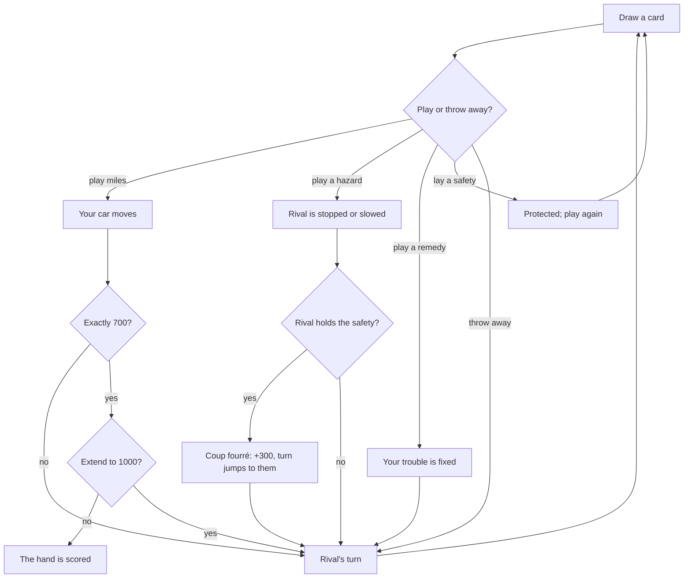

# How to play Detour

## Goal

Each hand is a race to exactly 700 miles. The side that gets there first scores a trip bonus,
but every card you lay scores too, so a hand you lose can still be worth a lot. A quick hand ends
with that one hand; a full game goes hand after hand until a side reaches 5000 points (or 2500
for a shorter run), and the higher total wins.

## Controls

The keys and the mouse do the same things; use whichever you like, even in the same turn.

| Action                                   | Keyboard                     | Mouse                                                                                    | Remappable |
| ---------------------------------------- | ---------------------------- | ---------------------------------------------------------------------------------------- | ---------- |
| Pick a card from your hand               | 1–6, or P for the new card   | Click the card                                                                           | no         |
| Move between cards                       | ← →                          | —                                                                                        | no         |
| Play the picked card where it goes       | U, or Enter on a picked card | Click its pile, drag the card onto it, double-click it, or Drive / Play / Throw at rival | no         |
| Throw the picked card away               | D                            | Click the discard pile, drag the card there, or Throw away                               | no         |
| Lay a coup fourré when the prompt shows  | C                            | Coup fourré!                                                                             | no         |
| Let a coup fourré pass                   | P                            | Let it pass, or click the deck                                                           | no         |
| Extend the trip to 1000 (at 700)         | Y                            | Extend to 1000                                                                           | no         |
| Stop at 700                              | N                            | Stop at 700                                                                              | no         |
| Next hand / see the result (score sheet) | Enter                        | Next hand / See the result                                                               | no         |
| Pause                                    | Esc                          | Pause button                                                                             | no         |
| Play again (results)                     | R                            | Play again                                                                               | no         |
| Back to the Hall (results)               | H                            | Back to the Hall                                                                         | no         |
| Share (Daily Road results)               | S                            | Share                                                                                    | no         |

You draw automatically at the start of each turn; the new card waits in the slot marked P.
Throwing away a safety asks first: there is only one of each, and it never comes back that hand.

A screen reader hears every play as it happens ("Your rival throws a Flat Tyre at you"), and
each card in your hand says what it does and, when it cannot go down, why not.

## The deck

| Family   | Cards                                                                                    | What they do                                                                            |
| -------- | ---------------------------------------------------------------------------------------- | --------------------------------------------------------------------------------------- |
| Miles    | 25 (Side street), 50 (Country lane), 75 (Coast road), 100 (Highway), 200 (Open throttle) | Move your car. At most two 200s a hand; never past the end of the trip.                 |
| Hazards  | Out of Fuel, Flat Tyre, Fender Bender, Red Light, Slow Zone                              | Thrown at your rival. The first four stop them; a slow zone limits them to 25s and 50s. |
| Remedies | Fill Up, Spare Tyre, Mechanic, Green Light, Open Road                                    | Fix your own trouble. Each fixes one hazard; Open Road ends a slow zone.                |
| Safeties | Long-Range Tank, Run-Flat Tyres, Road Sense, Green Wave                                  | One of each. Laid, it protects you from its hazard for the rest of the hand.            |

Green Wave answers both the red light and the slow zone, and lets you roll without a green light.

## Rules

1. Draw a card, then play one card or throw one away. Your hand always holds six cards after your
   turn.
2. You need a green light on your battle pile before you can lay miles.
3. A hazard stops your rival only while they are rolling (a slow zone works any time). They must
   lay its remedy and then a green light to roll again.
4. A safety can be laid at any time on your turn. It scores 100, clears its hazard if you have it,
   protects you for the rest of the hand, and gives you another turn.
5. **Coup fourré.** If your rival throws a hazard at you and you hold its safety, you may lay that
   safety at once, before anything else happens: 300 more points, the hazard bounces back, and the
   turn is yours.
6. Reaching exactly 700 ends the hand, unless you choose to **extend** the trip to 1000. Then the
   hand goes on and whoever reaches 1000 first finishes the trip.
7. When the deck runs out the hand goes on while anyone can still play a card.

### Teams

You and a computer partner share one car and one set of piles against two rivals, sitting
alternately round the table. The deck has 106 cards (one more of each hazard), a hand is 1000
miles, and there is no extension. Either partner may lay a coup fourré, even out of turn, and the
turn then jumps to whoever laid it. Your partner plays Classic.

## Modes

| Mode          | What changes                                                                                                                                 |
| ------------- | -------------------------------------------------------------------------------------------------------------------------------------------- |
| Quick hand    | One hand to 700 against the rival you choose: about five minutes.                                                                            |
| Full game     | Hand after hand to 5000, the original length, or to 2500 for a shorter run.                                                                  |
| Teams         | You and a partner against two rivals, one hand or a game to 2500 or 5000.                                                                    |
| Daily Road #N | Everyone gets the same shuffled deck and the same route today: one hand against Classic. Your first drive of the day is the one that counts. |

## Settings

| Setting     | Options                           | Default                               |
| ----------- | --------------------------------- | ------------------------------------- |
| Rival       | Rookie · Classic · Sly            | Classic                               |
| Length      | One hand · To 2500 · To 5000      | To 5000 (Full game), one hand (Teams) |
| Helper      | on · off (also in the pause menu) | on                                    |
| Game sounds | on · off                          | on                                    |

The helper greys out cards that cannot be played and gives the reason when you point at one,
puts a "save for a counter" ribbon on safeties, and explains every line of the score sheet.

## Scoring

Every hand both sides score what they laid; only the side that completes the trip scores the trip
bonuses.

| Item              | Points   | Who                                              |
| ----------------- | -------- | ------------------------------------------------ |
| Miles laid        | 1 a mile | both                                             |
| Safeties          | 100 each | both                                             |
| All four safeties | 300 more | both                                             |
| Coup fourré       | 300 each | both                                             |
| Trip completed    | 400      | the finisher                                     |
| Safe trip         | 300      | the finisher, without a single 200               |
| Delayed action    | 300      | the finisher, after the deck has run out         |
| Extension         | 200      | the finisher of an extended trip                 |
| Shut-out          | 500      | the finisher, when the rival has no miles at all |

The Daily Road's share line gives the day's number, your score, coups fourrés and miles:
`Detour #42 · 1,450 · ⚔️ 1 coup · 🛣️ 700`.

## Achievements (packages)

| Package             | Title              | How to earn it                                      |
| ------------------- | ------------------ | --------------------------------------------------- |
| `first-coup`        | Counter-thrust     | Lay your first coup fourré.                         |
| `safe-trip`         | Safe trip          | Win a hand without a single 200.                    |
| `shut-out`          | Left at the lights | Finish the trip before your rival has moved a mile. |
| `daily-regular`     | Daily driver       | Drive the Daily Road on seven different days.       |
| `all-four-safeties` | Fully covered      | Lay all four safeties in one hand.                  |
| `extension`         | The long way       | Extend a trip to 1000 and finish it.                |
| `delayed-action`    | Last of the deck   | Finish the trip after the deck has run out.         |
| `team-player`       | Co-driver          | Win a team game with your partner.                  |
| `double-coup`       | Twice parried      | Two coups fourrés in a single hand.                 |
| `full-game`         | Five thousand      | Win a full game to 5000.                            |
| `beat-sly`          | Outfoxed           | Beat Sly in a game to 2500 or 5000.                 |
| `world-tour`        | World tour         | Drive every route in the journal.                   |

## The travel journal

Every hand runs along one of five routes: the Coastal Highway and the Desert Run from the start,
the Snowline Pass after 3 hands won, the Rainforest Loop after 6 and Night City after 10. Your
first win on a route earns its sticker (Lighthouse Point, Mesa Motor Court, Snowline Summit,
Falls Crossing, Neon Avenue) and every win there adds a stamp to its page.

## XP

Detour reports each finished game to the Hall: a completed session, the first win of the day, the
Daily Road and packages all earn XP under the Hall's rules. On top of that a game earns 8 XP a
coup fourré (up to 18), 6 XP for completing a trip and 10 XP for a shut-out. The weekly cron goals
count games won, coups fourrés and miles driven.

## Tips

- Hold a safety while its hazard is still in the deck: a coup fourré is worth four times a plain
  safety, and the computer rivals know it too.
- Late in the hand, with the hazards gone, lay your safeties: 100 each, and another turn.
- A shut-out is worth 500. If your rival is stuck at the start, a fast trip pays twice.
- Slow zones cannot stop you, but they can cost you the 200s you were saving. Keep an Open Road.
- Extend only when you can see the miles in your hand; a failed extension gives up the trip bonus.
