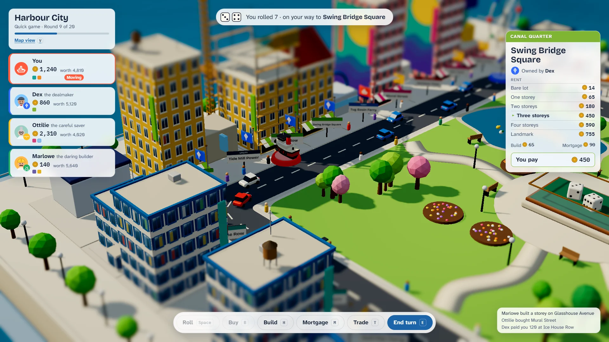

# Deeds & Dice

> Roll. Buy. Build. Out-deal everyone.

## The hook

A tiny living city in the palm of your hand. Roll the dice and walk the loop, buy the streets you
land on, and raise them storey by storey until a district's landmark goes up in a burst of
fireworks. Across the table sit rivals who know exactly what every deed is worth to them. They
make offers, turn yours down in a plain sentence, and come back with a counter: "I'll take it if
you add 150: that finishes your Fish Market."

## Where it comes from

`monop` is Ken Arnold's property-trading game for Berkeley Unix, from 1980. It was a referee, not
an opponent: up to nine people shared one terminal, typed their moves at a prompt, and the program
kept the money, the deeds and the rules. There were no computer players at all. The bank would
lend you money to buy what you could not afford, and then insist you "fix the problem" before play
went on. When only two players were left, a lot nobody bought simply stayed unowned: no auction.

The game it refereed is older still. In 1904 Lizzie Magie patented _The Landlord's Game_, a board
game about rents and landlords meant to show how they shaped a town. Players changed and
passed it around for decades. The Pop-up 1904 board is our nod to her.

Everything you see in Deeds & Dice is ours: the boards, the street and district names, every card,
the prices and rents (designed by simulation), the tokens and the rivals.

## What is new

- **Three living miniature worlds**, drawn entirely in code and seen through a tilt-shift lens:
  - _Harbour City_, an island town with ferries, gulls and a passing shower;
  - _Ring Colony_, domes and shuttle pads on an asteroid, with a gas giant overhead;
  - _Pop-up 1904_, a town that folds up out of an old book under a reading lamp.

  Each comes in a day look and a night look.

- **Rivals with minds of their own.** Five personalities and three levels play on one valuation:
  landing odds from a model of the board, the rent each lot can earn, and what a trade gives each
  side. They bid, borrow to build, and answer every offer in a sentence.
- **A coach.** It shows the streets glowing by how often they are landed on, how many rounds a
  building takes to pay back, a fairness meter on the trade table, and the turning point of the
  game in the recap.
- **Two rule sets.** _Standard_, as most people play today, and _Berkeley 1980_, the original
  program's rules, with the bank that lends to anyone.
- **Twenty-four scenarios and a Daily Deal.** Short puzzles on a table already in play, each one
  proven winnable by simulation, and one of them each day for everyone on the same dice.
- **A career.** Five titles from Tenant to Tycoon open tokens and touches on the boards, such as a
  statue of your token in the middle of town.

## At a glance

|                 |                                                         |
| --------------- | ------------------------------------------------------- |
| Directory       | `/usr/games/board`                                      |
| Players         | 1–6: you, friends at the same screen, and rivals        |
| Session         | about 30 minutes for a Quick game; 10–20 for a scenario |
| Daily challenge | yes: Daily Deal #N                                      |
| Inspired by     | `monop` (1980)                                          |

## More

- [How to play](HOW-TO-PLAY.md)
- [Changes from the original](CHANGES-FROM-ORIGINAL.md)
- [Architecture](ARCHITECTURE.md)
