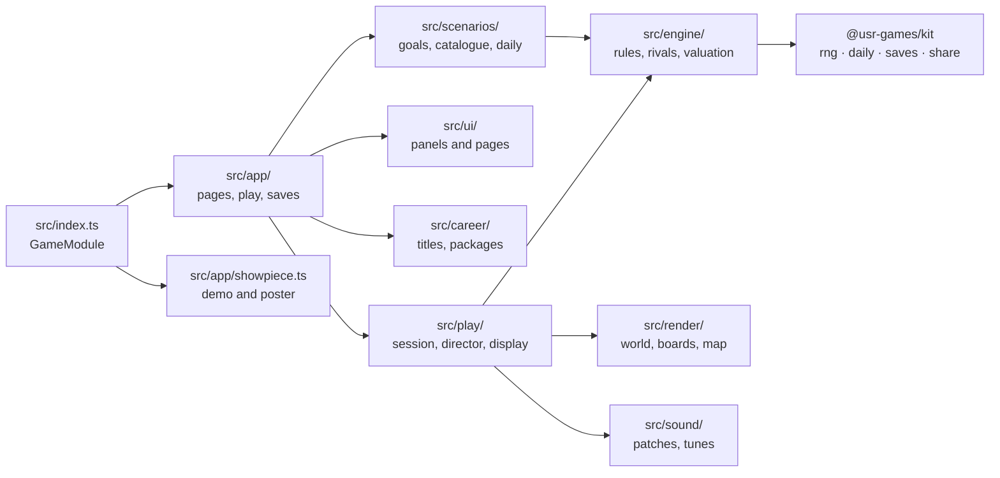
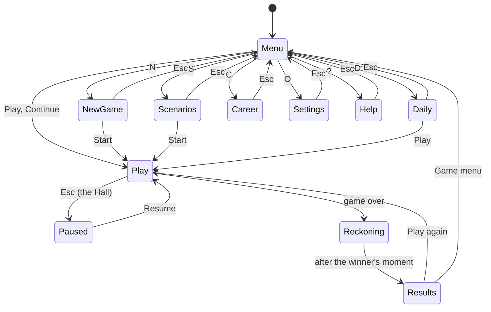

# Deeds & Dice — architecture

## Overview

A native game for the Hall, in TypeScript. A pure rules engine (no DOM, no clock) drives three
WebGL miniature towns drawn with three.js (ADR 0001), a flat 2D map drawn on a canvas, and DOM
panels for everything a player reads. About 21,000 lines of source and 1,800 of unit tests.

## Module map

| Path                         | Responsibility                                                                                                      |
| ---------------------------- | ------------------------------------------------------------------------------------------------------------------- |
| `src/index.ts`               | `mount`, `demo`, `poster`, `achievements` (the kit contract)                                                        |
| `src/engine/`                | State, rules, Markov landing odds, valuation, rival minds, coach, economy, simulation, the ledger                   |
| `src/scenarios/`             | Goals and the referee, restrictions, the 24-scenario catalogue, the proving pilot, the Daily Deal                   |
| `src/career/`                | Titles, unlocks and the twelve packages, all pure                                                                   |
| `src/play/`                  | `PlaySession` (moves, rivals, saving), `Director` (events into moments), display model, view model, words           |
| `src/app/`                   | `DeedsApp` (pages, games, recap, career), `PlayScreen` (input and panels in play), saves, game specs                |
| `src/ui/`                    | DOM panels and pages: HUD, trade table, auction, debt, recap, menu, setup, scenarios, daily, career, settings, help |
| `src/render/world/`          | The shared world: stage and post-processing, lots, scenery, tokens, hulls, overlays, weather, camera                |
| `src/render/boards/`         | Each board's art: Harbour City, Ring Colony, Pop-up 1904, and what they share                                       |
| `src/render/map/flat-map.ts` | The Map view                                                                                                        |
| `src/sound/`                 | Synth patches, the three tunes, `TableSound`                                                                        |
| `dev/`                       | The workbench: game host, staged scenes for frames, staged tables                                                   |
| `scripts/`                   | Economy simulation, payback tables, the scenarios' proof                                                            |

## State machine

Inside play, the engine's own phases (turn, buy, auction, trade, debt, tax choice, after, over)
are drawn in NOTES.md, "The turn".

## Engine

- **The state is plain data** (`engine/types.ts`):
  - seats, deeds, the decks' order, the phase;
  - the seeded generator's state (the kit's sfc32);
  - the net-worth history.

  `apply(state, action)` checks a move with `whyNot`, which gives a reason a player can act on.
  It then changes the state in place and returns events. Saving is JSON; replaying a seed replays
  the game.

- **Economy:** our own formula, tuned by simulation (ADR 0002). Every board shares the same
  numbers.
- **The ledger** (`engine/ledger.ts`) keeps one seat's story from the events: deeds bought,
  districts held, buildings, rent taken, trades, bargains, lock-ups, debt, knockouts. The
  referee, the packages and the career read it.
- **Scenarios** (`scenarios/`):
  - Goals are data, judged after every move. A goal about the end waits for the final round.
  - Restrictions apply to the player only.
  - A scenario's table is set through the session's `prepare` hook.
  - The proof (`scripts/scenarios.ts`, and a lighter watch in the unit tests) plays each scenario
    with `Pilot`, a hard rival's mind that chases the goals.
- **The Daily Deal** picks the day's scenario from a shuffle that changes every 24 days. Its dice
  are the first of the day's seeds the pilot wins on.

## AI

Rivals (`engine/ai.ts`, ADR 0003) share one valuation:

- landing odds from a 123-state Markov chain;
- expected rent by building level;
- a net-present value per deed and per district.

A personality is a parameter set: cash cushion, appetite, district focus, building drive,
willingness to borrow, trading eagerness and margin. The level sets how precisely a rival sees
those numbers. Every move is legal by construction, and trades carry one sentence. There is no
wall clock anywhere: decisions are pure functions of the state and the rival's own seeded stream.

## Where visuals are defined

| Visual                                         | Defined in                                                             | Change it by                                       |
| ---------------------------------------------- | ---------------------------------------------------------------------- | -------------------------------------------------- |
| Picture pipeline (tilt-shift, bloom, grade)    | `render/world/stage.ts`, `tiltshift.ts`                                | each board's `look(dark)`; quality in `setQuality` |
| A board's sky, light, ground, park, scenery    | `render/boards/harbour.ts`, `colony.ts`, `popup.ts` (`setup`)          | the board's palette and setup functions            |
| Buildings per level and landmarks              | `harbour-buildings.ts`, `colony-buildings.ts`, `popup.ts`, `common.ts` | the board's `lot()`                                |
| Boats and ferries                              | `render/boards/harbour-boats.ts`, `render/world/hulls.ts`              | hull specs and the boat functions                  |
| Cars, rovers, people, lamps, trees             | `render/world/scenery.ts`                                              | `traffic()` parts, styles passed by each board     |
| Tokens                                         | `render/world/tokens.ts`                                               | one function a figure                              |
| Owner flags, sale boards, building sites       | `render/boards/common.ts`                                              | `ownerFlag`, `saleBoard`, `constructionKit`        |
| Bunting, debt boards, the winner's light, dust | `render/world/overlays.ts`                                             | the overlay functions                              |
| Clouds, rain, meteors                          | `render/world/weather.ts`                                              | `harbourWeather`, `colonyWeather`                  |
| Daylight drifting to evening                   | `BoardWorld.setProgress` in `render/world/world.ts`                    | `setDay`                                           |
| Career touches (pennants, statue, gold)        | `Honours` in `render/world/world.ts`                                   | `raiseStatue`, the token's gold rim                |
| First-landmark celebrations                    | each board's `signature()`                                             | the board file                                     |
| Camera shots                                   | `play/director.ts`; `landmarkShot` and `followShot` per board          | the board's art                                    |
| The flat map                                   | `render/map/flat-map.ts`                                               | `paintTile`, `paintTokens`                         |
| Panels and pages                               | `ui/*.ts`, `ui/styles.css`                                             | the view types and CSS; colours per board and look |

- **Light and dark** are two designs per board, chosen by the Hall's appearance and rebuilt live
  (`BoardWorld.setDark`). The panels take their colours from `data-board` and `data-look` on the
  game's root.
- **Reduced motion** cuts several things:
  - camera glides and token walks;
  - construction steps;
  - coin flights;
  - weather;
  - the length of celebrations.
- **Graphics.** Light quality drops shadows, the blur passes, bloom and extra pixels. Automatic
  switches to light for the rest of the visit after two four-second stretches in a row under
  40 frames a second (`DeedsApp.watchFrames`).

## Adding a board

The rules, the economy and the 40-space loop are shared; a board is names, art and sound. Add its
id to `BoardId` and `BOARD_IDS` (`src/boards/themes.ts`), then fill every table TypeScript then
asks for:

1. **Its theme** in `BOARDS`: the name, the 40 spaces' names, the district colours, the decks and
   the tokens (`src/boards/themes.ts`, emblems in `emblems.ts`).
2. **Its card texts** in `src/engine/cards.ts` (the effects are shared, the words are the board's)
   and its words for transit in `play/view.ts` and `scenarios/goals.ts`.
3. **Its art**: a `BoardArt` in `src/render/boards/`, registered in `arts.ts`. It needs a layout
   (`SQUARE_LAYOUT` or `RING_LAYOUT`), `setup`, `lot`, `token`, `signature` and `look` for both
   appearances; `animate`, `weather`, `statueSpot`, `landmarkShot` and `followShot` are optional.
4. **Its sound**: a bed and calls, a tune, and its voices for building, buying and a landmark
   (`src/sound/patches.ts`, `music.ts`).
5. **Its panel colours** for both looks under `.dd-app[data-board='…']` in `src/ui/styles.css`.
6. **Its chapter of eight scenarios** in `src/scenarios/catalogue.ts`, proved with
   `pnpm --filter @usr-games/game-monop scenarios 200`.
7. **The career's records** (`winsByBoard`, `tokens` in `src/career/career.ts`), with a migration
   of the `career` save.

The menu's 1–3 keys follow `BOARD_IDS`, so a fourth board needs a fourth key.

## Where sounds are defined

Everything is a kit synth patch; there are no audio files.

| Sound                                                        | Patch                                                          | Plays when                          |
| ------------------------------------------------------------ | -------------------------------------------------------------- | ----------------------------------- |
| Beds: surf, the colony's hum, a study's hush                 | `sound/patches.ts#BEDS`                                        | a scene is up, sound on, not paused |
| Calls: waves, gulls, a ferry horn; beeps, an airlock; a page | `sound/patches.ts#CALLS`                                       | now and then over the bed           |
| Tunes: Tide Waltz, Orbit Drift, Box Tune                     | `sound/music.ts#TUNES`                                         | bar by bar, with rests, music on    |
| Dice, step, coins, pay day, card, gavel, bid                 | `DICE`, `STEP`, `coinsPatch`, `SALARY`, `CARD`, `GAVEL`, `BID` | the matching engine event           |
| Building a storey                                            | `BUILD[board]`                                                 | a storey goes up                    |
| Buying                                                       | `BUY[board]`                                                   | a deed is bought                    |
| Lock-up, release, debt, deal, refusal, leaving               | `LOCKUP`, `FREE`, `DEBT`, `DEAL`, `NO_DEAL`, `OUT`             | the matching event                  |
| A district whole; a first landmark                           | `DISTRICT`; `LANDMARK[board]`                                  | the director's moments              |
| The end                                                      | `finale(won)`                                                  | the final reckoning                 |
| Pages                                                        | `SELECT`, `BACK`                                               | moving between the menu's pages     |

## Hall integration

- **`reportResult`** sends the player's outcome (`win`/`loss`) and their net worth as the score.
  - Stats: `games`, `wins`, `netWorth`, `landmarks`, `districts`, `deals`, and `scenariosWon` for
    scenarios.
  - XP events: `landmark` (8 each, up to 16), `district` (5 each, up to 10), `scenario-won` (12).
  - `daily` is true on the day's first Daily Deal.
  - `presentation: 'game'`: the game shows its own recap.
- **Packages:** `career/packages.ts`, mirrored in `manifest.json`, installed when a game ends.
- **Pause menu:** Coach (C, not in the Daily), Map view (V), Music, New game or Restart the
  scenario.
- **Daily numbering and share** come from the kit: `context.daily`, `composeShare`.
- **Saves** go through `context.save`:
  - `settings` v2, the player's choices (migrated from v1, which held only the coach);
  - `career` v1;
  - `game` v1, the game in progress: its spec, the engine state, the chronicle, the ledger and
    the seconds played.
- **The attract mode and poster** (`app/showpiece.ts`).
  - The demo is a town some forty turns in on a board picked by the seed, the camera drifting
    round it, silent, stopped off screen.
  - The poster renders Harbour City once off screen, copies the frame and frees the GPU context.
    Animated, it drifts the still.

## Tests

| Test               | Command                                                 | What it proves                                                                                                                                                                                                                                                                                  |
| ------------------ | ------------------------------------------------------- | ----------------------------------------------------------------------------------------------------------------------------------------------------------------------------------------------------------------------------------------------------------------------------------------------- |
| Unit tests (129)   | `pnpm exec vitest run --root games/monop`               | Rules and Berkeley faithfulness, the Markov odds against brute force, rivals never taking clearly bad trades, economy and coach, scenarios (referee, restrictions, 40-seed proof, the Daily's 30 days), career and packages, sound mapping, save and resume, the action bar at the Berkeley tax |
| Economy simulation | `pnpm --filter @usr-games/game-monop simulate`          | The tables in NOTES.md                                                                                                                                                                                                                                                                          |
| Scenarios' proof   | `pnpm --filter @usr-games/game-monop scenarios 200`     | Every scenario won by the pilot on 23–94 % of 200 seeds                                                                                                                                                                                                                                         |
| Hero frames        | `pnpm exec playwright test -c games/monop --grep @hero` | The 14 frames in `media/hero/`                                                                                                                                                                                                                                                                  |
| The slice          | `--grep @slice`                                         | A staged game by keys and mouse (recorded), the night table, a whole game to the recap                                                                                                                                                                                                          |
| Stage 4            | `--grep @stage4`                                        | Both other boards to the recap, a scenario, the Daily share, hot seat, career touches                                                                                                                                                                                                           |
| Stage 5            | `--grep @stage5`                                        | Continue after a reload, the map, settings that stick, the final reckoning                                                                                                                                                                                                                      |
| In the Hall        | `--grep @hall`                                          | Escape out of the menu, the pause items, a scenario by keys to the recap with the Hall's receipt, H home, no request beyond the Hall                                                                                                                                                            |

The suites start what they need if it is not running: the workbench
(`pnpm --filter @usr-games/game-monop dev`, port 5294) and, for `@hall`, a Hall of the game's own
on port 5314 (`MONOP_HALL_PORT` moves it).

## Kit candidates

- **A per-game "how far through" daylight for 3D scenes** is board-specific; nothing to share yet.
- **`TableSound`'s bar-by-bar tune player** (`sound/table.ts`, `sound/music.ts`) could become a
  kit `playTune(synth, tune)` for any game with music.
- **The poster's render-once-and-free approach** (`app/showpiece.ts`) suits any WebGL game.
- **The progression model's row for `monop`** (`packages/kit/src/progression/sim/collection.ts`)
  should become `['monop', 'board', 20, 90, true]`. The kit owner's to change.
