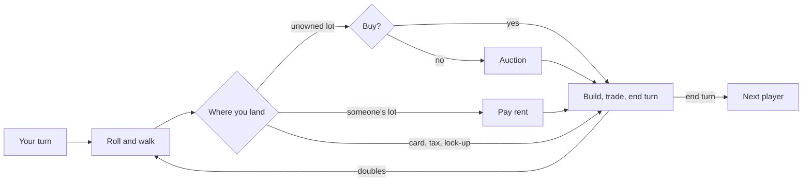

# How to play Deeds & Dice

## Goal

In a **Quick game** the richest player when the last round ends wins. Richest means coins, plus
every deed at its price (half when mortgaged), plus every building at cost. In **Classic**,
play on until one player is left standing. A **scenario** has goals of its own, shown on the board
badge with how far along you are.

## Controls

| Action                               | Keyboard                      | Mouse                               | Remappable |
| ------------------------------------ | ----------------------------- | ----------------------------------- | ---------- |
| Roll the dice                        | Space                         | Roll                                | no         |
| Buy the lot / send it to auction     | B / P                         | Buy / Auction it                    | no         |
| Build list                           | H                             | Build                               | no         |
| Mortgage, sell and pay-off list      | M                             | Mortgage                            | no         |
| Trade table                          | T                             | Trade                               | no         |
| End your turn                        | E                             | End turn                            | no         |
| Lock-up: pay the fine / use a pardon | F / U                         | Pay 60 / Use pardon                 | no         |
| Berkeley income tax: flat / a tenth  | F / W                         | Pay 180 / Pay a tenth of your worth | no         |
| The main choice                      | Enter                         | the highlighted button              | no         |
| Rows in a list, bids, trade partners | 1–9                           | click the row                       | no         |
| Counter an offer                     | C                             | Counter                             | no         |
| Skip the moment on screen            | Enter or Space while it plays | —                                   | no         |
| Map view or the town                 | V                             | Map view / Town view under the name | no         |
| Look at a lot                        | Arrow keys                    | click the lot                       | no         |
| Close what is open                   | Esc                           | Close                               | no         |
| Pause                                | Esc                           | the Hall's pause button             | no         |
| Play again (results)                 | R                             | Play again                          | no         |
| Back to the Hall (results)           | H                             | Back to the Hall                    | no         |
| Share the Daily Deal's line          | S                             | Share                               | no         |

On the game menu, 1–3 pick the board, Enter plays (or continues a saved game), N opens a new game,
S the scenarios, D the Daily Deal, C your career, O settings and ? this manual. Esc goes back from
any page.

## Rules

1. **Your turn.** Before or after rolling you may build, mortgage and trade. Roll two dice and
   walk the loop; passing or landing on the start pays you.
2. **Landing.**
   - A lot nobody owns: buy it at its price, or pass. Under Standard rules a passed lot goes to
     auction, and anyone may bid, you included.
   - Someone else's lot: pay their rent.
   - A card space: draw from that deck and do what it says.
   - A tax space: pay.
   - The corner across from the lock-up sends you there.
3. **Doubles** roll again. A third double in one turn sends you straight to the lock-up.
4. **The lock-up.** Pay the fine, use a pardon card or try for doubles. After the third miss you
   pay and walk out. You still collect rent while you are inside.
5. **Districts.** Own every lot of a district and its bare rent doubles, and you may build on it:
   - storeys one at a time and evenly, never more than one ahead of the rest;
   - after four storeys, the landmark;
   - no lot in the district may be mortgaged while you build.
6. **Transit stops** charge more for every one their owner holds. **Utilities** charge a multiple
   of the dice.
7. **Money.** Mortgage a lot for half its price (it earns nothing until paid off, at a tenth
   more). Sell storeys back for half their cost.
8. **Debt.** If you go below zero, raise the money before play goes on: sell, mortgage or trade.
   If you cannot, you leave the game, and what you own goes to whoever you owe (or back to the
   bank).
9. **Trading.** Offer any mix of deeds and coins to anyone between rolls. Rivals accept, refuse
   with a reason, or send a counter-offer you can accept, refuse or counter in turn. Under
   Standard rules a district with buildings cannot change hands until they are sold.

### Two rule sets

|                              | Standard                         | Berkeley 1980 (the original program)                                    |
| ---------------------------- | -------------------------------- | ----------------------------------------------------------------------- |
| Buying, building, paying off | You need the coins               | The bank lends; fix the debt after                                      |
| A passed lot                 | Auctioned                        | Auctioned only while more than two are playing                          |
| Buildings                    | 34 storeys and 12 landmarks      | No limit                                                                |
| Trading a built district     | Not until its buildings are sold | Allowed; buildings left behind earn bare rent                           |
| Utility rent                 | The dice that moved you          | A fresh roll                                                            |
| The first tax                | A flat sum                       | Choose a tenth of your worth or the flat sum, before you see your worth |

### House rules

Each is a switch on the New game page, off by default:

- **A pot on the rest space.** Taxes and card payments go into a pot; whoever lands on the rest
  space takes it.
- **Double pay on the start.** Landing exactly on the start pays twice.
- **No rent from the lock-up.** An owner sitting in the lock-up collects nothing.

## Modes

| Mode          | What changes                                                                                                                                                     |
| ------------- | ---------------------------------------------------------------------------------------------------------------------------------------------------------------- |
| Quick game    | The menu's game: you against Dex the dealmaker and Marlowe the builder, about thirty minutes; richest at the end wins.                                           |
| New game      | Your board, two to six seats (rivals of any personality and level, or friends at this screen), Quick or Classic, either rule set, the house rules, the coach.    |
| Classic       | Play on until one player is left.                                                                                                                                |
| Scenarios     | Twenty-four short puzzles, eight a board, on a table already in play; each has goals, a number of turns and sometimes rules of its own (no streets, no trading). |
| Daily Deal #N | One scenario for everyone today, on the same dice, with the coach off. Your first try counts; you may play it again for fun.                                     |

**Continue.** A game in progress saves itself whenever it waits for you, so you can leave and
come back. Starting a fresh game while one is saved asks for a second press.

**Friends at the same screen** take their own turns with the same controls; the banner says whose
turn it is. The game counts for your career only.

## Settings

The Hall's settings (appearance, volume, motion, palette) apply everywhere. These are the game's
own:

| Setting            | Options                  | Default   |
| ------------------ | ------------------------ | --------- |
| Sound effects      | on · off                 | on        |
| Music              | on · off                 | on        |
| Cinematics         | on · off                 | on        |
| Map view           | on · off                 | off       |
| Graphics           | Automatic · Full · Light | Automatic |
| Coach in new games | on · off                 | on        |

The coach can also be switched from the pause menu (C), and Map view with V. Reduced motion cuts
camera glides, stop-motion building, coin flights and the weather, whatever the switches say.

## Scoring

Net worth is coins plus deeds at price (half when mortgaged) plus buildings at cost. The recap
charts every player's worth turn by turn and names the turning point. Your best worth for the
career counts only from Quick and Classic games played without the coach.

The Daily Deal's share line reads `Deeds & Dice #46 · won in 6 turns · 🏙️ 0 towers · 🤝 1 deal`,
or `not this time` when it got away. A tower is a lot you built on; a deal is a trade.

## Career

| Title     | Earned by                         | Opens                                       |
| --------- | --------------------------------- | ------------------------------------------- |
| Tenant    | —                                 | three tokens on every board                 |
| Landlord  | 1 win                             | a fourth token; gold pennants on your flags |
| Developer | 3 wins and a best worth of 5,000  | a fifth token; your statue in town          |
| Magnate   | 8 wins and a best worth of 7,500  | every token; a golden base                  |
| Tycoon    | 15 wins and a best worth of 9,000 | a gilded statue and flagpoles               |

Wins count from Quick and Classic games, each scenario's first win and each Daily Deal won. Every
touch on the boards can be switched off on the career page.

## Achievements (packages)

| Package          | How to earn it                                            |
| ---------------- | --------------------------------------------------------- |
| `first-deed`     | Buy your first deed.                                      |
| `full-set`       | Hold every lot of a district.                             |
| `skyline`        | Raise a landmark.                                         |
| `deal-maker`     | Make three trades in one game.                            |
| `daily-regular`  | Play the Daily Deal on seven different days.              |
| `never-jailed`   | Win a Quick or Classic game without once being locked up. |
| `transit-baron`  | Own all four transit stops at once.                       |
| `comeback`       | Fall into debt, climb out of it, and win.                 |
| `auctioneer`     | Win a lot at auction for less than its price.             |
| `berkeley-rules` | Win a game under the Berkeley 1980 rules.                 |
| `scenario-12`    | Win twelve different scenarios.                           |
| `all-boards`     | Win on Harbour City, Ring Colony and Pop-up 1904.         |

## XP

This game reports results to the Hall: a completed session, the first win of the day, the daily
challenge and packages all earn XP (see the Hall's rules). Its own XP events are a landmark (8
each, up to 16), a district finished (5 each, up to 10) and a scenario won (12). Weekly cron goals
ask you to win games, raise landmarks or make trades.

## Tips

- Districts win games. A whole district with three storeys earns many times its bare rent; aim
  your buying and trading at finishing one.
- The middle districts are landed on most. With the coach on, the warm glow shows where.
- A rival's counter-offer tells you what the deal is worth to them. If the coach's meter leans
  your way, the extra may still be worth paying.
- Under Berkeley rules the bank lends: buy boldly, but keep something you can mortgage.
- A scenario's goal is all that counts. "Finish the richest" is a different game from "own all
  four ferries".
