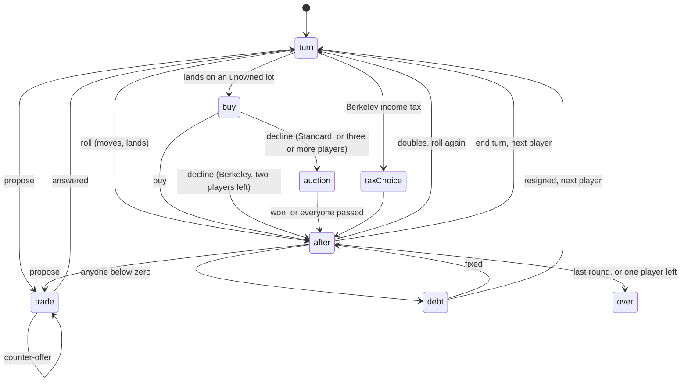
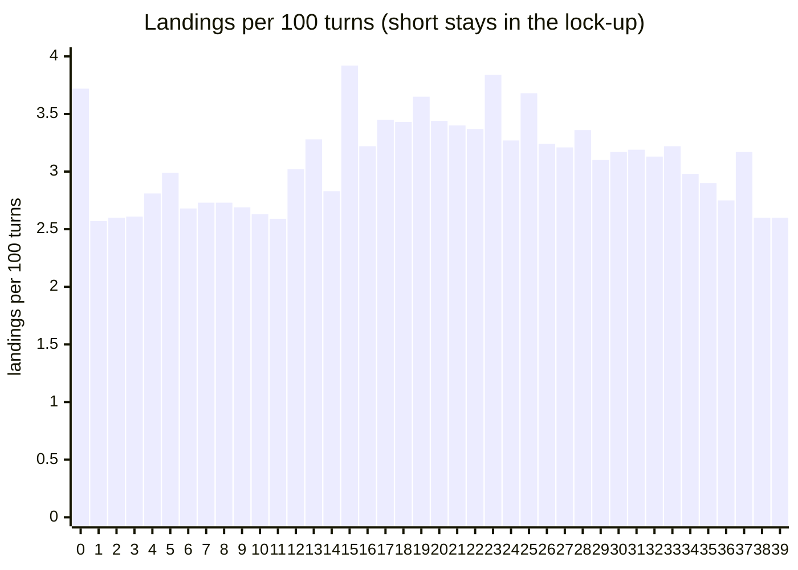
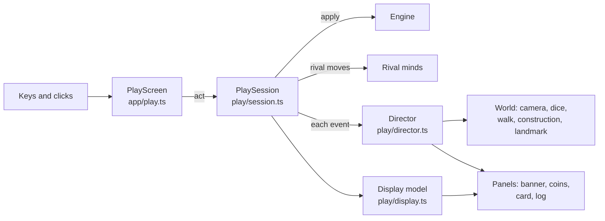
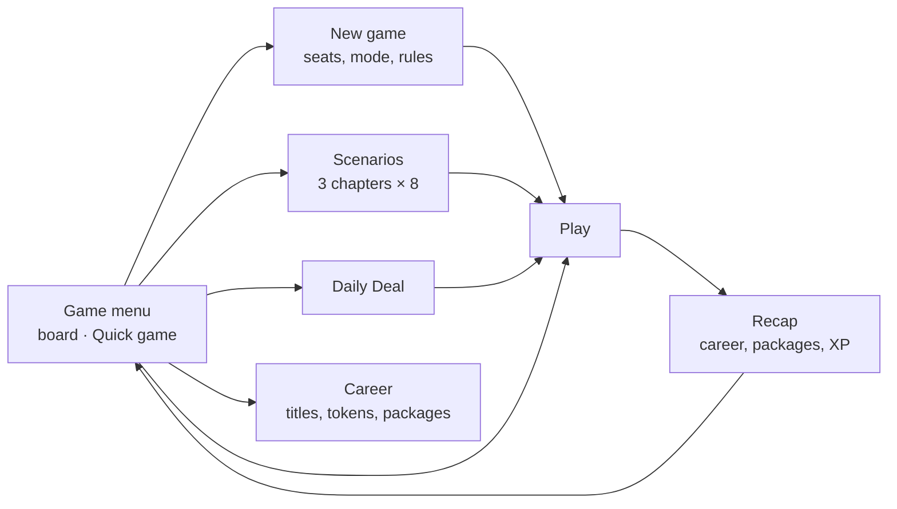

# Deeds & Dice — notes

The lab notebook: verified facts about the original, the name check, and the record of each
stage. Stage 1 (hero frames) was written on 2026-10-15; stage 2 (engine, rivals, economy),
stage 3 (the vertical slice), stage 4 (both other boards, scenarios, the Daily Deal and the
career), stage 5 (sound and polish) and stage 6 (critique, performance, the Hall) on 2026-10-16.

## Source

Read-only: `E:\Projects\BSDGames\BSDGames-master\monop`, the bsd-games packaging of the NetBSD
sources (file revisions from 2003–2004). References are `file:line` there. No message, card text,
board name, price or rent from it is used anywhere in this game.

- **Licence:** © 1980, 1993 The Regents of the University of California, BSD 3-clause
  (`monop.c:3-29`, the same header in every source and data file). The manual page names Ken Arnold
  as the author (`monop.6.in:175-176`); the C files do not.
- **`malloc.c`:** Chris Kingsley's 1982 Caltech allocator, © 1983, 1993 Regents
  (`malloc.c:4,41-50`).
- **The data files reproduce a commercial edition.** `brd.dat`, `prop.dat` and `cards.inp` carry
  the classic US board's street names, prices, rents and card wording, and the manual page names the
  commercial game (`monop.6.in:37,43`). The BSD licence covers the code, not those names and texts,
  so this game uses neither: every board, price, rent and card is our own (prompt 15 §0).

## The hooks, verified

| Claim                                                                      | Verdict            | Evidence                                                                                                                                                                                                                                                                                                                                              |
| -------------------------------------------------------------------------- | ------------------ | ----------------------------------------------------------------------------------------------------------------------------------------------------------------------------------------------------------------------------------------------------------------------------------------------------------------------------------------------------- |
| No computer players: it referees 1–9 people at one terminal                | True               | "Monitors" a game for 1–9 users (`monop.6.in:42-45`); the count is checked against 1..9 (`monop.c:113-115`, `monop.h:49`); every decision is typed in (`getinp.c:52-106`). One player is allowed.                                                                                                                                                     |
| The bank lends: you may buy what you cannot afford, then must fix the debt | True, with caveats | Buying never checks cash (`execute.c:158-162`); the fix-it loop runs while cash is **at or below** zero (`morg.c:220-227`) and offers every command but roll (`morg.c:47-65`). Nothing notices when recovery is impossible. The creditor is not remembered: a resign goes to the owner of the square you stand on, else the bank (`trade.c:249-264`). |
| With two players left, a declined lot is not auctioned                     | True               | `else if (num_play > 2) bid();` (`execute.c:163-164`). It counts players still in the game, not solvent ones.                                                                                                                                                                                                                                         |
| `?` lists the answers; resigning to the bank leaves property "virgin"      | Partly             | `?` works at word and menu prompts only, not at number prompts (`getinp.c:71-91`, `misc.c:93-121`). Resigning to the bank clears owners, mortgages and buildings (`trade.c:296-309`); one jail card goes back to its deck and the cash disappears.                                                                                                    |
| Its own memory allocator; a beauty-contest card pays 11                    | True / True        | `malloc.c` is built in (`Makefile.bsd:7-8`) because saving dumps the heap. The card pays 11 (`cards.inp:35-37`).                                                                                                                                                                                                                                      |

## How the original plays (verified, in our words)

- **Turn.** The player may give any commands first (build, mortgage, trade, look), then rolls with
  RETURN. Doubles roll again; the third double goes to jail without moving (`execute.c:98-103`).
  Landing: card squares draw, taxes are paid, an unowned lot is offered at its price, someone
  else's lot charges rent (`execute.c:133-171`). The game ends only when one player is left; there
  is no time or round limit (`trade.c:321-327`).
- **Rent.** Mortgaged lots charge nothing; a complete group doubles bare rent; buildings use the
  rent ladder; transit rent doubles with each one owned; a utility multiplies a **fresh** dice roll
  by 4, or 10 with both (`rent.c:46-96`). An owner in jail still collects.
- **Jail.** Pay a fine before rolling, use a card, or roll doubles; the third failed roll pays and
  moves (`jail.c:47-120`). Paying is not checked against cash.
- **Cards.** Two decks of 16, shuffled once and dealt in a cycle (`cards.c:113-138`). Effect types:
  collect, collect from each player, pay, pay each player, advance to a square, go back, go to jail,
  nearest transit (double rent), nearest utility (ten times the dice), repairs per building (rates
  fixed per deck in code, not in the card file), get out of jail (`cards.c:127-225`).
- **Building.** Only on a complete, unmortgaged group, at most five per lot (the fifth is the top
  building), spread evenly with at most one between lots (`houses.c:67-152`). **No building
  supply limit.** Selling returns half the cost (`houses.c:225`).
- **Mortgage.** Pays half the price; lifting costs half plus a tenth (`morg.c:139-214`). A lot with
  buildings cannot be mortgaged, but its neighbours may still have buildings.
- **Trade.** Lots (mortgaged or built), cash and jail cards; one yes or no at the shared keyboard
  (`trade.c:64-237`).
- **Save and restore** dump and reload the heap (`execute.c:173-272`); in this copy the board and
  players live outside the heap, so a restore cannot work.
- **Quirks:** doubles onto go-to-jail keep the turn (`execute.c:98-107`); a player in debt on their
  own lot "resigns to themselves" (`trade.c:253-254`); debt is only enforced on the current player
  (`monop.c:88`); trading a lot out of a built group strands its buildings (`houses.c:180-181`,
  `rent.c:72-73`); exactly zero cash counts as debt (`morg.c:224`); the dice can very rarely roll a 7
  (`roll.c:77`).

## Name check (2026-10-15)

"Deeds & Dice" and "Deeds and Dice": no board game, video game, app or trademark found under
either (web search; BoardGameGeek and Steam; app stores; US trademark mirrors). Nearest neighbours,
not conflicts: _Dicey Deeds_ (a 2022 game-jam platformer) and _Good & Bad Deeds_ (a board game).
BoardGameGeek and itch.io refused direct queries, so a two-minute manual search there and on USPTO
before launch would close the gap. **Verdict: clear.**

## Stage 1 — hero frames (2026-10-15)

Fourteen live frames at 1920 × 1080 in `media/hero/`, rendered by `e2e/hero.spec.ts` from the
workbench's staged scenes (`dev/scenes.ts`): each board mid-game (a street going up, a token on the
move, the play panels) and at its first-landmark moment, light and dark, and the trade table with a
rival's counter-offer on Harbour City.

| Board        | Light look                                    | Dark look                                        | First landmark                                          |
| ------------ | --------------------------------------------- | ------------------------------------------------ | ------------------------------------------------------- |
| Harbour City | Morning sun on an island town, sails, ferries | Neon in the district colours, lit windows, lamps | Lighthouse Hill's lighthouse with fireworks             |
| Ring Colony  | Sunlit deck under a ringed gas giant          | Night side: glowing rings, domes, an aurora      | The Observatory lights up, a shuttle lands beside it    |
| Pop-up 1904  | A picture book in window light on a desk      | The book under a reading lamp, long warm shadows | College Hill's clock tower folds up with paper confetti |

- **Critique rounds:** Harbour City went through eight (framing, district buildings, the park,
  night light, the landmark set, the fireworks); Ring Colony four (the dome, the sky and planet,
  habitat families, the landing moment); Pop-up 1904 three (tokens, the fold, the lamp's fill).
- **Frame rate while shooting:** 60–61 fps at 1920 × 1080 on the workbench for every board in both
  looks, all lots built and traffic running (the same machine as the other sessions, GPU on).
- **Economy in the panels is provisional** (`src/engine/economy.ts`, our own formula); stage 2 tunes
  it by simulation.

## Stage 2 — rules engine, landing odds, rivals and economy (2026-10-16)

Everything in `src/engine/` is plain TypeScript with no DOM and no clock. Every random number
comes from the seeded generator kept in the state, so a game saves as JSON and replays exactly.
Tests: 81 (`pnpm exec vitest run --project monop`).

### The turn

- `apply(state, action)` checks the move with `whyNot`, which returns a reason a player can act
  on ("You need 40 more coins.", "Build evenly: the other lots in the district come first."),
  then carries it out and returns events for the interface to animate.
- **Debt.** Anyone pushed below zero gets the fix-it panel in turn, starting from the current
  player. They can sell, mortgage, trade or resign, and play resumes where it stopped. This
  covers players pushed under by a card that charges everyone, which the original never made
  them fix (`monop.c:88`).
- **The creditor.** The first payment that takes a player below zero records who they owe. The
  original guessed it from the square they stood on (`trade.c:249-264`).

### Standard and Berkeley 1980

| Behaviour                            | Standard                             | Berkeley 1980 (the original, verified)                          |
| ------------------------------------ | ------------------------------------ | --------------------------------------------------------------- |
| Buying, building, lifting a mortgage | Needs the coins                      | The bank lends; fix the debt after (`execute.c:158-162`)        |
| A declined lot                       | Auctioned                            | Auctioned only with more than two players (`execute.c:163-164`) |
| Buildings                            | 34 storeys and 12 landmarks in stock | No limit (`houses.c`)                                           |
| Trading a lot from a built district  | Not until its buildings are sold     | Allowed; the buildings left behind earn only bare rent          |
| Mortgaging                           | The whole district must be bare      | Only the lot itself must be bare (`morg.c:122-129`)             |
| Utility rent                         | The dice that moved you              | A fresh roll (`rent.c:82-92`)                                   |
| Tax at space 4                       | Flat                                 | Choose a tenth of your worth or the flat sum, before seeing it  |
| A debtor resigning to their creditor | Creditor gets what the debtor had    | Creditor keeps the full rent; the debt goes nowhere             |

- **Both rule sets:**
  - three doubles go to the lock-up without moving;
  - doubles out of the lock-up move with no roll again;
  - the third failed try pays the fine and moves;
  - resigning to the bank leaves every lot unowned, unmortgaged and bare, and puts the pardon
    cards back in their decks;
  - mortgage at half the price, lifted at half plus a tenth;
  - even building and selling;
  - a complete district doubles bare rent even with a lot mortgaged;
  - transit fares climb with every stop owned, mortgaged ones included.

  Faithfulness tests in `game.test.ts` cover each of these.

- **Not reproduced, being bugs:**
  - doubles onto the lock-up keeping the turn;
  - resigning to yourself;
  - debt enforced only on the current player;
  - zero coins counting as debt;
  - the seventh face of the dice;
  - returning only one pardon card on resignation;
  - the biased shuffle.

  Decks are shuffled fairly once and dealt in a cycle, as in the original.

- **House rules** (each a switch, off by default):
  - a pot on the rest space for taxes and card payments;
  - double pay for landing exactly on the start;
  - no rent while the owner is in the lock-up.

### Landing odds

`markov.ts` is a 123-state chain:

- 40 squares × doubles so far (0–2);
- three lock-up states;
- every card that moves a token.

Leaving the lock-up at once ("short") gives 1.187 rolls a turn and 0.047 trips to the lock-up a
turn; rolling for doubles ("long") gives 1.166 rolls and 0.044 trips. The brute-force test plays
the real engine for 96,000 turns per stay, and every space must agree within 0.0035.

### Economy

The figures come from our own formula (ADR 0002); `pnpm --filter @usr-games/game-monop simulate`
reproduces every table below, and `scripts/tables.ts` prints the price table and the chart.

- **Starting purse and salary:** 1,600 coins to start, plus 50 for each seat after the first;
  220 for passing or landing on the start.
- **Taxes and fine:** taxes of 180 (space 4) and 90 (space 38); a lock-up fine of 60.
- **Transit stops:** 190 each; fares 30 · 60 · 110 · 210 with one to four owned.
- **Utilities:** 160 each; 5 or 12 times the dice with one or both.
- **Buildings in stock (Standard rules):** 34 storeys and 12 landmarks.
- **Card amounts and targets:** our own. The 11-coin second prize stays, as the nod to the
  original.

| Space | Harbour City name   | Price | Rent: bare · 1 · 2 · 3 · 4 storeys · landmark | Storey |
| ----: | ------------------- | ----: | --------------------------------------------- | -----: |
|     1 | Net Loft Lane       |    70 | 4 · 20 · 50 · 130 · 170 · 215                 |     45 |
|     3 | Rope Walk           |    90 | 6 · 25 · 80 · 190 · 250 · 325                 |     45 |
|     6 | Market Steps        |   110 | 8 · 35 · 105 · 255 · 335 · 430                |     55 |
|     8 | Ice House Row       |   120 | 8 · 35 · 105 · 255 · 335 · 430                |     55 |
|     9 | Chowder Court       |   140 | 10 · 45 · 130 · 320 · 420 · 540               |     55 |
|    11 | Lock Gate Walk      |   150 | 10 · 45 · 130 · 320 · 420 · 540               |     65 |
|    13 | Barge Row           |   160 | 12 · 55 · 155 · 385 · 505 · 650               |     65 |
|    14 | Swing Bridge Square |   180 | 14 · 65 · 180 · 450 · 590 · 755               |     65 |
|    16 | Mural Street        |   190 | 14 · 65 · 180 · 450 · 590 · 755               |     75 |
|    18 | Kiln Yard           |   200 | 16 · 70 · 210 · 510 · 670 · 865               |     75 |
|    19 | Gallery Row         |   220 | 16 · 70 · 210 · 510 · 670 · 865               |     75 |
|    21 | Signal Street       |   230 | 18 · 80 · 235 · 575 · 755 · 970               |     85 |
|    23 | Keeper's Way        |   240 | 20 · 90 · 260 · 640 · 840 · 1080              |     85 |
|    24 | Beacon Rise         |   260 | 20 · 90 · 260 · 640 · 840 · 1080              |     85 |
|    26 | Sailcloth Avenue    |   270 | 22 · 100 · 285 · 705 · 925 · 1190             |     95 |
|    27 | Mast Lane           |   280 | 24 · 110 · 310 · 770 · 1010 · 1295            |     95 |
|    29 | Regatta Road        |   300 | 26 · 115 · 340 · 830 · 1090 · 1405            |     95 |
|    31 | Glasshouse Avenue   |   310 | 28 · 125 · 365 · 895 · 1175 · 1510            |    105 |
|    32 | Fountain Terrace    |   320 | 28 · 125 · 365 · 895 · 1175 · 1510            |    105 |
|    34 | Observatory Road    |   340 | 30 · 135 · 390 · 960 · 1260 · 1620            |    105 |
|    37 | Clifftop Crescent   |   370 | 34 · 155 · 440 · 1090 · 1430 · 1835           |    115 |
|    39 | Lantern Point       |   390 | 36 · 160 · 470 · 1150 · 1510 · 1945           |    115 |

The names are Harbour City's; the other two boards share the numbers.

Payback in rounds for deeds plus buildings, with two rivals landing (short-stay odds):

| District          | 1 storey |    2 |    3 |    4 | Landmark |
| ----------------- | -------: | ---: | ---: | ---: | -------: |
| 0 Old Docks       |    107.0 | 50.3 | 25.9 | 23.8 |     21.7 |
| 1 Fish Market     |     86.1 | 38.1 | 19.3 | 17.5 |     15.8 |
| 2 Canal Quarter   |     71.2 | 32.5 | 16.0 | 14.4 |     12.9 |
| 3 Arts District   |     59.2 | 25.7 | 12.7 | 11.4 |     10.1 |
| 4 Lighthouse Hill |     54.0 | 23.4 | 11.5 | 10.2 |      9.1 |
| 5 Marina          |     54.9 | 23.9 | 11.6 | 10.3 |      9.2 |
| 6 Skyline Park    |     53.8 | 23.0 | 11.2 | 10.0 |      8.8 |
| 7 Harbour Heights |     54.6 | 23.3 | 11.3 |  9.9 |      8.8 |

Equal paybacks were the first target, and play showed they were not fair (see the tuning record
below). Dear districts come together later and cost more to build, so they now pay back faster.

Landing odds per turn, in percent, when players leave the lock-up at once:

#### The clock

The simulator charges each event its on-screen time. When the event belongs to seat 0 (the
person), or is an offer made to or by them, it also charges thinking time.

| Event                | On screen              | A person also spends |
| -------------------- | ---------------------- | -------------------- |
| Roll                 | 2.5 s                  | 1.5 s                |
| Token walk           | 0.4 s + 0.28 s a space | —                    |
| Card                 | 3 s                    | 2 s                  |
| Rent paid            | 1.5 s                  | —                    |
| Buy                  | 1.5 s                  | 3 s                  |
| Auction              | 5 s, plus 0.8 s a bid  | 6 s                  |
| Storey or landmark   | 1.2 s                  | 2 s                  |
| Mortgage or sale     | 0.8 s                  | 3 s                  |
| Trade made / refused | 2 s / 1 s              | 20 s / 15 s          |
| Debt to fix          | —                      | 10 s                 |
| Lock-up              | 1.5 s                  | —                    |
| Next player          | 1 s                    | —                    |

#### Results (2026-10-16, Medium rivals, mixed personalities)

Quick, Standard rules, by table size:

| Players | Games | Rounds (limit) | Minutes, mean (p10–p90) | Wins by seat, %                         | Trades | Landmarks | Players out |
| ------: | ----: | -------------- | ----------------------- | --------------------------------------- | -----: | --------: | ----------: |
|       2 | 1,500 | 55 (80)        | 22.6 (14.4–30.6)        | 49.1 · 50.9                             |    0.8 |       1.5 |         0.9 |
|       3 | 3,000 | 44 (56)        | 23.2 (16.0–29.3)        | 32.0 · 33.6 · 34.4                      |    2.0 |       2.3 |         1.6 |
|       4 | 1,500 | 41 (48)        | 25.9 (18.6–31.8)        | 26.3 · 24.3 · 25.1 · 24.2               |    3.1 |       3.3 |         2.4 |
|       5 | 1,500 | 38 (42)        | 28.8 (21.7–34.0)        | 21.5 · 20.5 · 18.7 · 19.6 · 19.7        |    3.9 |       3.7 |         2.9 |
|       6 | 1,500 | 36 (37)        | 31.4 (25.3–35.8)        | 18.0 · 17.1 · 17.6 · 17.5 · 15.4 · 14.3 |    4.2 |       3.7 |         3.0 |

Games that end early end because the other players went broke. A game played to its last round
runs about 30 minutes at every table size; that is how the limits were set (0.42 to 0.88 minutes
a round).

Districts, three players, 3,000 Quick games:

| District          | Completed | Its completer wins | Formed first | …and that player wins | Rent a game | Rent ÷ coins spent |
| ----------------- | --------: | -----------------: | -----------: | --------------------: | ----------: | -----------------: |
| 0 Old Docks       |      73 % |               91 % |         10 % |                  44 % |         143 |               0.54 |
| 1 Fish Market     |      74 % |               91 % |         19 % |                  50 % |         516 |               0.82 |
| 2 Canal Quarter   |      76 % |               91 % |         18 % |                  53 % |         657 |               0.81 |
| 3 Arts District   |      79 % |               91 % |         18 % |                  52 % |         887 |               0.85 |
| 4 Lighthouse Hill |      78 % |               92 % |         13 % |                  48 % |         853 |               0.72 |
| 5 Marina          |      74 % |               93 % |          6 % |                  45 % |         694 |               0.56 |
| 6 Skyline Park    |      72 % |               93 % |          2 % |                  45 % |         641 |               0.48 |
| 7 Harbour Heights |      82 % |               89 % |         14 % |                  54 % |       1,090 |               0.87 |

Transit stops took 553 coins of rent a game and utilities 177.

Rivals and levels, three players:

- **Personalities, Medium:** Marlowe 33.7 %, Ottilie 29.1 %, Colette 34.1 %, Dex 37.8 %,
  Stella 32.0 %.
- **One of each level at the table (3,000 games):** Easy 25.1 %, Medium 31.3 %, Hard 43.6 %.

Other rule sets:

- **Berkeley 1980, Quick, three players (1,500 games):**
  - seats 34.0 · 34.6 · 31.4 %;
  - 23.1 minutes;
  - every district's completer wins 91–93 %.
- **Classic, three players (1,500 games):**
  - no game stalled; every one ended with two players broke, after 43 rounds on average
    (p90 66) and 23.8 minutes;
  - seats 30.3 · 33.2 · 36.5 %;
  - about 17 auctions a game, because a deed's price does not count at the end.
- **Classic, four players (1,500 games):**
  - seats 24.9 · 24.4 · 24.1 · 26.5 %;
  - 29.4 minutes.

**Classic is less even than Quick.** With no final reckoning, the dear districts are weaker: the
player who forms Skyline Park first wins 31 % of three-player games (17 % with four), against
55–64 % for the middle districts. Ottilie, the saver, wins 26 % (three players) and 14 % (four).
Quick is the default and is balanced. Tuning Classic on its own is listed for the owner below.

#### Tuning record

- **Quick at 18 rounds was far too short.** After six rounds only 13 of the 28 deeds were sold;
  over 18 rounds no landmark went up and finishing a district barely mattered (its owner won
  35 % of three-player games). Quick's length is now set by the clock.
- **Rivals built one storey at a time and never started,** because a lone first storey never
  pays. They now plan a district's best height.
- **Equal paybacks made dear districts traps.** Skyline Park formed first won 12 %, against 68 %
  for the Fish Market. Searching rent tilt (0–0.6) × storey step (25, 15, 12, 10) over 900–1,500
  games each found 0.4 and 10. The spread of "completer wins" across districts fell from 16
  points to 5.
- **Personalities.**
  - Marlowe won 52 % until every rival could borrow to build, past a bar set by its personality.
  - Ottilie won 20 % until her cushion shrank.
  - A cushion based on expected rent rather than the worst single rent did not change the
    balance; it is kept because it reads better.
- **Difficulty.**
  - Valuation error alone (up to ±35 %) barely changed results, because in Quick nearly every
    deed is worth buying.
  - Borrowing to build turned out to be the skill that matters. Easy never borrows, Medium holds
    up to two mortgages for it, and Hard borrows as the plan needs.
- **The first player's edge.** It grew with the table: at six players seat 0 won 22 % and seat 5
  12 %. A bonus of 60 coins per later seat evened Quick, and 30 evened Classic, so the bonus is 50.
- **Classic stalemates.** 18 games in 600 never ended: two rivals sat on hundreds of thousands
  of coins with the builders' stock used up. The causes were a valuation horizon that shrank
  with the round count, and building costs weighed the same however rich a rival was. The fix:
  a fixed horizon, and a rival with far more coins than it needs builds as if buildings cost
  little. The 250-round long stop is a safety net that the simulations never reached.
- **Our own numbers.** The original's transit fares, utility multipliers and repair rates, and
  the squares the movement cards sent a token to, matched the commercial edition, so all were
  replaced (fares 30 · 60 · 110 · 210, utilities 5 and 12, repairs 35/110 and 30/90, targets
  13, 15, 23 and 37). The balance held (seats 31.1 · 33.7 · 35.3 %).

### Rivals

Five personalities as parameter sets on one valuation, and three levels of sight; see ADR 0003
for the parameters and the trade logic.

- **Medium and Hard never accept a clearly bad trade.** An exact valuation guards every
  acceptance; the test throws hundreds of random offers at rivals in real mid-game positions.
- **Every refusal carries one sentence,** and a stingy offer gets a counter-offer: "I'll take it
  if you add 150: that finishes your Fish Market."
- **The coach (`coach.ts`) reads the same numbers:**
  - landing heat;
  - "A third storey here pays back in about 6 rounds.";
  - a trade meter with each side's gain;
  - the recap's turning point, from a chronicle of trades, finished districts, landmarks,
    cheap auctions and big rents ("The trade on turn 14 decided the game.").

## Stage 3 — the vertical slice (2026-10-16)

A Quick game on Harbour City against Dex (the dealmaker) and Marlowe (the daring builder), both
Medium, from the game menu to the recap. Everything goes through the stage 2 engine; the screen
only tells it.

- **The engine runs ahead; the picture follows event by event.** A move is settled at once (the
  roll, the walk, the rent, a card that moves the token again), and the display model replays
  its events one at a time while the director shows each. When the move is finished, the display
  is set straight from the engine, so it cannot drift.
- **Timing follows the stage 2 clock:**
  - dice 1.25 s;
  - a token walks 0.28 s a space, hopping;
  - a card holds 3 s, or until Enter;
  - rent 1.4 s;
  - a storey 1.2 s;
  - a first landmark 4.2 s;
  - a rival thinks 0.55 s before each move.

  All of it scales with the pace (workbench `?pace=`), and reduced motion cuts walks, tumbles and
  construction.

- **Construction is stop-motion.** A storey rises in eight steps, which suits the miniature. It
  also keeps rebuilding a lot to eight times per storey.
- **The first landmark in a district** is the board's celebration (fireworks over the harbour).
  The camera pulls back and low to frame the tower against the sky, open lists close, and the
  caption ("Lighthouse Hill comes alive") sits above the action bar.
- **The coach** (on by default; Coach in the pause menu and C on the menu):
  - warm discs under the lots by landing odds while it is your move;
  - each lot's card says how often it is landed on and how many rounds a building takes to pay
    back;
  - the trade table's fairness meter shows what each side gains;
  - the recap names the turning point.
- **Keys** (every button has one, every key has a button):

  | Key    | What it does                                                    |
  | ------ | --------------------------------------------------------------- |
  | Space  | Roll                                                            |
  | B / P  | Buy, or let the lot go to auction                               |
  | H      | Build list                                                      |
  | M      | Mortgage list                                                   |
  | T      | Trade table                                                     |
  | E      | End turn                                                        |
  | Enter  | The main choice                                                 |
  | 1–9    | Rows in a list, bids in an auction, partners at the trade table |
  | C      | Counter an offer                                                |
  | Arrows | Walk the lot card round the board                               |
  | Esc    | Closes what is open; otherwise the Hall's pause                 |

  Clicks on lots show their card.

- **Escape:** the game listens in the capture phase so it can claim Escape for its own panels
  before the Hall pauses, and it ignores keys while paused.
- **The person going broke ends their game** with "Out of coins" and the turn it happened.
  The recap also opens when the round limit or the last player standing ends the game.
- **Results** go through `reportResult` (`presentation: 'game'`). The recap's buttons follow the
  collection's order: Play again (R), Game menu, Back to the Hall (H).
- **Staged tables** (`dev/stages.ts`, `?stage=slice`) set a game up ten rounds in through the
  session's `prepare` hook. The scenarios of stage 4 will use the same hook.
- **The workbench autopilot** (`?auto=1`) lets a Medium rival play the person's seat through the
  same `act` path as keys. It is for recordings and soak tests only.

### Measured

- **A whole Quick game** (56 rounds) on autopilot at eight times the pace, 1920 × 1080: 60–61 fps
  throughout.
- **First soak run:** GPU geometries grew from 385 to 2,531, because a rebuilt lot's old meshes
  were never freed.
  - Shared geometries and materials are now marked, and the world releases everything else when
    a lot or a celebration is replaced.
  - Sign and label textures are now painted once per name.
  - After the fix: geometries hold at about 420 and textures at 80 for the whole game.
- **`e2e/slice.spec.ts` (`--grep @slice`):** the staged game by keys and mouse, recorded; the same
  table at night; and a whole Quick game from the deal to the recap with no page errors. All
  three pass.

### Media for the checkpoint

`docs/media/slice/` holds:

- `slice-quick-game.webm` (65 s, 1280 × 720, 8.2 MB);
- ten frames at 1920 × 1080:
  - `01-menu`, `02-table-with-coach-heat`, `03-first-landmark`, `04-trade-offer`,
    `05-counter-offer`, `06-buy-or-auction`, `07-auction`, `08-recap`;
  - two night frames, `09-table-night` and `10-first-landmark-night`.

### The slice review (2026-10-16)

The owner could not tell what the boats and cars were. They were redrawn before the slice was
approved:

- **Hulls** (`render/world/hulls.ts`) are lofted from a plan outline, with a pointed stem, a
  transom, sides that flare from a narrow keel and a deck that rises to the bow, painted in crisp
  vertex-colour bands.
- **Yachts** carry two triangular sails with a little belly. **Ferries** have stepped decks with
  window bands, a bridge with wings, a raked funnel and orange lifeboats
  (`render/boards/harbour-boats.ts`).
- **The tug token** stands on the same hull.
- **Cars** got four wheels, a glass cabin and a roof in their colour. The colony's rovers run on
  six wheels under a glass bubble (`traffic()` takes `vehicle: 'car' | 'rover'`).

## Stage 4 — both other boards, scenarios, the Daily Deal and the career (2026-10-16)

The owner approved the slice on 2026-10-16. Stage 4 opens the whole game: the menu, a table of
your own, twenty-four scenarios, the Daily Deal, the career and its packages, on all three boards.

### Ring Colony and Pop-up 1904 in play

- **Board choice.** Changing the board builds the new town in place of the old one, so the
  menu's backdrop is always the board you are choosing. The keys are 1–3, and the pages that
  belong to a board (the setup, a scenario chapter, the Daily Deal) show it behind them.
- **Parity.** Both boards play a whole Quick game to the recap with no page errors
  (`e2e/stage4.spec.ts`), with the same panels, coach, trades, auctions, construction and
  celebration as Harbour City.
- **Landmark framing per board.** The camera's framing for a first landmark comes from each
  board, taken from the approved hero frames. The colony frames its dome against the planet; the
  pop-up book is seen from higher up, so that at night the fold stands on the lamp-lit page
  rather than against the dark room.

### A table of your own

- **Seats.** Two to six. Each seat is you, a rival (one of the five personalities, at Easy,
  Medium or Hard), or a friend at the same screen.
- **Game settings.** Quick or Classic, Standard or Berkeley 1980, the three house rules, and the
  coach.
- **Hot seat.** Friends take their own turns with the same controls, the banner says whose turn
  it is, and their seat card reads "Your move". The game counts only for the first seat's career
  (the Hall's player). With more than one person at the table, people go by their seat names
  ("Player 1", "Player 2").

### Scenarios

Twenty-four short puzzles on a table already in play, eight a board, each chapter from gentle to
fierce (`src/scenarios/`):

- **Goals** are plain data (`goals.ts`): own a district, raise a landmark, have storeys
  standing, be worth, collect rent, own transit stops or utilities, make trades, put rivals out,
  pay off every mortgage, be the last one standing, finish the richest, still be standing.
  - Goals that can be met mid-game win the moment they are all met.
  - Goals about the end are judged when the last round is over.
  - The same description drives the brief, the progress line on the board badge and the recap's
    ticks.
- **Restrictions** bend the rules for the player only: no streets (no buying, bidding or
  trading for them) and no trades. The Buy button switches off, and the engine refuses with a
  plain reason.
- **The ledger** (`engine/ledger.ts`) keeps the player's story in numbers move by move: deeds
  bought, districts held, storeys and landmarks, rent, trades, bargains, lock-ups, debt,
  knockouts. The referee, the packages and the career all read it.
- **The proof.** A hard rival's mind plays your seat (`scenarios/pilot.ts`) and chases the goal
  the way a person would:
  - it offers each owner what it should accept for the deeds a goal needs;
  - it takes offers that bring them;
  - it saves up and pays off mortgages when asked;
  - it builds when a goal wants buildings;
  - it keeps to the restrictions.

  `pnpm --filter @usr-games/game-monop scenarios 200` plays every scenario on 200 seeds. The
  unit tests watch 40 seeds of each and ask for a win rate between 15 and 98 %.

| #   | Scenario              | Board        | Goal                                       | Turns | Pilot wins (200 seeds) | Turns to win |
| --- | --------------------- | ------------ | ------------------------------------------ | ----: | ---------------------: | -----------: |
| 1   | First Mooring         | Harbour City | A whole district                           |    12 |                   94 % |          5.8 |
| 2   | The Fish Market Run   | Harbour City | The Fish Market, three storeys             |    10 |                   80 % |          5.2 |
| 3   | Rent Day              | Harbour City | 1,500 in rent                              |    12 |                   75 % |          7.0 |
| 4   | Ferry Baron           | Harbour City | All four ferries                           |    10 |                   69 % |          6.0 |
| 5   | Out of the Red        | Harbour City | Pay off every mortgage, finish the richest |    20 |                   63 % |         20.0 |
| 6   | Marina Skyline        | Harbour City | A landmark in the Marina                   |    12 |                   46 % |          8.8 |
| 7   | Harbour Master        | Harbour City | Finish the richest, no streets             |    16 |                   37 % |         16.0 |
| 8   | Last Ferry Out        | Harbour City | Last one at the table                      |    20 |                   50 % |         12.8 |
| 9   | Quiet Shift           | Ring Colony  | Worth 3,000                                |    14 |                   68 % |         10.7 |
| 10  | Seed Vault            | Ring Colony  | All of Hydroponics                         |    12 |                   70 % |          3.8 |
| 11  | Dealmakers’ Day       | Ring Colony  | Three trades, two whole districts          |     8 |                   76 % |          4.8 |
| 12  | Pad Network           | Ring Colony  | Three pads and both utilities              |    14 |                   55 % |          8.8 |
| 13  | Observatory Night     | Ring Colony  | A landmark in the Observatory              |    14 |                   67 % |          9.2 |
| 14  | Reactor Scare         | Ring Colony  | Still standing, worth 1,000                |    15 |                   50 % |         15.0 |
| 15  | Borrowed Air          | Ring Colony  | Eight storeys (Berkeley rules)             |    10 |                   41 % |          7.8 |
| 16  | Captain’s Spire       | Ring Colony  | Finish the richest against two Hard rivals |    20 |                   45 % |         19.6 |
| 17  | Gas and Wires         | Pop-up 1904  | Both utilities and two halts               |    14 |                   73 % |          7.3 |
| 18  | Opening Night         | Pop-up 1904  | Theatre Row, six storeys                   |    10 |                   76 % |          6.0 |
| 19  | Pennies Add Up        | Pop-up 1904  | 1,200 in rent (double pay on the start)    |    14 |                   68 % |          9.7 |
| 20  | The Landlord’s Lesson | Pop-up 1904  | Put a rival out (Berkeley rules)           |    12 |                   70 % |          8.2 |
| 21  | Market Day            | Pop-up 1904  | All of Market Square, no trading           |    18 |                   70 % |          6.7 |
| 22  | Two Districts         | Pop-up 1904  | Two whole districts at once                |    18 |                   70 % |         12.0 |
| 23  | The Clocktower        | Pop-up 1904  | The College Hill landmark                  |    12 |                   51 % |          8.5 |
| 24  | The Heights           | Pop-up 1904  | Last one at the table, three Hard rivals   |    35 |                   23 % |         26.8 |

A game takes 2–10 ms to simulate.

**Tuning record.**

- **The first pilot** was a plain hard rival and won 0–3 % of the trading scenarios: it never
  offered coins for a ferry or a stall. Once it chased the goal, the same scenarios were won in
  a single turn, so purses were thinned to make the price something you must save up for.
- **Out of the Red** stayed at 0 % until the pilot stopped taking new mortgages while paying the
  old ones off. Before that it ran a loop: pay one off, mortgage it again to build, pay it off.
- **Each chapter** was reordered so its win rates fall from first to last, roughly.

### The Daily Deal

- **One scenario for everyone each day** (`scenarios/daily.ts`). The twenty-four come round in a
  shuffled order, a fresh shuffle every twenty-four days.
- **Proven dice.** The game's seed is the first of the day's seeds (`<day seed>:0`, `:1`, …) on
  which the pilot wins, so every Daily Deal has been won before anyone plays it. A test proves
  thirty days in a row.
- **The same dice for everyone.** A seed fixes the dice whatever the player decides: buying,
  trading and bidding use no random numbers.
- **The coach stays off, and the first try of the day counts.** Later tries play for fun, and the
  result is reported to the Hall as the day's challenge only once.
- **The share line:** `Deeds & Dice #46 · won in 6 turns · 🏙️ 0 towers · 🤝 1 deal` (a tower is
  a lot you built on).

### Career and packages

Winners of three-player Quick games against Medium rivals end worth 7,430 (median), 5,690 (the
bottom tenth) and 8,760 (the top tenth). Those figures set the worth steps (300 games,
`simulate()`).

| Title     | Wins | Best worth | Opens                         |
| --------- | ---: | ---------: | ----------------------------- |
| Tenant    |    0 |          — | Three tokens a board          |
| Landlord  |    1 |          — | A fourth token; gold pennants |
| Developer |    3 |      5,000 | A fifth token; your statue    |
| Magnate   |    8 |      7,500 | Every token; a golden base    |
| Tycoon    |   15 |      9,000 | A gilded statue and flagpoles |

- **What counts as a win:** every Quick and Classic win, each scenario's first win, and each
  Daily Deal won.
- **Best worth** comes only from Quick and Classic games played without the coach: "off in the
  Daily and in ranked records". A game where the coach was on at any moment sets no record.
- **The touches on the boards** are drawn by the shared world (`Honours` in `world.ts`), so all
  three boards get them:
  - a gold pennant over each of your flags;
  - your token, cast large on a plinth, in the middle of town (behind the dice tray, so it never
    hides them);
  - a gold rim under your token;
  - gilding on the statue and your flagpoles.

  Each one is a switch on the career page. The workbench's `?honours=all` shows them all.

- **Twelve packages** (`career/packages.ts`), as the prompt lists them, in our words: first-deed,
  full-set, skyline, deal-maker, daily-regular (core); never-jailed, transit-baron, comeback,
  auctioneer, berkeley-rules (extra); scenario-12, all-boards (rare). They are checked when a game
  ends.
- **XP events:** a landmark (8 each, up to 16), a district (5 each, up to 10), a scenario won
  (12).

### Fixed on the way

- **Selling a storey paid half coins** (27.5 for a 55-coin storey), and the panels showed worths
  like 1,040.5. A sale now pays half the cost rounded down (`saleValue`).
- **The menu's C** now opens the career page. The coach switch lives in the New game page and in
  the pause menu.

### Measured and tested

- **Unit tests: 123.**
  - Scenarios (catalogue, referee, restrictions, the 40-seed proof, the Daily's thirty days and
    its share line).
  - Career and packages.
  - The sale rounding.
- **`e2e/stage4.spec.ts` (`--grep @stage4`, 7 tests, 2.1 min):**
  - Colony and Pop-up Quick games to the recap;
  - a scenario from the list to its verdict and into the career;
  - the Daily Deal to its share line;
  - a hot-seat Berkeley Classic table;
  - the statue on the board;
  - frames of the new pages.
- **`@slice`** still passes.
- **Frames:** `docs/media/stage4/` holds the menu, New game, Scenarios, Daily Deal and Career at
  1920 × 1080, light and dark.

## Stage 5 — sound and polish (2026-10-16)

### Sound

Everything is synthesised by the kit's synthesiser from patches (`src/sound/`): no audio files,
and the Hall's volume and mute sit over all of it. **Sound effects** and **Music** are the
player's two switches (Settings, and Music in the pause menu). Everything stops during a pause,
and the tune plays one bar at a time, so a pause silences it within a bar.

| Board        | Bed                                | Now and then                                      | Tune (our own)                                            | Its own voice                                                      |
| ------------ | ---------------------------------- | ------------------------------------------------- | --------------------------------------------------------- | ------------------------------------------------------------------ |
| Harbour City | Surf: low noise with a little hiss | A wave on the seawall, two gulls, a ferry's horn  | _Tide Waltz_: a marimba waltz in D, 104 bpm               | Hammer taps for a storey; a horn and a bright chord for a landmark |
| Ring Colony  | A hum of two low sines and air     | A console answering a console, an airlock cycling | _Orbit Drift_: slow sine arpeggios that ring on, 66 bpm   | A servo whirr for a storey; a sweep and a hanging chord            |
| Pop-up 1904  | The hush of a study                | A page turned somewhere                           | _Box Tune_: a music box in C, 92 bpm, with a sour twelfth | A sheet folding for a storey; the music box running up its comb    |

- **Shared sounds of play:**
  - the dice's rattle and a tick for each hop of a token;
  - coins, brighter when they come to a person;
  - pay day, a card's swish, a gavel for auctions and a tick for each bid;
  - a clank for the lock-up and a release when you get out;
  - two low notes for debt;
  - a chord for a deal and a soft fall for a refusal;
  - three falling notes when someone leaves;
  - three rising notes for a district made whole.
- **The end of a game:** a fanfare for a win. A loss gets a warm close, never a sad trombone
  (CLAUDE.md rule 11: no guilt).
- **Tests** (`sound.test.ts`):
  - every patch stays between 40 Hz and 5 kHz, with gains at or under 0.25 a patch;
  - the bed comes and goes with the scene, a pause and the switch;
  - the tune plays bar by bar and stops for a pause or the switch;
  - each event gets its sound, in the board's voice where the board has one.

  **Nothing here has been listened to by a person yet**: the patches are checked as data only.

### Polish

- **Settings and How to play** pages, linked from the menu (O and ?).
  - Settings holds sound effects, music, cinematics, Map view, and the coach in new games.
    Volume points to the Hall's own settings.
  - How to play gives the rules in short, both rule sets and the keys.
- **Cinematics** (on by default). Off, the camera stays on the whole board: no follow shots, no
  swing to a building. Reduced motion still cuts motion whatever the switch says.
- **Skipping.** Enter or Space while a move is being shown cuts that moment short: a walk, a
  building going up, a celebration, the final reckoning.
- **A district made whole:**
  - bunting in its colour goes up along its street;
  - the camera glances at it;
  - the caption reads "Fish Market is whole · its rent doubles, and it can be built on".

  Districts already whole when play begins (a scenario's table, a saved game) are not
  announced again.

- **The final reckoning.** Before the recap, columns of light in the winner's colour rise over
  every lot they own, and the camera rises over the town. It takes 3.4 s, or 1.4 s without
  cinematics, and Enter skips it.
- **Debt:** sale boards stand on the lots of anyone below zero until they settle.
- **Lots given back to the bank** settle into empty plots in a puff of dust.
- **Rent** sends a few coins arcing from the payer's token to the payee's purse in the players'
  panel. With reduced motion only the amount rises.
- **Map view** (V, or the link under the board's name; Settings can make it the default). It is
  the board drawn flat on a 2D canvas from the same picture as the town (`render/map/flat-map.ts`):
  - district bands, owner discs with their emblem, buildings as bars and the landmark as a star;
  - mortgages hatched;
  - the coach's heat as a warm tint;
  - tokens hopping between spaces;
  - clicks pick lots.

  While the map shows, the world keeps time for the game's moments but draws nothing
  (`stage.drawing`), so a slow machine is spared the town.

- **Continue.**
  - The game in progress is saved (state, chronicle, ledger and time played) every time play
    waits for a person, so leaving the Hall loses nothing.
  - The menu offers Continue (Enter) with a line saying where the game stands.
  - A fresh game over a saved one needs a second press within four seconds: a slip loses
    nothing.
  - Rivals pick up with fresh minds: their memory of offers already refused is not saved.

### Measured and tested

- **Unit tests: 128.** New: the sound's checks, and a session saved after a dozen moves and
  resumed into an identical state.
- **`e2e/stage5.spec.ts` (`--grep @stage5`, 5 tests):**
  - a game continued after a reload, and the second press;
  - the map picking a lot;
  - settings that stick across a reload, and a game opening on the map;
  - the final reckoning before the recap;
  - frames of the new moments.
- **`@slice` and `@stage4` pass.** The slice test now waits for your move after the deal,
  because the district moment that follows it takes a breath.
- **Frames:** `docs/media/stage5/` holds Settings, How to play, the Map view and the district
  moment (each light and dark) and the final reckoning on Ring Colony at night, all at
  1920 × 1080.

## Stage 6 — critique, performance and the Hall (2026-10-16)

### The sky and the time of day

- **Evening comes with the game.** By day, the sun warms and sinks as the rounds go by
  (`BoardWorld.setProgress`, from the round over the Quick game's rounds; Classic counts forty).
  The night looks are night already and stay as they are.
- **Harbour City:**
  - by day, cloud shadows drift across the town;
  - one round in six (the 3rd, 9th, 15th and so on, the same every game) brings a passing shower,
    by day or night.
- **Ring Colony** has no air for clouds, but a meteor crosses its sky now and then.
- **Pop-up 1904** sits on a desk indoors, so it has no weather.
- **Reduced motion** stills the weather. None of it touches the game.
- **Not done: lights switching on at dusk.** Windows and street lamps do not come on as a day game
  reaches its evening (prompt §4.1). The day look keeps its lamps off and the night look has them
  on. Open for the owner.

### Graphics

- **Settings → Graphics:** Automatic (the default), Full or Light.
- **Light** drops the shadows, the tilt-shift's two blur passes and the bloom, and draws one pixel
  for each CSS pixel.
- **Automatic** watches play while the town is drawn. After two four-second stretches in a row
  under 40 frames a second, it switches to Light for the rest of the visit.
- Traffic and people are not thinned in Light (the prompt's "crowd density"): the measurements
  below never called for it.

### Into the Hall

- **`manifest.json`:**
  - status `shipped`, a daily challenge, 1–6 players, 20–90 minutes;
  - the twelve packages, mirrored from `career/packages.ts`;
  - weekly cron goals for wins, landmarks and deals;
  - the man page's see-also: `mille`, `backgammon`, `cribbage`.
- **`src/index.ts`** gives the Hall `mount`, `demo`, `poster` and `achievements`.
- **The attract mode (`demo`)** is a town some forty turns in, on a board picked by the seed, with
  the camera circling it. It is silent and stops when it leaves the screen.
- **The poster** renders Harbour City once off screen at the poster's size, copies the frame and
  frees the GPU context. Animated, the still drifts slowly. The Hall can show many posters without
  running out of WebGL contexts.
- **Leaving the game** now also gives its WebGL context back (`forceContextLoss`), so opening and
  closing it again and again does not pile contexts up.
- **One lazy chunk.** The whole game is a single module the Hall loads only when the game is
  opened (`import.meta.glob`, lazy), so the Hall's first load is untouched. Built alone it is:
  - JavaScript 1,052 kB (266 kB gzipped), three.js included;
  - CSS 31 kB (7 kB gzipped).

### Critique rounds

1. **1280 × 720, every board, light and dark (70 frames, a contact sheet per board and look).**
   The frames cover every page:
   - the menu, New game, Scenarios, the Daily Deal, Career, Settings, How to play;
   - the table, the Map view, the build list, a landmark, the trade table and a rival's reply;
   - buy or auction, an auction, debt and the recap.

   Two problems:
   - **Ring Colony's follow shot sat too low.** The colony's lots stand out on the rim, so at
     night the token and the lot sank into the tilt-shift blur. Each board now sets its own follow
     shot (`followShot`). The colony's comes closer (44 instead of 52), from higher (0.74 instead
     of 0.62), and looks three units out towards the lots.
   - **The Map view's names were small at 1280 × 720.** The type grew to 9.5–13 px by tile width.

2. **1920 × 1080, the same frames.** No new problem.
3. **The rest:**
   - Harbour's shower by day and by night;
   - the Hall's poster in both looks, and the attract mode;
   - the Map view at 1280 after round 1's fix;
   - reduced motion.

   The bigger type let long names ("Noticeboard", "Observatory") run over their tiles at 1280.
   Each tile's type now shrinks until its longest word fits, never under 7 px.

`docs/media/stage6/` holds the shower (light and dark), the poster (light and dark), the attract
mode and the Map view at 1280.

### Performance

The table for this test:

- every one of the 22 streets built to its landmark, plus the transit stops and utilities;
- four owners, and bunting along every district;
- evening light.

It was measured at 1920 × 1080 on the workbench machine's GPU (Chromium, Direct3D through ANGLE),
for five seconds on Full:

| Board        | Look  | Full     | Worst frame | Geometries | Textures |
| ------------ | ----- | -------- | ----------- | ---------- | -------- |
| Harbour City | light | 60.0 fps | 17 ms       | 415        | 55       |
| Harbour City | dark  | 60.0 fps | 17 ms       | 408        | 66       |
| Ring Colony  | light | 60.0 fps | 17 ms       | 411        | 50       |
| Ring Colony  | dark  | 60.0 fps | 17 ms       | 416        | 51       |
| Pop-up 1904  | light | 60.1 fps | 17 ms       | 706        | 98       |
| Pop-up 1904  | dark  | 60.1 fps | 17 ms       | 704        | 109      |

- **Switching to Light** measured 48–59 fps over the next three seconds. The shaders are compiled
  again at the switch, a dip that happens once.
- **Soak:** a whole Quick game on autopilot at ten times the pace, 1280 × 720, with GPU memory read
  every 15 seconds.
  - Ring Colony: geometries rose from 317 and settled at 443–445; textures held at 66–67.
  - Pop-up 1904: geometries rose from 256 to 389 and fell back to 353–359; textures held at
    131–137.
  - No page errors.

  Harbour City's soak is in stage 3 (about 420 geometries and 80 textures).

### Hero frames shot again

The fourteen frames in `docs/media/hero/` were shot again (`--grep @hero`). They now show the
redrawn yachts, ferries, cars and rovers, and the tug token.

### Documentation

`ABOUT.md`, `HOW-TO-PLAY.md`, `ARCHITECTURE.md` (with how to add a board) and
`CHANGES-FROM-ORIGINAL.md` are written. ADR 0001 is accepted, with the Map view, the quality
switch and the weather.

### Fixed on the way

- **The Berkeley income tax stopped the game for a person.** Rivals chose between the flat sum and
  a tenth of their worth, but a person landing on the first tax space under Berkeley 1980 rules
  got no buttons, and play stood still. It turned up in the hot-seat test, on a roll that went to
  a card and back to the tax.
  - The action bar now offers **Pay 180** (F, the main choice) and **Pay a tenth of your worth**
    (W). The in-game keys and HOW-TO-PLAY list them, with the lock-up's F and U.
  - A unit test covers both buttons and the tenth. The hot-seat test now uses a seed whose first
    roll lands on the tax (`?seed=` now reaches games started from the New game page too).
- **Enter could do nothing at a lot you could not afford.** The main choice was Buy even when Buy
  was switched off. It is now Auction it (or Pass) whenever the lot cannot be bought.

### Tests and checks

- **Unit tests: 129.** New: the Berkeley income tax on the action bar.
- **On the workbench:** `@slice` (3), `@stage4` (7) and `@stage5` (5) pass.
- **`e2e/hall.spec.ts` (`--grep @hall`, 3 tests, new):** the game in a Hall of its own on port 5314. It checks:
  - Escape on the game menu goes back to the Hall;
  - the pause menu's coach, map and music, with Map view laying the board flat;
  - a scenario played by keys to the recap with the Hall's receipt, and H back to the Hall;
  - no request beyond the Hall's own files.
- **Checks in this folder:** `tsc`, ESLint and Prettier are clean.
- **Repository checks:** zero raster, no network, Mermaid, provenance and the catalog pass. The
  words check fails only on `games/robots-classic`, another session's work.
- **`scripts/catalog.test.ts`** was already failing on the kit's session rows of six other games.
  This game's row joins them (KNOWN-ISSUES #61).

## Decisions log

| Date       | Decision                                                                                          | Why                                                                                              |
| ---------- | ------------------------------------------------------------------------------------------------- | ------------------------------------------------------------------------------------------------ |
| 2026-10-15 | three.js 0.169.0 (and its types) in `games/monop` only, installed offline from the store          | Owner approved; the prompt names three.js; the same version the robots game already uses         |
| 2026-10-15 | One world framework, a `BoardArt` per board, a pluggable layout (square or ring)                  | Three very different worlds over one rules engine; Ring Colony is a true ring                    |
| 2026-10-15 | Tilt-shift as our own two-pass blur by distance from a focus band, then bloom and a grade         | Full control of the miniature look and its cost; see ADR 0001                                    |
| 2026-10-15 | Signs turn to face the camera; names, prices and owners live in 2D panels                         | Readability first: a lot's name is never back to front                                           |
| 2026-10-15 | Money is shown as coins with a drawn coin, never a currency symbol                                | Fictional money only (CLAUDE.md rule 11's exception for this game)                               |
| 2026-10-15 | Group colours are our own per board, not the classic sequence; tokens are our own figures         | No trade dress (hard rule 3)                                                                     |
| 2026-10-15 | The play panels keep clear of the Hall's pause pill (top right) and toast corner (bottom left)    | The native contract's safe zones                                                                 |
| 2026-10-15 | In the pop-up book a storey under construction is a sheet half folded, not a crane                | The board's own grammar: it folds up out of the paper                                            |
| 2026-10-16 | One pure engine (`src/engine/`): plain-data state; `apply` returns events; `whyNot` gives reasons | Saves as JSON, replays from a seed, simulates thousands of games, and speaks a player's language |
| 2026-10-16 | Berkeley 1980 is a preset of rule switches; its bugs are documented, not reproduced               | Faithful to the rules, not to the crashes                                                        |
| 2026-10-16 | Our own economy from a formula, tuned by simulation (ADR 0002)                                    | No number from the commercial edition; balance shown, not assumed                                |
| 2026-10-16 | Later seats start 50 coins richer                                                                 | Evens the first player's edge at every table size                                                |
| 2026-10-16 | Quick's length by table size (80/56/48/42/37 rounds); Classic's long stop at 250 rounds           | About thirty minutes; no game can run forever                                                    |
| 2026-10-16 | Rivals: one valuation, personalities as parameters, difficulty as sight (ADR 0003)                | A clear ladder (25/31/44 %) and characters who play differently                                  |
| 2026-10-16 | The picture replays a settled move event by event (display model + director)                      | The rules stay instant and testable; the screen keeps its own pace                               |
| 2026-10-16 | Construction shown in eight stop-motion steps                                                     | Reads as a miniature, and bounds how often a lot is rebuilt                                      |
| 2026-10-16 | The game hears keys in the capture phase and claims Escape only for its own panels                | Esc closes a list without pausing, and still pauses when nothing is open                         |
| 2026-10-16 | A person who goes broke goes straight to the recap                                                | Watching rivals finish a game you are out of is no fun                                           |
| 2026-10-16 | Staged tables (`prepare`) and a workbench autopilot, both dev-only                                | Recordings and soak tests reach the moments that matter in a minute                              |
| 2026-10-16 | Scenario goals as data, judged by one referee after every move                                    | One description drives the brief, the progress line and the verdict, and tests can reach it      |
| 2026-10-16 | Scenarios proved by a goal-chasing pilot, 15–98 % on 40 seeds in the tests                        | "Proven winnable" checked on every run, and no scenario a pushover                               |
| 2026-10-16 | The Daily Deal's dice are the first of the day's seeds the pilot wins on                          | Every Daily Deal proven winnable before anyone plays it, the same for everyone                   |
| 2026-10-16 | Best worth only from uncoached Quick and Classic games; wins from every mode                      | The coach stays out of ranked records, and scenario tables are not real games                    |
| 2026-10-16 | Career touches drawn by the shared world, each a switch the player can turn off                   | Every board gets them at once, and nothing is forced on a player                                 |
| 2026-10-16 | Hot seat counts only for the first seat's career; people go by seat names                         | The Hall has one player; a friend's turn must not read as yours                                  |
| 2026-10-16 | A storey sells for half its cost rounded down                                                     | Coins are whole; the odd build costs made half-coins                                             |
| 2026-10-16 | Sound as synthesised patches: a bed, calls, a tune a bar at a time, and the sounds of play        | No files (zero raster's spirit for audio), quiet, and silent within a bar of a pause             |
| 2026-10-16 | The flat map draws from the same picture as the town; the world keeps time but stops drawing      | One source of truth for both views, and a slow machine is spared the GPU work                    |
| 2026-10-16 | The game saves itself whenever it waits for a person; a fresh game over it needs a second press   | Leaving the Hall loses nothing, and neither does a slip of the finger                            |
| 2026-10-16 | Enter or Space skips the moment on screen; the end gets a final reckoning before the recap        | Every shot short and skippable, as the prompt asks; the win deserves its moment                  |
| 2026-10-16 | Evening light and weather follow how far through the game the table is, the same every game       | Atmosphere without chance in the picture; the same round looks the same in a replay              |
| 2026-10-16 | Graphics: Automatic, Full or Light; Automatic steps down once and stays down                      | A slow machine gets a steady game instead of a picture that keeps changing                       |
| 2026-10-16 | Each board sets its own follow and landmark shots                                                 | The ring's lots stand on its rim; one framing cannot suit a square town and a ring               |
| 2026-10-16 | The poster renders once off screen and frees its GPU context; leaving the game frees its own      | The Hall shows many posters, and browsers allow only a handful of WebGL contexts                 |
| 2026-10-16 | The highlighted main choice is always one that can be made                                        | Enter should never do nothing; a person short of coins passes the lot on, or mortgages first     |

## Open for the owner's review

- The three looks and the fourteen frames.
- Rival names and portraits (Marlowe, Ottilie, Colette, Dex, Stella).
- Whether the mid-game frames should show the play panels (as now) or the world alone.
- The economy and the Quick lengths above; whether Classic should get its own tuning (dear
  districts and the saver are weaker there).
- The seat bonus (50 coins per later seat): shown on the setup screen, or kept quiet?
- The house rules offered: a pot on the rest space, double pay on the start, no rent from the
  lock-up.
- The slice (stage 3 checkpoint): its pacing, the camera's follow shots, the landmark moment, the
  coach's heat discs (subtle on purpose), and whether the 8 MB recording belongs in the repo or
  only in this review.
- Stage 4:
  - the twenty-four scenarios: their briefs, their order and how hard the last of each chapter
    should be (The Heights is won by the pilot 23 % of the time);
  - the title names and steps: Tenant, Landlord, Developer, Magnate, Tycoon at 0, 1, 3, 8 and 15
    wins;
  - the touches each title opens (pennants, statue, golden base, gilding);
  - whether friends at the same screen should be able to name their seats.
- Stage 6:
  - lights switching on at dusk in a day game (prompt §4.1) are not done: wanted, or is the
    evening light enough?
  - Pop-up 1904 has no weather, being indoors;
  - Light graphics do not thin the traffic and people;
  - music is on by default; the sound has still not been listened to by a person;
  - the kit's progression model still has `monop` at 20–60 minutes with no daily
    (KNOWN-ISSUES #61);
  - Hush the Wumpus's Hall suite starts its Hall on port 5294 by default
    (`games/wump/e2e/ports.ts`), the port prompt 15 gives this game's workbench. While the
    workbench runs, that suite would find Deeds & Dice instead of a Hall; `WUMP_HALL_PORT` gets
    round it until wump's owner moves it.
- Stage 5:
  - the sound, which no person has listened to yet: the beds, the three tunes and their
    loudness against the Hall's;
  - whether music should be on by default;
  - the length of the final reckoning (3.4 s);
  - the coin arcs on rent.
