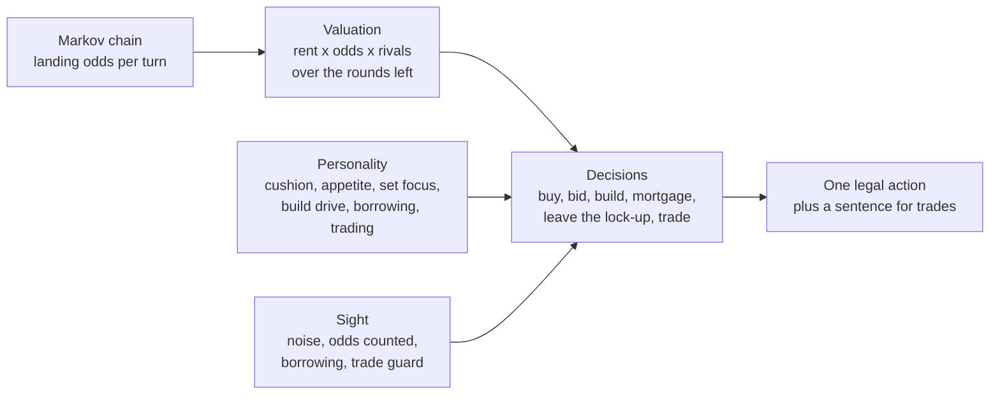

# 0003 — Rival minds: one valuation, five personalities, three levels of sight

- **Status:** Proposed (stage 2)
- **Date:** 2026-10-16

## Context

The original has no computer players; it only referees. Prompt 15 asks for rivals as a
showcase:

- a valuation built on a Markov model of the board;
- five personalities;
- three difficulty levels that change how precisely rivals see;
- trades with counter-offers and a one-sentence reason;
- no accepting clearly bad trades at Medium and Hard, and no ganging up.

## Decision

- **Landing odds (`markov.ts`).** The chain tracks:
  - each square, with how many doubles have been rolled this turn;
  - three lock-up states, for short stays (leave at once) and long stays (roll for doubles);
  - every card that moves a token.

  Its long-run distribution gives the expected landings on each space per turn. A test plays the
  real engine for 96,000 turns and agrees to within 0.0035 on every space.
- **Valuation (`valuation.ts`).** A deed is worth:
  - its rent × the landing odds × the number of rivals, summed over the rounds left with a 4 %
    discount;
  - for a complete district, also the best building plan;
  - for an incomplete one, an option on completing it, larger while no rival holds a lot in it;
  - in a Quick game, also its price, because the price counts at the end.

  Trades, auctions and purchases are all valued as the change in a seat's whole portfolio.
- **Personalities are parameter sets (`MINDS` in `ai.ts`):**

  | Rival   | Cushion    | Appetite | Set focus | Build drive | Borrows to build | Trading eagerness |
  | ------- | ---------- | -------- | --------- | ----------- | ---------------- | ----------------- |
  | Marlowe | small      | eager    | normal    | high        | readily          | some              |
  | Ottilie | large      | cautious | normal    | normal      | reluctantly      | rare              |
  | Colette | middling   | normal   | strong    | normal      | sometimes        | often             |
  | Dex     | middling   | normal   | some      | normal      | sometimes        | every turn        |
  | Stella  | middling   | normal   | normal    | slightly up | when it pays     | some              |

  Ottilie also needs a sweeter deal before she agrees to a trade.
- **Sight is the difficulty (`SIGHT`):**

  | Level  | Valuation error | Landing odds | Borrows to build      | Weighs the partner's gain | Clearly-bad guard |
  | ------ | --------------- | ------------ | --------------------- | ------------------------- | ----------------- |
  | Easy   | ±35 %           | all equal    | never                 | no                        | none              |
  | Medium | ±20 %           | counted      | up to two mortgages   | yes                       | refuses below −40 |
  | Hard   | none            | counted      | as needed             | yes                       | refuses below −20 |

  The error is fixed per rival and per deed, so a rival's mistakes are consistent, as a
  person's would be.
- **Trades.**
  - A trade's score for a rival is its own gain minus a share of the partner's gain: 0.85 with two
    players left, 0.6 with three, 0.45 with more.
  - It accepts when the score clears its margin.
  - Otherwise it counters once a turn with the same deal plus the coins that would make it
    acceptable, if the other side has them.
  - Every answer carries one plain sentence: "I'll take it if you add 150: that finishes your
    Fish Market."
  - Proposals look for a district a rival could finish with one other player, and pay coins (or
    add a lot) so the partner's own score clears its margin.
  - At Medium and Hard an exact valuation guards every acceptance, whatever the rival's error.
- **No ganging up.** A rival weighs every partner the same way, human or rival, and turns down
  trades that would hand a partner more than it gets. Two rivals trade only when both gain, and
  never at the third player's expense.

## Consequences

- **Measured over 3,000 three-player games with one of each level:** Easy wins 25 %, Medium
  31 %, Hard 44 %. Each personality wins 29–38 % of Quick games at a table of three. In
  Classic the saver is weaker (26 % with three players, 14 % with four); see NOTES.md.
- **Rivals hold no hidden state the game needs.** A saved game restores without them; they rebuild
  their memory of refused offers as play goes on.
- **The coach (`coach.ts`) uses the same numbers:**
  - landing heat;
  - build payback in rounds;
  - the trade meter, with exact values;
  - the recap's turning point from a chronicle of moments.

  The player never gets advice the rivals could not have worked out themselves.
