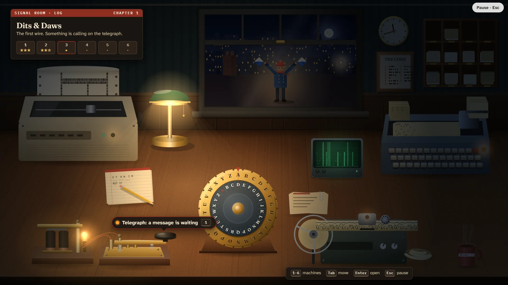

# Dits & Daws

> Tap it. Punch it. Crack it.

## The hook

Messages are arriving on machines from computing's past: a clicking telegraph, punched cards,
paper tape, a printer banner, a scrambled cipher, and a signaller waving flags on the roof across
the street. You are the night operator at a little signal room at the top of an old exchange.
Listen, read, crack and send, one machine at a time, until the messages start to need all of
them at once. The best moments are when a cipher clicks into place and the split-flap board
flips letter by letter into English, and when a sideways banner turns a quarter and lands
upright across the wall.

## Where it comes from

Six small programs from the BSD games, the kind that lived in `/usr/games` next to the real
games:

- **caesar** (Stan King and John Eldridge, after an idea of Bob Morris) cracks shift ciphers by
  itself. It scores every possible turn against English letter frequencies on a log scale, so a
  single rare letter weighs heavily against a wrong guess. **rot13**, its thirteen-place cousin,
  hid the endings of stories in USENET posts.
- **morse** prints Morse code in words: every dash is a "daw", never a "dah", and every message
  ends with the operator's end-of-work sign.
- **bcd** prints punched cards. Steve Hayman rebuilt it in 1989 from nothing but its manual:
  with no code table to hand, he deduced the hole patterns from the old program's output, and
  wrote that they "may be wrong". (They were, a little; the logbook tells how.)
- **ppt** punches and reads eight-hole paper tape.
- **banner** by Mark Horton prints "a large, high quality banner" on its side down a 132-column
  printer, and grows grainy when told to print narrow.

Flag semaphore has no BSD original: it is the sixth machine, added for this desk.

## What is new

- Every tool is a machine on a desk you can touch: a brass key and sounder, a cipher wheel with
  a frequency scope, a card punch, a tape reader with its reel, a banner printer and its
  fan-fold paper, and a signaller on the roof.
- **The Signal Room**: seven chapters of six messages from someone who signs "K.", ending in
  chained messages where each answer is the key to the next machine.
- **Learning ladders**: Morse two letters at a time, Koch-style; flags a circle at a time, as
  the 1911 scouting handbook taught them. Charts are always there while you learn.
- **The Daily Signal**: one message a day for everyone, in three pieces on three machines, with
  a share line such as `Dits & Daws #42 · cracked in 2:47 · 📻🔐🗂️ · no hints`.
- **Make your own**: turn a message on the wheel, choose a machine to carry it, and send a
  friend a desk code; save the card, tape or banner as a drawing.

## At a glance

|                 |                                                                   |
| --------------- | ----------------------------------------------------------------- |
| Directory       | `/usr/games/numbers`                                              |
| Players         | 1                                                                 |
| Session         | 3–15 minutes                                                      |
| Daily challenge | yes                                                               |
| Inspired by     | `caesar`, `rot13`, `morse`, `bcd`, `ppt` and `banner` (1980–1989) |

## More

- [How to play](HOW-TO-PLAY.md)
- [Changes from the original](CHANGES-FROM-ORIGINAL.md)
- [Architecture](ARCHITECTURE.md)
- [Notes](NOTES.md)
