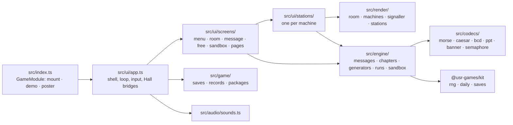
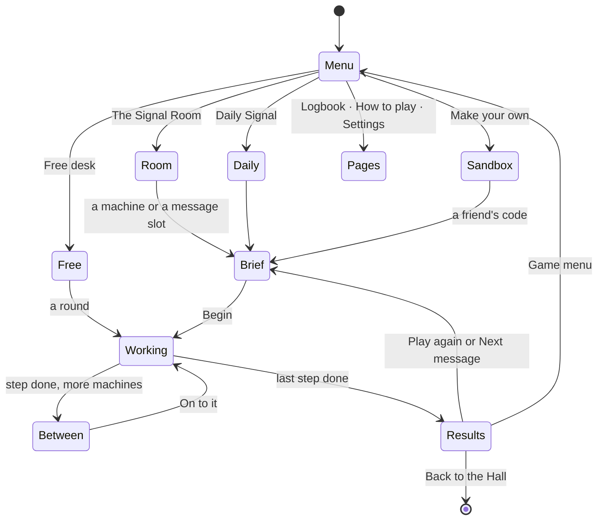

# Dits & Daws — architecture

## Overview

A native game: TypeScript in strict mode against the kit contract, drawn with Canvas 2D under an
HTML interface ([ADR 0001](adr/0001-desk-in-canvas-2d.md)). There is no opponent: the game is
codecs reproduced from the five BSD programs, a semaphore codec, messages built on them, and
six stations that let a player read and send through each machine
([ADR 0002](adr/0002-messages-without-an-opponent.md)).

## Module map

| Path           | Responsibility                                                                                                                                   |
| -------------- | ------------------------------------------------------------------------------------------------------------------------------------------------ |
| `src/index.ts` | `mount` (routes the screens), `demo` (attract loop), `poster`, `achievements`                                                                    |
| `src/codecs/`  | Pure codecs: the originals' tables and behaviour (see NOTES.md), each proved against the originals                                               |
| `src/engine/`  | Steps and messages, the 42 campaign messages, par times, ladders, free and daily generators, the run and its stars, desk codes and SVG keepsakes |
| `src/game/`    | Versioned saves (records, prefs), the 14 packages and the rules that earn them                                                                   |
| `src/render/`  | Every drawing: the room, the window and the signaller, the machines, the station scenes, poster, attract                                         |
| `src/ui/`      | The shell, the screens, the stations (input and per-machine logic), cards, charts, CSS                                                           |
| `dev/`         | The workbench on port 5293: the game on a stand-in Hall, hero scenes, the attract loop and poster                                                |
| `e2e/`         | Playwright: the workbench suite, the hero frames, the Hall suite, the screenshots                                                                |

## State machine

The message screen (`src/ui/screens/message.ts`) runs one message: it keeps a `MessageRun`
(`src/engine/run.ts`, pure: steps, wrong tries, hints, paid help, time) and hosts one station at
a time. Typed steps (reading) end when `submitAnswer` says right; machine-judged steps (keying,
the wheel, punching, flags) end when the station calls `done` with its letters wrong and late.

## Engine

- **Codecs** reproduce the originals' output byte for byte; `src/codecs/originals.test.ts`
  compares 58 captured outputs. The banner glyphs were converted once from `banner.c`'s byte
  program into row groups (`banner-glyphs.ts`).
- **Messages**: `Step` names a machine, a mode and its knobs; `Message` holds steps, a story and a
  reply, a help rule and a par. `chapters.ts` writes the campaign; `generate.ts` makes free steps
  from the phrase bank, "beat the machine" ciphers by rejection sampling, and the Daily Signal from
  `context.daily.seed()` (the kit's `createRng`, labelled splits per step).
- **Ladders** (`ladder.ts`): Morse two characters at a time (E T, A N, I M, S O, H R, D W, …),
  semaphore by the 1911 circles; lessons mix real words from `WORDS` with five-character groups.
- **Par times** (`par.ts`) come from each machine's own playing time plus thinking time.
- **Desk codes** (`sandbox.ts`): `DD1-<carrier>-<turn>-<payload>-<check>`, base32 with a light
  scramble; the payload carries the turn so a secret turn can still be checked.

## Where visuals are defined

| Visual                                                   | Defined in                                      | Change it by                                         |
| -------------------------------------------------------- | ----------------------------------------------- | ---------------------------------------------------- |
| Colours of both looks                                    | `src/render/palette.ts`                         | `MORNING` and `NIGHT`                                |
| Wall, window, clock, chart, pigeonholes, desk, sun, lamp | `src/render/room.ts`                            | One function per item                                |
| The view outside, roof, pigeons                          | `src/render/outside.ts`                         | `paintSky`, `paintSkyline`, `paintRoof…`             |
| The signaller                                            | `src/render/signaller.ts`                       | `BODY` proportions, `paintArm`, `paintFlag`          |
| Telegraph key and sounder                                | `src/render/machines/telegraph.ts`              | `paintKey`, `paintSounder`                           |
| Register (inked marks)                                   | `src/render/machines/register.ts`               | `layoutMarks`, `paintRegisterRows`                   |
| Cipher wheel, scope                                      | `machines/cipher-wheel.ts`, `machines/scope.ts` | Ring radii, `paintTrace`                             |
| Split-flap board                                         | `src/render/flaps.ts`                           | `paintFlapTile`                                      |
| Card and desk punch                                      | `src/render/machines/card-punch.ts`             | `paintCard`, `paintCardPunch`                        |
| Tape and reader                                          | `src/render/machines/tape-reader.ts`            | `paintTapeStrip`, `paintReel`                        |
| Printer and fan-fold paper                               | `src/render/machines/printer.ts`                | `paintPrinter`, `paintSheet`                         |
| The hub layout                                           | `src/render/desk-view.ts`                       | `PLACES`                                             |
| Station scenes                                           | `src/render/stations/*.ts`                      | `CIPHER_LAYOUT`, `BANNER_LAYOUT`, `SEMAPHORE_LAYOUT` |
| Pose chart                                               | `src/render/pose-chart.ts`                      | `paintMiniPose`                                      |
| Attract loop, poster                                     | `src/render/attract.ts`, `src/render/poster.ts` | `MESSAGES`, the poster's banner text                 |
| Interface                                                | `src/ui/styles.css`, `src/ui/screens.css`       | `--dd-*` tokens per look                             |

Reduced motion: the wheel jumps to its turn, flaps change at once, the tape and the banner's
quarter turn appear without travel, the signaller's arms snap, dust and steam stop. The lamp and
the register still show every mark, since they carry the message.

## Where sounds are defined

All in `src/audio/sounds.ts`, synthesised with the kit's synth.

| Sound                     | Plays when                                 |
| ------------------------- | ------------------------------------------ |
| `sounderDown`/`sounderUp` | Every mark, sent or received               |
| `tone`                    | With each mark, when the 600 Hz tone is on |
| `detent`                  | Each letter the wheel turns                |
| `flap`                    | Split-flap tiles landing                   |
| `punch`                   | A hole punched in a card or tape           |
| `whirr`                   | Tape running in                            |
| `printLine`               | Every other printed line                   |
| `flag`                    | A flag moving                              |
| `stamp`                   | The judge's stamp on a sent flag letter    |
| `right`/`wrong`           | Answers                                    |

## Hall integration

- `reportResult` once per finished message: `outcome` `win` (`complete` in free play), `score`
  stars × 100 plus seconds under par, `stats` `{ messagesRead, stars, machines }`, an XP event of
  five per star, `daily` on the first Daily Signal of the day, `presentation: 'game'`.
- Packages are installed through `App.keep`, from the pure rules in `src/game/records.ts`.
- Pause menu items (between Resume and How to play): play the message again, show or hide the
  chart, show me the answer, back to the desk.
- Saves: `records` v1 (stars, best times, dailies, best keying speed, steps worked, packages
  earned) and `prefs` v1 (speeds, tone, charts, ladder positions).
- The share line is built by `dailyShareLine` with the kit's daily number and contains no URL.

## Tests

| Test                    | Command                                                          | What it proves                                                                              |
| ----------------------- | ---------------------------------------------------------------- | ------------------------------------------------------------------------------------------- |
| Codecs vs originals     | `pnpm vitest run --project signal`                               | 58 outputs of the real programs reproduced byte for byte                                    |
| Codec unit tests        | (same)                                                           | Round trips, Morse timing and key reading, semaphore chart properties                       |
| Engine tests            | (same)                                                           | Every campaign step solvable; chains consistent; dailies solvable; stars                    |
| Sandbox tests           | (same)                                                           | Desk codes round-trip; damaged codes refused; SVGs carry no raster                          |
| Workbench browser suite | `npx playwright test --config games/signal/playwright.config.ts` | Each machine by keyboard and mouse, a chain, the sandbox round trip, the daily share, exits |
| Hero frames             | `… --grep @hero`                                                 | The owner checkpoint frames                                                                 |
| Hall suite              | `… --project hall`                                               | Inside the Hall: menu, results and packages, pause order, safe zones, exits                 |

## Kit candidates

- `CachedLayer` and `blit` (`src/render/frame.ts`): paint a still layer once per size and key.
- `place` with `minWidth` and `bottom` (`src/ui/dom.ts`): pin HTML to a design frame without
  letting text shrink below its minimum.
- The `KeyReader` (`src/codecs/morse.ts`) for any game that wants a one-button rhythm input.
