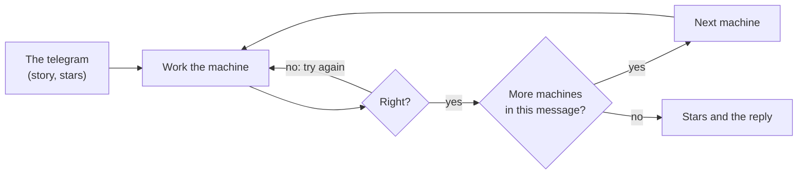

# How to play Dits & Daws

## Goal

Read every message that arrives on the desk, and send a few back. Each message earns up to three
stars: **every letter right**, **inside the par time**, and **without hints** (or without the
charts, where using them costs a star). Read all 42 messages of the Signal Room to finish it.

## Controls

| Action                            | Keyboard                                               | Mouse                              |
| --------------------------------- | ------------------------------------------------------ | ---------------------------------- |
| Choose a machine on the desk      | 1–6, or Tab then Enter                                 | Click the machine                  |
| Begin a message / next machine    | Enter                                                  | Begin / On to it                   |
| Type an answer and check it       | Type, then Enter                                       | Check                              |
| Open or close the chart           | H (S for the cipher's scope)                           | Show the … chart                   |
| A hint                            | —                                                      | A hint                             |
| Show the answer (no stars)        | —                                                      | Show me                            |
| Hear or see the message again     | —                                                      | Hear it again / See it again       |
| **Telegraph:** key a dit / a daw  | Tap Space / hold Space                                 | Press the key (short / long)       |
| Telegraph: take back a letter     | Backspace                                              | —                                  |
| **Cipher wheel:** turn            | ← →                                                    | Drag the wheel, or the mouse wheel |
| Cipher wheel: choose a ring       | ↑ ↓ (key-word messages)                                | —                                  |
| Cipher wheel: read it             | Enter                                                  | Read it                            |
| **Card punch:** move              | Arrow keys                                             | Click a hole                       |
| Card punch: punch or close a hole | Space                                                  | Click                              |
| Card punch: next column / feed    | Enter                                                  | Feed the card                      |
| Card punch: clear a column        | Backspace                                              | —                                  |
| **Tape:** move along the tape     | ← →                                                    | Click a row                        |
| Tape: punch holes 1 to 8          | 1–8                                                    | Click a hole                       |
| Tape: next row / tear it off      | Enter                                                  | Tear it off                        |
| **Flags:** left flag              | Q W E · A D · Z X C                                    | Click a position, or drag the flag |
| Flags: right flag                 | Number pad 7 8 9 · 4 6 · 1 2 3, or U I O · J L · M , . | Click a position, or drag the flag |
| Flags: both down to rest          | Space                                                  | —                                  |
| Pause                             | Esc                                                    | Pause button                       |
| Play again (results)              | R                                                      | Play again                         |
| Next message (results)            | N                                                      | Next message                       |
| Back to the Hall (results)        | H                                                      | Back to the Hall                   |

## The machines

1. **Telegraph.** The sounder clicks out the message; its lamp lights for every mark and the
   register inks it, so you can read it by eye, by ear, or both. A short mark is a dit, a long
   one a daw (three dits long). Letters are separated by a short gap, words by a longer one.
   When sending, the key reader learns your own rhythm, so a slow steady hand reads as well as a
   fast one.
2. **Cipher wheel.** Every letter of the message was turned the same number of places. Turn the
   wheel until the split-flap board reads, then read it off. The frequency scope shows the
   message's letters as bars against English's (the dashed outline) and lights the turn the old
   codebreaker would choose; for short messages full of odd letters, it can be wrong. Key-word
   messages turn each letter by the next letter of a key word: each ring of the wheel takes one.
3. **Card punch.** Each column is one character. A hole in the 12, 11 or 0 row picks a third of
   the alphabet; a hole in rows 1 to 9 picks the place in it. Digits are a single hole.
4. **Tape reader.** Each row across the tape is one character, its holes worth 128, 64, 32, 16
   and 8, then the little sprocket hole, then 4, 2 and 1. Capitals add 64 to their place (A is
   65); digits add 48 (0 is 48); a space is 32.
5. **Banner printer.** The banner prints on its side, the tops of the letters towards the right.
   Type it as soon as you can read it. Narrow banners skip lines and columns and grow grainy.
6. **Flags on the roof.** Each letter is a pose of two flags, held for a beat; between words both
   flags drop and cross. A numerals sign comes before digits, and J brings letters back. When
   sending, each letter has a clock: in time is right, within twice the time is late, after
   that the letter is wrong and the next one starts.

## Modes

| Mode            | What it is                                                                                                    |
| --------------- | ------------------------------------------------------------------------------------------------------------- |
| The Signal Room | Seven chapters of six messages: one machine a chapter, then chained messages that use them all                |
| Daily Signal #N | One message a day for everyone, in three pieces on three machines; the same for every player on the same day  |
| Free desk       | Every machine on its own: the Morse and flag ladders, practice, ciphers that fool the machine, squint banners |
| Make your own   | Turn and carry a message of your own, share it as a desk code, open a friend's code, save drawings as SVG     |

## Settings

| Setting                                     | Options              | Default |
| ------------------------------------------- | -------------------- | ------- |
| Letter speed (free desk telegraph)          | 10–25 words a minute | 15      |
| Spacing (Farnsworth, overall speed)         | 5–25 words a minute  | 8       |
| The sounder's 600 Hz tone                   | on · off             | on      |
| Open the charts by themselves where free    | on · off             | on      |
| Seconds per flag letter when sending (free) | 3–8                  | 5       |

Sound, volume, appearance and motion follow the Hall's settings.

## Scoring

Each message gives up to three stars; the best stars and time for each campaign message are
kept in the logbook. The Daily Signal's share line gives the time, the machines in order and
whether any help was used. Points are scores only.

## Achievements (packages)

| Package            | How to earn it                                                              |
| ------------------ | --------------------------------------------------------------------------- |
| `first-dit`        | Tap the telegraph key for one short mark.                                   |
| `first-daw`        | Hold the key for a long mark.                                               |
| `morse-20wpm`      | Key a whole message at twenty words a minute or faster, every letter right. |
| `frequency-sleuth` | Crack a turned message with the scope and no other help.                    |
| `beat-the-machine` | Crack a message that fools the automatic codebreaker.                       |
| `card-reader`      | Read a card of ten characters or more without the code chart.               |
| `tape-weaver`      | Punch a tape of eight rows or more without a slip.                          |
| `banner-day`       | Read a banner before half of it has printed.                                |
| `squint`           | Read a grainy banner printed thirty-three columns wide or narrower.         |
| `flag-reader`      | Read a message of twenty letters or more from the roof.                     |
| `flag-sender`      | Send a word by flag with no late or wrong letters.                          |
| `chain-reaction`   | Solve a message that runs through more than one machine.                    |
| `signal-room`      | Read every message in all seven chapters.                                   |
| `daily-regular`    | Play seven Daily Signals.                                                   |

## XP

The desk reports each finished message to the Hall: a completed session, the first win of the
day, the Daily Signal and packages all earn XP, plus a little for each star. Weekly goals count
messages read and stars earned.

## Tips

- In Morse, listen for rhythm, not dots: E is a single blip, T a single beat, A "di-daw".
- On the wheel, find the message's most common letter and turn it to E; the scope does this for
  every letter at once.
- On a card, the zone row tells you where to look: 12 is A–I, 11 is J–R, 0 is S–Z.
- On the tape, the 64 hole means a capital; the five holes from 16 down to 1 count the letter.
- Read banners from the top of the paper down, tilting your head to the right: the first letter printed is the one furthest up.
- For flags, the first circle (A–G) moves one arm only; learn those and the rest follow.
